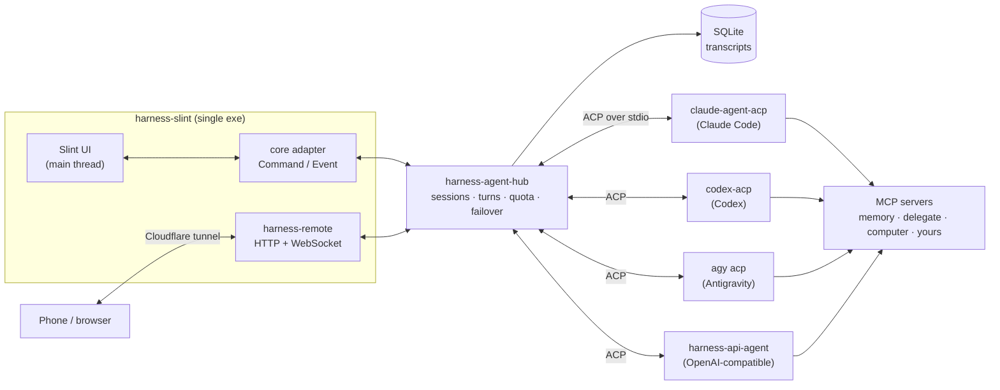

# Worse Harness

**A native desktop orchestrator for AI coding agents.** Worse Harness (Harness for short) runs the coding agents you already
use (Claude Code, Codex, Antigravity, or any OpenAI-compatible model such as DeepSeek) side by side
in one fast Rust app, keeps every conversation in one place, and moves work between agents when one
of them runs out of quota.

[](https://slint.dev)

> Worse Harness is an independent project. It started as a Rust remake of
> [ZCode](https://github.com/zai-org/ZCode) and builds on many open-source projects; see
> [Credits](#credits).

---

## Contents

- [Concept](#concept)
- [Features](#features)
- [How it works](#how-it-works)
- [Supported agents](#supported-agents)
- [Platforms](#platforms)
- [Getting started](#getting-started)
- [Remote access from your phone](#remote-access-from-your-phone)
- [Configuration and data](#configuration-and-data)
- [Project layout](#project-layout)
- [Development](#development)
- [Design principles](#design-principles)
- [Credits](#credits)
- [License](#license)

---

## Concept

Modern coding agents are powerful but scattered: each one has its own CLI, its own login, its own
history and its own usage limits. Harness puts a single desktop app in front of all of them.

- **One workspace, many agents.** Every chat session has a *sticky* agent. You pick the agent in
  the composer; Harness remembers it for that session.
- **Failover instead of waiting.** When an agent hits its usage limit, Harness can continue the same
  session on the next agent in your fallback order (another Claude account, Codex, Antigravity, an
  API model), with the transcript intact.
- **Harness owns the transcript.** Conversations are stored in a local SQLite database, not inside
  one vendor's CLI, so you can search, resume, fork and import them regardless of which agent wrote
  them.
- **Agents talk a standard protocol.** Harness does not embed an LLM runtime. It drives external
  agent CLIs over the [Agent Client Protocol (ACP)](https://github.com/agentclientprotocol/agent-client-protocol)
  on stdio, and ships its own small ACP agent for OpenAI-compatible APIs.
- **Agents can delegate to agents.** Through a built-in MCP server, an agent can spawn subagents
  (for example, a cheap API model for routine edits), receive their results automatically and
  coordinate who edits which files.
- **Native and fast.** The product is a single Rust executable with a [Slint](https://slint.dev)
  UI: no Electron, no webview for the main window, low memory and instant start.

## Features

**Chat and sessions**
- Multiple sessions per project, grouped by workspace folder in the Projects tree.
- Composer with agent picker, model and mode selection, `@` file mentions, image and file
  attachments, slash commands and a command palette.
- Steer a running turn, queue follow-ups, find in transcript, pin, archive, fork sessions.
- "Open folder…" starts a new session whose workspace is that folder.
- Git worktree sessions for isolated changes.
- Import history from ZCode and Claude Code, with native resume where the agent supports it.

**Agents and accounts**
- Built-in adapters for Claude Code, Codex and Antigravity (`agy`), plus custom API providers.
- Multiple Claude Code accounts (separate `CLAUDE_CONFIG_DIR` profiles) and multiple Antigravity
  accounts (credential swap through the OS credential store).
- Quota detection per agent dialect and automatic failover in a configurable order.
- Login detection without ever reading credential files.
- First-run setup that finds installed CLIs and installs missing ACP adapters.

**Orchestration**
- **Orchestra**: route work between agents, background tasks, live subagent panel.
- **Subagents** (`harness-delegate` MCP): up to four concurrent children per session, results
  pushed back to the parent, path claims to avoid edit conflicts.
- **Board**: kanban cards linked to sessions, optional GitHub Project sync.
- **Inbox**: turn incoming items (for example GitHub issues) into agent tasks.
- **Scheduled prompts**: run a prompt on a schedule.

**Tools for agents**
- **Harness MCP registry**: one MCP server list for every agent, with import from Claude Code,
  Codex and Antigravity configs, plus built-in servers:
  - `harness-memory` (project and global `MEMORY.md`),
  - `harness-delegate` (subagents),
  - `harness-computer` (screenshots, mouse and keyboard for computer use).
- Shared skills and instructions (`CLAUDE.md`, `AGENTS.md`, `GEMINI.md`) editable in Settings.
- The built-in API agent loads `AGENTS.md`/`CLAUDE.md` from the project automatically and keeps
  its system prompt stable for prompt caching.

**Workspace panels**
- Diff ("turn changes"), Git, file tree with fast search, integrated terminal (PTY), plan usage.

**App**
- Live update on Windows: the app runs from a shadow copy, so a new build can be installed while
  it runs; a "New build ready · Restart" pill appears.
- Native Windows title bar option, dark "Midnight Glass" theme, keyboard shortcuts editor.
- Remote access from a phone (see below).

## How it works



1. A Slint callback sends a `Command` to the core thread.
2. The adapter turns it into a call on the `HarnessCore` API (`crates/harness-core-api`).
3. `harness-agent-hub` runs one actor per session, spawns agent processes on demand, streams ACP
   updates and writes the transcript (it is the only SQLite writer).
4. Hub events flow back to the UI and to connected phones.

The same executable also serves helper modes selected by a leading flag (`--api-agent`,
`--memory-mcp`, `--delegate`, `--computer-mcp`), so Harness ships as one file.

## Supported agents

| Agent | How Harness runs it | Requirements |
| --- | --- | --- |
| Claude Code | [`claude-agent-acp`](https://github.com/agentclientprotocol/claude-agent-acp) | `npm i -g @agentclientprotocol/claude-agent-acp`, signed-in `claude` |
| Codex | [`codex-acp`](https://github.com/agentclientprotocol/codex-acp) | `npm i -g @agentclientprotocol/codex-acp`, signed-in `codex` |
| Antigravity | `agy acp` | Antigravity CLI 1.5+, signed in by running `agy` |
| Any OpenAI-compatible API (DeepSeek, …) | built-in `harness-api-agent` | provider URL and API key in Settings → Providers |

Harness never reads or logs credential files; API keys are kept in `providers.json` and only sent
in the `Authorization` header.

## Platforms

| Platform | Status |
| --- | --- |
| Windows 10/11 | Primary target (live update, Credential Manager accounts, native title bar) |
| macOS 11+ | Universal build (arm64 + x86_64) from CI, ad-hoc signed |
| Linux | Builds; GTK3 needed for the file dialog |
| Android | Remote client only (WebView app in `apps/harness-mobile`) |

## Getting started

### Prerequisites

- Rust stable (pinned by `rust-toolchain.toml`).
- At least one agent from [Supported agents](#supported-agents).
- Linux: GTK3 development packages.

### Build and run

```powershell
git clone https://github.com/rraahh133/Worse.git
cd Worse
cargo build --release -p harness-slint --bins
./target/release/harness-slint          # harness-slint.exe on Windows
```

Faster local iteration (unoptimized app, optimized dependencies):

```powershell
cargo build -p harness-slint --profile quick   # target/quick/harness-slint
```

Harness opens the current directory (or the last workspace) as the project. Use
**New session ▾ → Open folder…** to work in another folder.

### macOS

Download `Harness-macos-universal.zip` from the
[macos-release workflow](.github/workflows/macos.yml) artifacts, unzip, then right-click
`Harness.app` → **Open** the first time (the build is ad-hoc signed, not notarized). If macOS still
blocks it: `xattr -dr com.apple.quarantine Harness.app`.

## Remote access from your phone

Harness can serve a small mobile web client from inside the app:

1. **Settings → Remote**: enable the server (loopback `127.0.0.1:7878` by default).
2. Optionally point it at a tunnel helper (for example a wrapper around
   [cloudflared](https://github.com/cloudflare/cloudflared)) to get a public `https://` URL.
3. Pair a device by scanning the QR code or entering the 8-character code.

Security model: per-device tokens (constant-time comparison), rate-limited pairing, Host/Origin
checks, an RPC allowlist and body size caps. The Android app in `apps/harness-mobile` is a thin
WebView around the same client. Details: [docs/plans/remote-contract.md](docs/plans/remote-contract.md).

## Configuration and data

All state lives under `HARNESS_HOME` (default `~/.harness`):

| Path | Contents |
| --- | --- |
| `settings.json` | app settings |
| `providers.json` | custom API providers (contains API keys) |
| `accounts.json`, `agy_accounts.json` | Claude / Antigravity account lists (no secrets) |
| `mcp.json` | Harness MCP registry |
| `remote.json` | paired device tokens |
| `harness.sqlite` | sessions, turns, board, inbox, schedules |
| `bin/` | live-update shadow copies |
| `MEMORY.md` | global memory (projects use `<project>/.harness/MEMORY.md`) |

Useful environment switches:

| Variable | Effect |
| --- | --- |
| `HARNESS_HOME` | data directory root |
| `HARNESS_WORKSPACE` | force the workspace folder |
| `HARNESS_UI_CORE=fake` | scripted in-process core, no agent CLIs (demos, UI tests) |
| `HARNESS_NO_SHADOW=1` | disable the live-update shadow copy |
| `HARNESS_RENDERER=skia\|femtovg\|software` | renderer order |

## Project layout

```text
apps/
  harness-slint/        The product: Slint UI + every helper mode, one executable
  harness-mobile/       Android WebView remote client
  harness-app/          Legacy Tauri v2 + React prototype (reference only)
crates/
  harness-core-api/     HarnessCore trait and wire types (the contract)
  harness-agent-hub/    Sessions, turns, quota, failover, accounts, subagents, MCP servers
  harness-api-agent/    ACP agent for OpenAI-compatible APIs
  harness-agent-config/ Agent CLI config, login detection, MCP registry and import
  harness-settings/     Settings model and single writer
  harness-remote/       Phone HTTP/WebSocket server and pairing
  harness-workspace/    PTY, file watch, search (harness-pty, -watch, -search, -fs, -git)
  harness-import/       Read-only import of ZCode and Claude Code history
  harness-store/ …      Storage and platform helpers
  harness-fake-agent/   Scripted ACP agent for tests
  harness-core-gate/    End-to-end gate driver
docs/
  specs/harness/        Design specs (phase 8+ describe the current product)
  plans/                Remote access and APK plans
scripts/e2e/            End-to-end gates (Node)
```


## Development

```powershell
cargo fmt --all -- --check
cargo clippy --workspace --all-targets -- -D warnings
cargo test -p harness-agent-hub            # per crate; cargo test --workspace for all
node scripts/e2e/phase9-chat.mjs           # example end-to-end gate
```

Android client: JDK 17+, then `cd apps/harness-mobile && ./gradlew assembleDebug`.

## Design principles

- **One owner per piece of state.** Transcript: the hub store. Settings: `SettingsStore`. Subagent
  status: the delegate registry. No second writers.
- **Contracts are additive.** `harness-core-api` changes bump `API_VERSION`.
- **No secrets in logs.** Credentials are checked for presence only; keys travel only in headers.
- **Typed errors, no panics.** `unwrap`/`expect` are denied outside tests; `unsafe` is forbidden
  except in the one Win32 credential module.
- **Small modules.** Files stay roughly under 300 lines, split by responsibility.

## Credits

Worse Harness stands on the shoulders of these projects. Thank you to their authors and contributors.

**Origin and concepts**
- [ZCode](https://github.com/zai-org/ZCode) by Z.ai (Apache-2.0): Harness began as a Rust remake of
  ZCode. Its product behaviour served as the parity reference for sessions, settings, remote
  control, history import and UI flows, and its file-type icons are reused (see below).
- [Agent Client Protocol](https://github.com/agentclientprotocol/agent-client-protocol)
  (Apache-2.0): the protocol Harness speaks to every agent.
- [claude-agent-acp](https://github.com/agentclientprotocol/claude-agent-acp) and
  [codex-acp](https://github.com/agentclientprotocol/codex-acp): ACP adapters for Claude Code and
  Codex.
- [Model Context Protocol](https://github.com/modelcontextprotocol/modelcontextprotocol): the tool
  protocol behind the Harness MCP registry and built-in servers.
- [Zed](https://github.com/zed-industries/zed): the editor that introduced ACP and the original ACP
  adapters.

**Agents Harness integrates with** (used as external tools, not bundled)
- [Claude Code](https://github.com/anthropics/claude-code) by Anthropic
- [Codex CLI](https://github.com/openai/codex) by OpenAI
- [Antigravity](https://antigravity.google) by Google
- Any OpenAI-compatible API, for example [DeepSeek](https://github.com/deepseek-ai)

**Frameworks and libraries**
- [Slint](https://github.com/slint-ui/slint): the native UI toolkit (royalty-free license with
  attribution).
- [Tauri](https://github.com/tauri-apps/tauri): used by the legacy `apps/harness-app` prototype.
- [Tokio](https://github.com/tokio-rs/tokio), [rusqlite](https://github.com/rusqlite/rusqlite),
  [portable-pty](https://github.com/wezterm/wezterm) (WezTerm),
  [ignore / grep](https://github.com/BurntSushi/ripgrep) (ripgrep),
  [notify](https://github.com/notify-rs/notify), [rfd](https://github.com/PolyMeilex/rfd),
  [xcap](https://github.com/nashaofu/xcap), [enigo](https://github.com/enigo-rs/enigo),
  [qrcode](https://github.com/kennytm/qrcode-rust), [toml_edit](https://github.com/toml-rs/toml),
  [image](https://github.com/image-rs/image), [chrono](https://github.com/chronotope/chrono),
  [uuid](https://github.com/uuid-rs/uuid), [serde](https://github.com/serde-rs/serde) and the rest
  of the crates listed in `Cargo.lock`.
- [cloudflared](https://github.com/cloudflare/cloudflared): Cloudflare Tunnel, used through a
  user-provided helper for phone access.

**Icons** (details and license texts in
[`apps/harness-slint/ui/icons/LICENSES.md`](apps/harness-slint/ui/icons/LICENSES.md))
- [Hugeicons](https://github.com/hugeicons/hugeicons) (MIT)
- [Phosphor Icons](https://github.com/phosphor-icons/core) (MIT)
- [Solar icon set](https://www.figma.com/community/file/1166831539721848736) by 480 Design (CC BY 4.0)
- [Material Icon Theme](https://github.com/material-extensions/vscode-material-icon-theme) by
  Philipp Kief (MIT), via ZCode
- Icon data packaged by [Iconify](https://github.com/iconify/icon-sets)

Product names and trademarks belong to their owners. Worse Harness is not affiliated with or endorsed by
Anthropic, OpenAI, Google, Z.ai, DeepSeek, Cloudflare or Zed Industries.

## License

Worse Harness is licensed under the [Apache License 2.0](LICENSE). See [NOTICE](NOTICE) for attribution:
portions are derived from [ZCode](https://github.com/zai-org/ZCode) (Apache-2.0), and third-party
components keep their own licenses as listed above.
