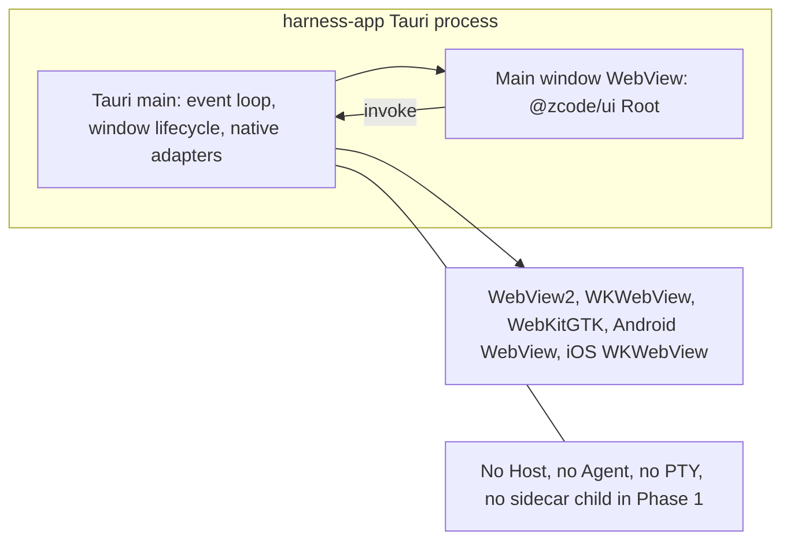
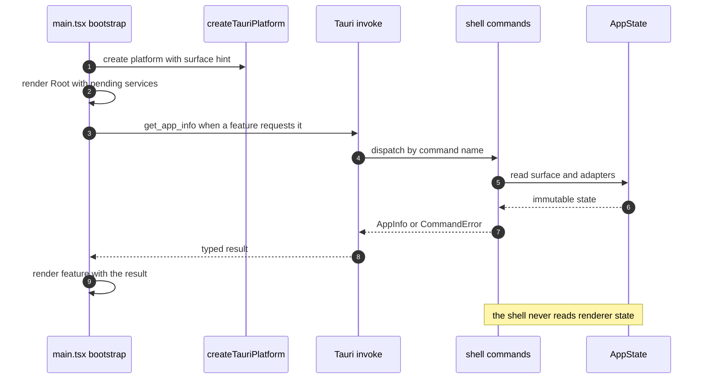
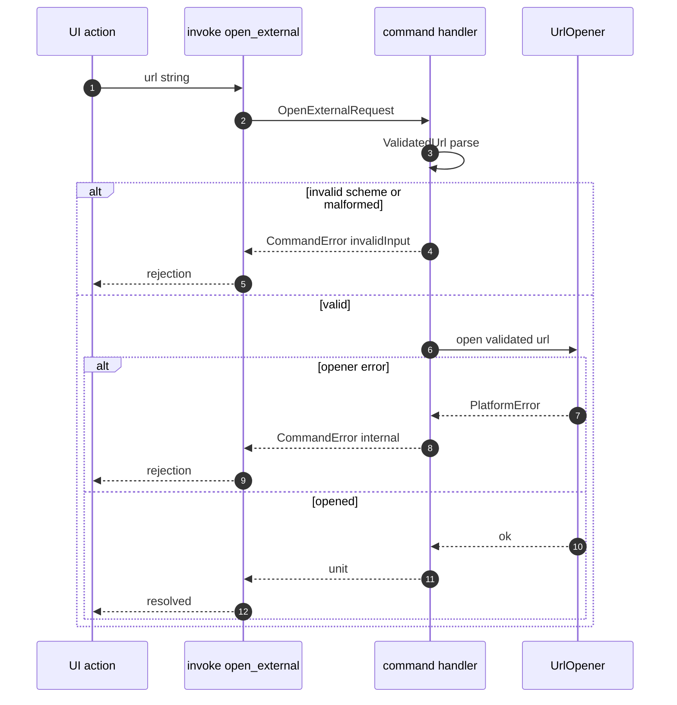
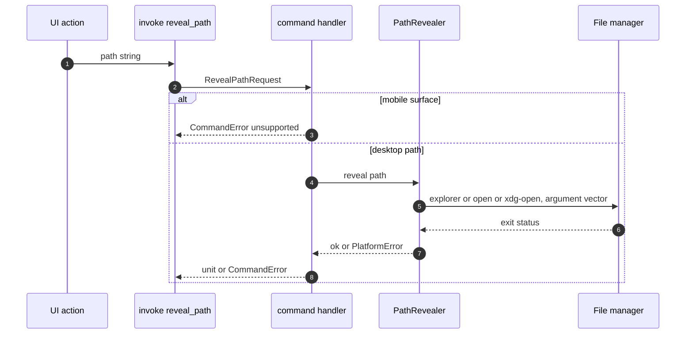

# Harness Phase 1: Shell

Status: implementation contract
Phase: 1, Tauri shell hosting the existing UI
Owner: w02
Last updated: 2026-10-31
Plan: [Harness Rust + Tauri v2 plan](../../../../docs/plans/harness-rust-tauri-v2-plan.md)
Code root: `Worse/`

Normative terms: MUST, MUST NOT, SHOULD, MAY.

**Phase goal.** Ship a Tauri v2 shell that renders the existing `@zcode/ui` application, exposes a small typed native command surface, and proves that the shell owns no task or session state. Real Host and agent wiring starts in Phase 2.

## 1. Product rules

| ID | Rule | Rationale |
| --- | --- | --- |
| R1 | The shell is platform-only. It owns window lifecycle, native adapters, and process supervision. It MUST NOT own tasks, sessions, conversations, queues, snapshots, or projections. | Plan section 1.9, invariant 3. |
| R2 | Phase 1 runs one Tauri process and one WebView per window. It spawns no Host, Agent, PTY, terminal, watcher, or local service. | Phase 1 exit gate. |
| R3 | The command surface is fixed at six commands: `get_app_info`, `get_capabilities`, `open_external`, `reveal_path`, `select_directory`, `select_file`. Adding a command is a protocol change. | One typed surface, no ad hoc IPC. |
| R4 | `get_capabilities` is the declarative authority for what the surface can do. The UI gates native affordances on capability flags. Commands still re-validate every request; a flag never substitutes for validation. | Defense in depth and mobile safety. |
| R5 | Mobile surfaces (Android, iOS) are remote-control clients. They expose no local host, filesystem, file picker, reveal, PTY, agent, or sidecar. | Plan sections 5.2 and 6.1. |
| R6 | Every fallible command returns `Result<T, CommandError>`. No panic path, no `unwrap()`, no `expect()` outside tests. | Clean-code rules and stable UX. |
| R7 | Errors cross the boundary as typed `CommandError` values with a stable `ErrorCode`. Free-form text is a message, never control flow. | The frontend branches on codes. |
| R8 | Secrets, tokens, and raw credentials MUST NOT appear in logs, command errors, or generated types. | AGENTS.md logging rules. |
| R9 | A WebView reload is stateless. The shell survives it; the renderer reconstructs UI state only and re-queries capabilities. A reload MUST NOT restart or duplicate any process. | Invariant 10. |
| R10 | The WebView has no Node or Electron API. The adapter MUST NOT use `window.zcode`, `require`, `process`, or `node:` imports. | Plan section 4, Phase 1. |
| R11 | Tauri capabilities and plugin permissions are allowlisted per window. No blanket filesystem, shell, or network permission. | Plan section 7.9. |
| R12 | No blocking work on the Tauri main thread. Blocking native pickers run on a worker thread; adapters stay async where the platform call can block. | Performance priority. |
| R13 | Identity is computed by one implementation: `WorkspaceKey::resolve(identity, path)` uses `identity.trim()` when non-empty, otherwise `path`. Nothing re-derives it. | Invariant 5. Phase 1 ships the primitive even though no Host consumes it yet. |
## 2. State ownership

| Owner | State | Lifetime | MUST NOT hold |
| --- | --- | --- | --- |
| Shell `AppState` | Surface and platform adapter handles | Process lifetime; immutable after setup | Tasks, sessions, conversation rows, queue, goal, interaction, snapshots, workspace projections |
| WebView renderer | Drafts, focus, scroll, navigation, optimistic overlay | Page lifetime; lost on reload by design | Authoritative conversation or task state |
| `harness-sidecar` registry (Phase 2) | Child id, pid, stdin and stdout handles, shutdown grace | Child lifetime | Business payloads, task state, conversation content |
| Future Host (Phase 2 Node Host) | Attachments, service registry, source routing, controller projection, task index | Window Host lifetime | Nothing in this phase |
| Future Agent (Phase 2) | Conversation, queue, goal, interaction, model runs | Agent process lifetime | Nothing in this phase |
| Generated TS DTOs | None at runtime | Build artifact, checked in | Handwritten divergence from Rust types |

The sidecar crate ships in Phase 1 but the shell creates no supervisor or child process yet.

Rules:

- The shell MAY cache `AppInfo` and `Capabilities` because both derive from build metadata and `Surface`; nothing else is cached.
- Only window close, app quit, or update install ends the shell. Reloading a WebView or closing a secondary view is not a shutdown path.
- Phase 1 MUST NOT add a global event topic for conversation updates. No such stream exists yet and the shell is not its owner.
- Any task-like data shown by the reused UI in Phase 1 comes from the local fallback service bundle and is empty. It is not persisted and not authoritative.

```mermaid
flowchart TB
 State[AppState: surface and adapters]
 State[AppState: surface and adapters]
 Cmd[six native commands]
 Cmd --> State
 end
 WV[WebView: @zcode/ui Root] -- invoke --> Cmd
 WV --- Drafts[drafts, focus, scroll, navigation]
 State -. no task or session state .-> Future[Phase 2 Host and Agent]
```

## 3. Module map

- `Worse/Cargo.toml` workspace manifest: resolver 2, members `crates/*` and `apps/harness-app/src-tauri`.
- `Worse/crates/harness-core/` identity primitives, no internal dependencies.
- `Worse/crates/harness-protocol/` wire DTOs, command names, TypeScript export.
- `Worse/crates/harness-platform/` native adapters, no tauri dependency.
- `Worse/crates/harness-sidecar/` desktop-only process supervisor scaffold.
- `Worse/apps/harness-app/src-tauri/` composition root, package `harness-app`, lib `harness_app_lib`.
- `Worse/apps/harness-app/` `@harness/app` frontend, Tauri config, capabilities.

| Path | Package | Depends on | Public responsibility |
| --- | --- | --- | --- |
| `crates/harness-core` | `harness-core` | serde, thiserror | `WorkspaceKey`, `WindowId`, `SidecarId`, `Surface`, `CoreError` |
| `crates/harness-protocol` | `harness-protocol` | core, serde, serde_json, ts-rs | `PROTOCOL_VERSION`, DTOs, `CommandError`, `commands` constants |
| `crates/harness-platform` | `harness-platform` | core, protocol, thiserror, tracing, url | `UrlOpener`, `PathRevealer`, `ValidatedUrl`, `capabilities_for`, `PlatformError`, per-OS adapters |
| `crates/harness-sidecar` | `harness-sidecar` | core, tokio, thiserror, tracing | `Supervisor`, `SidecarSpec`, `SidecarHandle`, `TokioSupervisor`, `SidecarError` |
| `apps/harness-app/src-tauri` | `harness-app`, lib `harness_app_lib` | protocol, platform, sidecar (desktop only), tauri plugins | `run()`, `AppState`, command handlers |
| `apps/harness-app` | `@harness/app` | ui, shared, tauri api and plugins | `main.tsx`, `createTauriPlatform`, typed invoke wrappers |

```mermaid
flowchart LR
 PROTO[harness-protocol] -. ts-rs .-> GEN[src/generated DTOs]
 FE[@harness/app] --> GEN
 FE --> UI[@zcode/ui Root]
 APP[harness-app] --> PROTO
 APP --> PLAT[harness-platform]
 APP --> SIDE[harness-sidecar]
 PLAT --> PROTO
 PLAT --> CORE[harness-core]
 PROTO --> CORE
 SIDE --> CORE
```

Module rules:

- Dependencies point one way only: app, then platform or sidecar, then protocol, then core. Core depends on no internal crate.
- `harness-platform` MUST NOT depend on tauri or harness-sidecar. Native behavior is exposed through traits and injected by the app.
- `harness-sidecar` is compiled out entirely on Android and iOS with `#![cfg(not(any(target_os = android, target_os = ios)))]`.
- `src-tauri` is a composition root. It contains no business logic beyond mapping dependencies to commands.
- Each module file SHOULD stay under about 300 lines. Split by responsibility, not by type.
- Only public API is re-exported from `lib.rs`; everything else stays private.

## 4. Interfaces

### 4.1 Core primitives

| Type | Contract |
| --- | --- |
| `WorkspaceKey(String)` | Private field. `resolve(identity: Option<&str>, path: &str)` returns the trimmed identity when non-empty, otherwise the path unchanged. Returns `CoreError::EmptyWorkspaceKey` when no trimmed identity exists and the path is empty or whitespace-only. `as_str`, `Display`, transparent `Serialize` and `Deserialize`. |
| `WindowId(u32)` | Display. Identifies one shell window. Not persisted as task identity. |
| `SidecarId(String)` | Display. Constructed from any string; `CoreError::InvalidId` is reserved for later identifier validation. |
| `Surface` | `Desktop` or `Mobile`. `current()` uses `cfg(any(target_os = android, target_os = ios))` for mobile and desktop otherwise. |
| `CoreError` | `EmptyWorkspaceKey`, `InvalidId(String)`. `thiserror` messages, no secrets. |

```rust
pub fn resolve(identity: Option<&str>, path: &str) -> Result<WorkspaceKey, CoreError>
pub fn as_str(&self) -> &str
```

Resolution detail: an all-whitespace identity is treated as absent. A path that is not whitespace is used exactly as supplied; a whitespace-only path is rejected instead of stored. Filesystem normalization belongs to the consumer, not to this type.

### 4.2 Protocol

- `PROTOCOL_VERSION` is `1`. It is reported by `get_app_info` and is not negotiated in Phase 1.
- Every DTO derives `Serialize`, `Deserialize`, and `TS`, uses `serde(rename_all = camelCase)` on the wire, and exports to `apps/harness-app/src/generated/` via `#[ts(export_to = "../../../apps/harness-app/src/generated/")]`. `ts-rs` resolves `export_to` relative to `TS_RS_EXPORT_DIR` (default `./bindings` under the crate root), which is why the relative path has three `..` segments.
- `ts-rs` export runs on `cargo test`. Generated files are committed so the frontend builds without a Rust toolchain step.
- DTOs MUST NOT contain credentials, tokens, or machine-specific secrets.
- `SurfaceDto` has `From<harness_core::Surface>` so the shell never maps surfaces by hand.

| DTO | Fields | Notes |
| --- | --- | --- |
| `AppInfo` | `name`, `version`, `protocolVersion`, `surface`, `os` | `name` is Harness; `version` is the app package version; `os` is a short platform label. |
| `SurfaceDto` | `Desktop`, `Mobile` | Serialized as `desktop` and `mobile`. |
| `Capabilities` | `openExternal`, `revealPath`, `selectDirectory`, `selectFile`, `localHost`, `notifications` | Boolean flags. See section 5 for the truth table. |
| `OpenExternalRequest` | `url` | Raw string; validated by the platform layer. |
| `RevealPathRequest` | `path` | Raw path string; validated for emptiness only. |
| `SelectDirectoryResponse` | `path` | Null means the user cancelled. |
| `SelectFileResponse` | `path` | Null means the user cancelled. |
| `CommandError` | `code`, `message` | `code` is `ErrorCode`; `message` is safe to display and log. |
| `ErrorCode` | `unsupported`, `invalidInput`, `denied`, `internal` | Closed set. `denied` is reserved for Phase 2 permission denials. |

Command constants live in `harness_protocol::commands`. The strings below are the only accepted wire names.

| Constant | Wire name | Request | Success | Failure codes |
| --- | --- | --- | --- | --- |
| `GET_APP_INFO` | `get_app_info` | none | `AppInfo` | none |
| `GET_CAPABILITIES` | `get_capabilities` | none | `Capabilities` | none |
| `OPEN_EXTERNAL` | `open_external` | `{ url }` | unit | `invalidInput`, `internal` |
| `REVEAL_PATH` | `reveal_path` | `{ path }` | unit | `unsupported`, `invalidInput`, `internal` |
| `SELECT_DIRECTORY` | `select_directory` | none | `{ path }` | `unsupported`, `invalidInput`, `internal` |
| `SELECT_FILE` | `select_file` | none | `{ path }` | `unsupported`, `invalidInput`, `internal` |

Rust handlers accept one `request` argument where a body exists. The TypeScript wrappers own that payload shape and are the only code that calls `invoke`.

Error mapping is closed: `PlatformError::Unsupported` becomes `unsupported`, `PlatformError::InvalidInput` becomes `invalidInput`, and `PlatformError::Io` becomes `internal`. `Denied` is never produced by Phase 1 native adapters.

### 4.3 Platform traits

```rust
pub trait UrlOpener: Send + Sync {
 fn open(&self, url: &ValidatedUrl) -> Result<(), PlatformError>;
}

pub trait PathRevealer: Send + Sync {
 fn reveal(&self, path: &Path) -> Result<(), PlatformError>;
}

pub fn capabilities_for(surface: Surface) -> Capabilities
```

`ValidatedUrl::parse` is the only URL gate. It accepts `http`, `https`, and `mailto`; every other scheme, including `file`, `data`, and `javascript`, fails with `PlatformError::InvalidInput`. The validated value keeps its parsed form private so a raw string cannot be passed to an opener.

Capability truth table, matching `capabilities_for`:

| Flag | Desktop | Mobile |
| --- | --- | --- |
| `openExternal` | true | true |
| `revealPath` | true | false |
| `selectDirectory` | true | false |
| `selectFile` | true | false |
| `localHost` | true | false |
| `notifications` | true | true |

Flags describe surface ability. In Phase 1, `notifications` has no command and MUST NOT cause the UI to render a notification entry point. The UI exposes only the four native affordances backed by commands.

Desktop adapters live behind `cfg(not(mobile))` in one module per OS:

| OS | Reveal implementation | Notes |
| --- | --- | --- |
| Windows | `explorer` with one argument, `/select,` followed by the path | Build the selector with `Command::arg`; never route it through a shell. Verify long paths and UNC paths. |
| macOS | `open -R <path>` | `-R` reveals the item in Finder. |
| Linux | `xdg-open <parent>` | Opens the path itself for a directory, otherwise its parent; a file with no parent is an I/O error. |

All three use `std::process::Command` with an argument vector and no shell. Opener support is provided by `tauri-plugin-opener`; the platform crate keeps the trait so the policy can be unit-tested without tauri.

### 4.4 Sidecar supervisor

`harness-sidecar` is desktop-only. The whole crate body is behind `#![cfg(not(any(target_os = android, target_os = ios)))]`, so mobile builds contain no process-spawning code.

```rust
pub struct SidecarSpec {
 pub id: SidecarId,
 pub program: PathBuf,
 pub args: Vec<String>,
 pub cwd: Option<PathBuf>,
 pub env: Vec<(String, String)>,
 pub shutdown_grace: Duration,
}

pub type SupervisorFuture<'a, T> = Pin<Box<dyn Future<Output = T> + Send + 'a>>;

pub trait Supervisor: Send + Sync {
    fn spawn(&self, spec: SidecarSpec) -> SupervisorFuture<'_, Result<SidecarHandle, SidecarError>>;
    fn shutdown_all(&self) -> SupervisorFuture<'_, Result<(), SidecarError>>;
}
```

- `TokioSupervisor` keeps a registry of children keyed by `SidecarId`. A second spawn for a live id returns `SidecarError::AlreadyRunning`. `TokioSupervisor::shutdown(id)` returns `NotFound` for an unknown id, and `shutdown_all` is idempotent.
- `SidecarHandle::take_io()` yields the stdin writer and stdout line reader for NDJSON. It can be taken once; a second call returns no streams.
- Shutdown barrier, in order: close stdin, wait for the child for `shutdown_grace`, then kill the process tree. `kill_on_drop` is set as a final guard.
- Spawn uses `tokio::process::Command` with an argument vector and additional environment variables on top of the inherited parent environment. No shell, no string concatenation.
- `SidecarError` is `Spawn(String)`, `AlreadyRunning(SidecarId)`, `NotFound(SidecarId)`, `Io(String)`. Messages never include environment values.
- Phase 1 status: this crate compiles and is unit-tested, but nothing is spawned. Wiring the real ZCode agent is Phase 2 and is out of scope here.

The trait returns `SupervisorFuture`, a boxed `Send` future, so `dyn Supervisor` stays object-safe without an async-trait crate. The desktop shell will store the concrete `TokioSupervisor` when Phase 2 wires it, and may later store it behind `Box<dyn Supervisor>`.

### 4.5 Tauri composition root

`run()` is the only entry point. It performs four steps in this order:

1. Build `tauri::Builder` and register the opener, dialog, and log plugins.
2. Resolve `Surface::current()`, construct `AppState` with the app handle, and manage it.
3. Register exactly the six handlers through one `invoke_handler`.
4. Run the event loop.

`AppState` fields:

| Field | Type | Purpose |
| --- | --- | --- |
| `surface` | `Surface` | Immutable; drives capabilities and `get_app_info`. |
| `url_opener` | `Box<dyn UrlOpener>` | Plugin-backed adapter for every surface; wraps `tauri-plugin-opener`. |
| `path_revealer` | `Box<dyn PathRevealer>` | Desktop `SystemPathRevealer`; mobile reject-only adapter. |

`AppState` holds no OS string or process registry. `get_app_info` reads `std::env::consts::OS`, and the sidecar supervisor is created only when Phase 2 starts using it.

Handler surface. Metadata and platform commands are synchronous and return their value directly. The two dialog commands are async and move the blocking native picker to a worker thread. Dialog handlers receive the Tauri app handle because the dialog plugin is app-scoped.

| Handler | Input | Success |
| --- | --- | --- |
| `get_app_info` | shell state | `AppInfo` |
| `get_capabilities` | shell state | `Capabilities` |
| `open_external` | `OpenExternalRequest` | unit |
| `reveal_path` | `RevealPathRequest` | unit |
| `select_directory` | app handle | `SelectDirectoryResponse` |
| `select_file` | app handle | `SelectFileResponse` |

Command rules:

- `open_external` validates with `ValidatedUrl::parse` before calling the opener, and maps failure to `CommandError`.
- `reveal_path` checks the capability first; on mobile it returns `unsupported` before touching the filesystem. Otherwise the path goes to the adapter and failures map to `CommandError`.
- Dialog handlers return `{ path: null }` on cancel. A plugin error becomes `internal`; a missing dialog capability on mobile becomes `unsupported`.
- Handlers never call `block_on`, never spawn an unbounded task, and never write to stdout. Service crates log with `tracing`; the Tauri shell entry uses the `log` facade because `tauri-plugin-log` consumes it (debug builds also mirror to stdout).
- URL opening uses a plugin-backed `UrlOpener` on every surface. Path reveal uses `harness_platform::desktop::SystemPathRevealer` on desktop and a reject-only adapter on mobile, so `harness-platform` stays tauri-free.

Desktop name and window contract:

| Setting | Value |
| --- | --- |
| productName | Harness |
| identifier | dev.harness.app |
| build.frontendDist | ../dist |
| build.devUrl | http://localhost:1430 |
| build.beforeDevCommand | pnpm dev |
| build.beforeBuildCommand | pnpm build |
| main window | 1280 by 800, title Harness |

Both `capabilities/desktop.json` and `capabilities/mobile.json` grant only `core:default`. Opener and dialog calls originate in Rust, not in the WebView, so no plugin command permission is exposed to frontend code. Neither file grants filesystem, shell, or broad network permission. Adding a frontend-called plugin command requires a scoped permission in the matching file.

### 4.6 TypeScript adapter

`main.tsx` bootstrap order:

1. Locate the mount element and create the React root.
2. Call `createTauriPlatform()` once. It is synchronous and side-effect free.
3. Render `ZCodeIntlProvider` and `Root` with the platform, the pending service bundle, and the `isDesktop`, `isMacDesktop`, and `isWindowsDesktop` flags derived from the surface hint.
4. Capabilities are not fetched during first paint. Features that need them call `get_capabilities()` and gate their own affordances on the result.

`createPendingRootServices` in `platform/pendingServices.ts` satisfies the `services` prop type with empty data and typed not-attached errors. It MUST NOT fabricate tasks, sessions, or conversation rows. Its only job is to let app chrome and navigation render until Phase 2 binds real services.

`src/platform/commands.ts` wrappers. These are the only functions that call `invoke`.

```ts
export function getAppInfo(): Promise<AppInfo>
export function getCapabilities(): Promise<Capabilities>
export function openExternal(url: string): Promise<void>
export function revealPath(path: string): Promise<void>
export function selectDirectory(): Promise<SelectDirectoryResponse>
export function selectFile(): Promise<SelectFileResponse>
```

- Request bodies are passed as `{ request: { ... } }`; for example `invoke(OPEN_EXTERNAL, { request: { url } })`.
- A rejected `invoke` carries the serialized `CommandError`. Callers branch on `code` and tolerate an unknown rejection without crashing the view.
- The wire names in the wrappers are exactly the six constants in `harness_protocol::commands`; any mismatch is a review defect.
- Types come from `src/generated/`, never from handwritten duplicates.

`createTauriPlatform()` returns a complete `IPlatformService`. Phase 1 overrides:

| Member | Phase 1 behavior |
| --- | --- |
| `canOpenLocalFiles` | True on desktop, false on mobile, from the synchronous surface hint. |
| `canSelectFilePath` | Same rule. |
| `selectDirectory` | `invoke(SELECT_DIRECTORY)` and return the response path. |
| `selectFile` | `invoke(SELECT_FILE)` and return the response path. |
| `openExternal` | Fire and forget `invoke(OPEN_EXTERNAL)`; failures stay contained in the adapter and never escape into event handlers. |
| `openInFileManager` | `invoke(REVEAL_PATH)`; success true, `CommandError` becomes `{ success: false, error: message }`. |
| Optional members not implemented natively | Stay undefined or return an explicit unavailable result; for example `openExternalFile` resolves with `{ success: false }`. |

Required members outside this set return explicit safe fallbacks inline from the adapter: no-op subscriptions, empty arrays, `{ success: false }` results, and idle update state. The adapter MUST NOT throw during render.

Surface hint: the exported `isMobileSurface` value is derived from `import.meta.env.TAURI_ENV_PLATFORM`, matching `android` or `ios`. It exists only to set first-paint booleans such as `canOpenLocalFiles`. `get_capabilities()` remains the runtime authority for command-backed affordances, so the frontend does not need a platform plugin or a second detector.

Unsupported mobile behavior: `reveal_path`, `select_directory`, and `select_file` surface as `CommandError` with code `unsupported`; the UI never calls them because the corresponding capability flags are false.

### 4.7 Generated bindings and drift control

- `cargo test -p harness-protocol` exports DTOs to `apps/harness-app/src/generated/` through `ts-rs`. The attribute path is `../../../apps/harness-app/src/generated/` relative to the default `TS_RS_EXPORT_DIR`.
- Generated files are committed. CI fails if regeneration produces a diff.
- `pnpm build` for `@harness/app` runs `tsc --noEmit` before Vite, so a type drift breaks the build.
- Enum wire values are controlled by serde and ts-rs together. Do not add a second mapping table in TypeScript.
- Phase 1 has no runtime schema validator. Tauri argument deserialization plus the explicit checks in section 4.5 are the validation boundary. A full runtime validator belongs to the Phase 2 protocol work.

## 5. Platform matrix

| Platform | WebView engine | Surface | localHost | reveal and select | openExternal | Notes |
| --- | --- | --- | --- | --- | --- | --- |
| Windows 10 and 11, x64 and arm64 | WebView2 Evergreen | Desktop | true | true | true | Installer must bootstrap WebView2. Test long paths, UNC paths, and case-insensitive identity. |
| macOS 13 and later, x64 and arm64 | WKWebView | Desktop | true | true | true | Hardened runtime and notarization are release concerns. WKWebView is not Chromium; test layout fallbacks. |
| Ubuntu 22.04 and 24.04, x64 and arm64 | WebKitGTK 4.1 | Desktop | true | true | true | System GTK and WebKitGTK dependencies. Test Wayland, fractional scaling, IME, and GPU fallbacks. |
| Android | Android System WebView | Mobile | false | false | true | Remote client only. No child processes, PTY, filesystem, sidecar, or local agent. |
| iOS | WKWebView | Mobile | false | false | true | Remote client only. No process spawning. Respect safe areas and input accessory behavior. |

Minimum OS and WebView versions are not frozen by this spec. They MUST be checked against Tauri v2 prerequisites and the release matrix before a gate is claimed.

Platform-specific Phase 1 checks:

- Windows: WebView2 present or bootstrapped; `explorer` receives one selector argument; no console window appears.
- macOS: `open -R` reveals the item; window chrome works with the system title bar; no Electron-only drag region remains active.
- Linux: WebKitGTK 4.1 package present; `xdg-open` targets the parent directory; dialogs open under both X11 and Wayland.
- Android and iOS: the build compiles without `harness-sidecar`; capability response has `localHost` false; the three local commands return `unsupported`. Shipping the mobile app is Phase 4, so Phase 1 verifies compile and capability behavior only.

## 6. Process model and ordering

### 6.1 Phase 1 process model



One process, one main window, one WebView. The Tauri main thread owns window lifecycle and adapter handles. The WebView owns only renderer state. No IPC exists except the six commands.

### 6.2 Startup and first command order



### 6.3 open_external order



### 6.4 reveal_path order on desktop



### 6.5 Reload and shutdown order

```mermaid
sequenceDiagram
 autonumber
 participant W as WebView
 participant S as shell process
 participant P as child processes
 W->>W: reload
 W->>S: get_app_info or get_capabilities
 S-->>W: same process answers
 Note over S,P: no child is started or restarted; reload is not shutdown
 S->>S: window close or app quit
 S->>P: shutdown_all, empty in Phase 1
 S-->>P: bounded wait then kill tree
 S->>S: event loop exits
```

## 7. Acceptance scenarios

Every scenario is verifiable by the stated method on the stated surface. Desktop scenarios are Phase 1 gates. Mobile scenarios verify compile and capability behavior only.

| ID | Scenario | Expected | Verification |
| --- | --- | --- | --- |
| P1-01 | Workspace key resolution | Trimmed non-empty identity wins; blank identity falls back to the path unchanged; two empty inputs return `EmptyWorkspaceKey`. | `cargo test -p harness-core` |
| P1-02 | Surface selection | Desktop on Windows, macOS, Linux; Mobile on Android and iOS. | `cargo test -p harness-core` on desktop plus target checks for Android and iOS in CI |
| P1-03 | Protocol wire shape | `PROTOCOL_VERSION` is 1; fields are camelCase; `ErrorCode` serializes as `unsupported`, `invalidInput`, `denied`, `internal`. | `cargo test -p harness-protocol` and inspect generated files |
| P1-04 | Capability truth table | Desktop all true; mobile has `localHost`, `revealPath`, `selectDirectory`, `selectFile` false and the other two true. | `cargo test -p harness-platform` |
| P1-05 | URL policy | `http`, `https`, `mailto` accepted; `file`, `data`, `javascript`, empty, and malformed rejected as `invalidInput`. | `cargo test -p harness-platform` |
| P1-06 | Error mapping | `Unsupported` to `unsupported`, `InvalidInput` to `invalidInput`, `Io` to `internal`; no other mapping exists. | `cargo test -p harness-platform` |
| P1-07 | Reveal arguments | Windows uses one argument, `/select,` plus the path; macOS uses `-R` and the path; Linux opens the directory itself or the parent; no shell string. | per-OS unit tests where the build host allows, plus `cargo clippy -D warnings` |
| P1-08 | Sidecar shutdown barrier | Second spawn returns `AlreadyRunning`; unknown id returns `NotFound`; shutdown closes stdin, waits grace, kills the tree, and leaves no orphan. | `cargo test -p harness-sidecar` on desktop |
| P1-09 | Shell statelessness | No task, session, conversation, queue, snapshot, or projection type in `src-tauri`; review sign-off recorded. | `rg -n taskStore sessionStore ConversationProjection Worse/apps/harness-app/src-tauri` returns no matches; architecture review |
| P1-10 | No Node or Electron API | No `window.zcode`, `require`, `node:`, or `electron` in the frontend or shell. | `rg -n window.zcode require node: electron Worse/apps/harness-app/src Worse/apps/harness-app/src-tauri/src` returns no matches |
| P1-11 | Exact command surface | Handler registration and wrappers expose the same six wire names and nothing else. | compare the `generate_handler` list and `commands.ts` against `harness_protocol::commands` |
| P1-12 | Windows launch | Window opens at 1280 by 800 titled Harness; Root renders; `get_app_info` returns name Harness, protocol 1, surface desktop, os windows. | `pnpm dev` in the app plus `cargo tauri dev`, recorded screenshot and command result |
| P1-13 | macOS and Linux launch | Same render and command result on WKWebView and WebKitGTK; no blank screen, broken scroll, or unusable window controls. | manual run on both engines, recorded screenshots and app versions |
| P1-14 | Reload is stateless | WebView reload reattaches to the same shell process; process count is unchanged; commands still succeed. | reload in devtools and compare process count before and after |
| P1-15 | External URL safety | `javascript:` and `file:` URLs return `invalidInput` and launch nothing. | unit test plus one manual attempt from devtools |
| P1-16 | Dialog cancel | Cancelling the directory or file picker returns a null path, not an error. | manual dialog run on each desktop OS |
| P1-17 | Mobile capability behavior | Android and iOS builds compile without the sidecar; capabilities report no local host; reveal and select return `unsupported`. | `cargo check` for the mobile targets in CI and the capability unit test |
| P1-18 | Binding drift | Regenerating DTOs produces no diff; `tsc --noEmit` passes. | `cargo test -p harness-protocol`, then `pnpm --filter @harness/app typecheck`, then `git diff --exit-code` on generated files |
| P1-19 | Least privilege | Both capability files grant only `core:default`; no opener, dialog, filesystem, or shell permission is exposed to the WebView. | review both capability files and run a desktop bundle build |
| P1-20 | Panic and blocking policy | No `unwrap`, `expect`, or `block_on` outside tests; clippy passes with warnings denied. | `cargo clippy -p harness-core -p harness-protocol -p harness-platform --all-targets -- -D warnings` plus source search |

Manual scenarios record OS build, WebView version, engine version, steps, result, and a screenshot under `Worse/.work/evidence/` or in a linked issue. A claim without that evidence is not a pass.

## 8. Out of scope

The following are explicitly not part of Phase 1 and MUST NOT be implemented in these files:

- Wiring the real ZCode Node Host or agent sidecar, including spawning `zcode-cli` per workspace key. This is Phase 2.
- The Node Host sidecar, attachment registry, owner and lease routing, `rpc_call`, `stream_open`, `stream_close`, `resync`, and Host shutdown protocol. Phase 2 runs the existing TS Host; the Rust `harness-host` service graph is Phase 3.
- Conversation projection, CommandInbox, V4 acknowledgements, seq and revision, and gap recovery are Phase 2. The SQLite task index and its migrations move with the Rust Host in Phase 3.
- Local filesystem services, file tree, search, diff, git, file watcher, and PTY. This is Phase 3.
- SSH, WSL, Docker, remote server transport, relay, pairing, and mobile remote delivery. This is Phase 4.
- Shipping a mobile app. Phase 1 only checks that the mobile surface compiles and reports the right capabilities.
- Embedded browser, browser automation, CDP, plugins, MCP host, and CUA. This is Phase 5 or later.
- Tray, application menu, global shortcuts, deep links, OAuth callbacks, notifications implementation, print to PDF, save-as, drag regions, window state persistence, and auto-update. These are later Phase 1 follow-ups or separate specs.
- Packaging, code signing, notarization, installers, and release channels.
- Performance benchmarking and baseline numbers. Phase 0 owns the baseline; Phase 1 claims no performance number.
- Runtime schema validation of every IPC frame. Phase 1 validates command inputs explicitly; the full validator is Phase 2.

## 9. Contract notes and open requests

1. `Capabilities.notifications` is true on every surface, but Phase 1 has no notification command. This spec treats the flag as declarative ability while the UI exposes only command-backed affordances. Phase 2 should either add a notifications command or the flag should be documented as advertising-only in the protocol crate.
2. `harness-platform` cannot depend on tauri, so URL opening is a plugin-backed `UrlOpener` implemented in the composition root for every surface. The platform crate owns URL validation and path reveal only.
3. `createTauriPlatform()` has no capability argument in the shared contract, so first paint uses `TAURI_ENV_PLATFORM` as a surface hint. `get_capabilities()` remains authoritative for command-backed affordances.
4. The fallback service bundle lives in `apps/harness-app/src/platform/pendingServices.ts`. It holds no state and is replaced by real services in Phase 2.
5. The plan lists window controls, tray and menu, notifications, deep links, OAuth callbacks, and update state under Phase 1. The shared worker contract for this build fixes the surface at six commands, so this spec defers those items. Reconcile the plan or add a follow-up Phase 1 spec before claiming the full plan exit gate.

## 10. Verification commands

For each owned Rust package:

```text
cd Worse
cargo fmt -p harness-core -- --check
cargo clippy -p harness-core --all-targets -- -D warnings
cargo test -p harness-core
cargo fmt -p harness-protocol -- --check
cargo clippy -p harness-protocol --all-targets -- -D warnings
cargo test -p harness-protocol
cargo fmt -p harness-platform -- --check
cargo clippy -p harness-platform --all-targets -- -D warnings
cargo test -p harness-platform
cargo fmt -p harness-sidecar -- --check
cargo clippy -p harness-sidecar --all-targets -- -D warnings
cargo test -p harness-sidecar
cargo fmt -p harness-app -- --check
cargo clippy -p harness-app --all-targets -- -D warnings
```

Frontend and config checks:

```text
pnpm --filter @harness/app typecheck
pnpm --filter @harness/app build
cargo tauri dev, then verify window, Root render, and all six commands
```

A failed check is reported as failed. It is never described as passing because another package succeeded.
