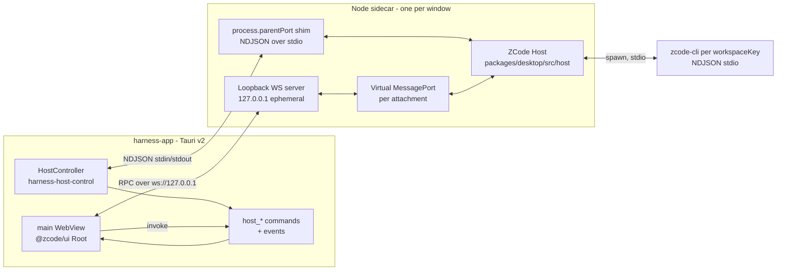
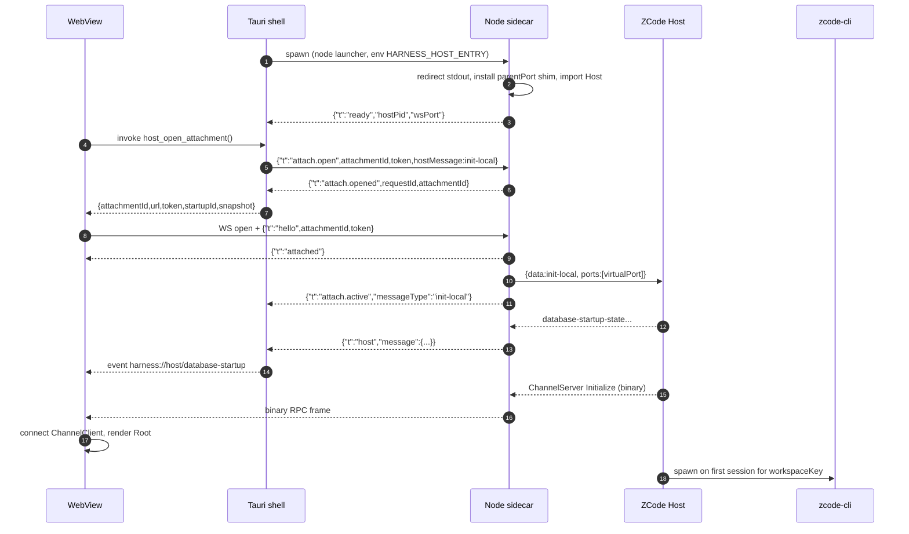
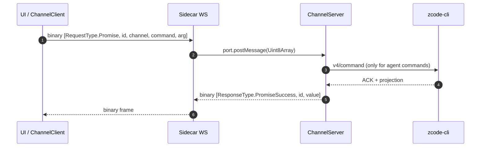
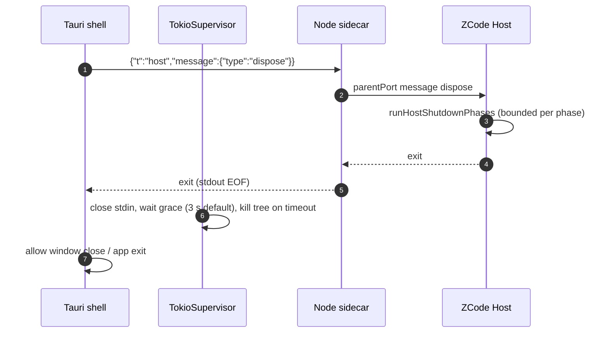

# Phase 2: Real ZCode UI on the real ZCode Host (Node sidecar)

Status: design accepted for implementation. Phase entry gate: Phase 1 shell renders.
Owner: Harness desktop. Applies to Windows, macOS and Linux. Mobile is out of scope.

## 1. Purpose

Make the Harness window show the real ZCode UI, served by the real ZCode desktop Host
(`packages/desktop/src/host/`) running as a Node sidecar under Rust supervision. A user must be
able to open a local workspace, create a session, chat with the agent (`apps/zcode-cli` spawned by
the Host exactly as today), see streaming output, stop a run, and reload the window without losing
the session.

The current Harness window renders the shared `@zcode/ui` Root against
`apps/harness-app/src/platform/pendingServices.ts`, which rejects every service call. That file
stops being the desktop path in this phase; it remains only for the mobile build.

## 2. Feasibility evidence (spike, 2026-10-31)

The approach was verified before writing this spec, using only `Worse/.work/tmp/phase2-spike/`:

- `packages/desktop/out/host/index.js` imported by plain Node 24.11 with a hand-written
  `process.parentPort` shim and `node:worker_threads` `MessageChannel` ports.
- `init-local` accepted; `database-startup-state` reached `phase: "ready"` in about 3 s.
- A `ChannelClient` (`packages/rpc/dist`) connected through `MessagePortProtocol` and
  `setting.get` returned a real settings object (`CLIENT_INITIALIZED` at 2.4 s).
- The Host bundle contains no runtime `electron` import: the only Electron references are the
  type-only import in `packages/desktop/src/host/electronPort.ts` and the global `Electron.*`
  type namespace in `packages/desktop/src/host/index.ts`.
- `node:sqlite` is available in Node 24 without a flag (experimental warning only).
- Node's `ws` package resolves from the repo root.

The spike also exposed two hazards that the design must address explicitly:

1. The Host writes `console.log`/`console.warn` to `stdout`. The sidecar's stdout is the control
   pipe, so the launcher must capture and redirect `process.stdout.write` to stderr before the Host
   is imported and emit NDJSON through the saved original writer.
2. Rust must answer every Host request that awaits a reply, even when the feature is unsupported.
   Otherwise `local-media-preview-path-authorize-request`, `browser-execute-request` and similar
   call sites wait until their own timeout.

## 3. Product rules

- **One Host per window.** The Harness shell runs at most one Node Host sidecar per window. A local
  workspace shares this Host. The shell owns process lifecycle and routing only; it owns no task,
  session, queue, projection, or agent state.
- **The Host is the service owner in Phase 2.** Attachments, service registry, local/remote source
  routing, session recovery and the shutdown barrier stay in the TypeScript Host. Rust does not
  implement file/git/search/PTY/SQLite services.
- **The renderer connects to the Host, not to Rust, for services.** Platform operations use Tauri
  commands. Service calls, v4 commands, queries and subscriptions use one RPC attachment per
  renderer boot, tunnelled over a loopback WebSocket.
- **`init-local` exactly once; every later boot is an attachment.** The first successful
  attachment after Host spawn carries `init-local` and its port. A renderer reload, a second window
  (future), or a re-open after a dropped socket carries `attach-service-port`.
- **Reload never restarts the Host or the agent.** Closing the WebSocket only disposes that
  attachment. The Host and its CLI children keep running.
- **Only window close, app quit, or update install shut the Host down.** A phone detach is not in
  scope in this phase and must never be added as a shutdown trigger later.
- **Local workspaces only.** Remote SSH/WSL/Docker/Server workspaces, phone relay, and mobile
  reattach are out of scope. Unsupported platform methods keep returning their existing explicit
  fallbacks; they must not pretend to work.
- **No second conversation source.** Rust never stores conversation rows, accepted commands,
  goals, or interaction state. It may cache only: Host process state, the latest
  `database-startup-state`, attachment grants, broadcast claims, and agent process telemetry.
- **Secrets stay out of logs.** Attachment tokens are returned to the webview, never logged, never
  embedded in URLs, and never written to disk.

## 4. Process model



Process count per window: 1 Tauri process, 1 Node Host sidecar, N `zcode-cli` children (one per
active workspace key, spawned by the Host). The sidecar is a transport adapter, not a second Host.

## 5. State ownership

| State | Owner | Must not be duplicated in |
| --- | --- | --- |
| Conversation, queue, goals, interactions, session truth | zcode-cli / Host | Rust, UI store |
| Attachment routing, owner/lease, service registry | Node Host | Rust, UI |
| Host process lifecycle, stdio framing, WS grants | Rust shell (`harness-host-control`) | Node Host |
| Latest `database-startup-state`, startup id | Rust shell (cache only) | UI (UI mirrors it for rendering) |
| Attachment token and expiry | Rust shell (issuer) + sidecar (verifier) | Disk, logs, URL |
| Drafts, focus, scroll, optimistic overlay | React UI | Rust, Host |
| Windows, menus, dialogs, native operations | Tauri shell | Rust crates, Host |

## 6. Event order

### 6.1 First boot and `init-local`



### 6.2 Service request / response



ACK is admission; projection frames remain the only conversation truth. The transport must not
reorder or coalesce RPC frames. It may only carry the Host's own flow-control control objects.

### 6.3 Renderer reload / reattach

```mermaid
sequenceDiagram
  autonumber
  participant UI as New WebView context
  participant Shell as Tauri shell
  participant SC as Node sidecar
  participant Host as surviving Host

  UI->>Shell: invoke host_open_attachment()
  Shell->>SC: attach.open with hostMessage attach-service-port
  SC-->>Shell: attach.opened
  Shell-->>UI: grant + latest startup snapshot
  UI->>SC: WS hello
  SC->>Host: attach-service-port + virtual port
  Host-->>SC: Initialize on the new attachment
  SC-->>UI: attached + RPC frames
  Note over Host: old attachment disposed on WS close; CLI and session survive
```

### 6.4 Shutdown barrier



If the sidecar does not exit within the grace period, `harness-sidecar` kills the tree with
`taskkill /T /F` on Windows or the process group on Unix. The CLI children are in that tree.

## 7. Transport

### 7.1 Rust <-> sidecar: NDJSON over stdio

- One JSON object per line, UTF-8, `\n` terminated. No pretty printing. Lines larger than 16 MiB
  are rejected with `fatal`.
- `stdout` is protocol-only. Before importing the Host, the launcher replaces
  `process.stdout.write` with a stderr-forwarding function and keeps the original writer for NDJSON.
- `stderr` is diagnostic only; the supervisor drains it to `tracing::debug`.
- stdin EOF is a shutdown request: the launcher dispatches `dispose` to the Host, waits, then exits.
- Every line carries `v: 1` and `t: <kind>`; unknown `t` or `v` is a protocol error.

### 7.2 WebView <-> sidecar: loopback WebSocket

- Bind `127.0.0.1` port `0` (ephemeral). Never `0.0.0.0`, never a Unix socket (not reachable from
  WKWebView/WebView2), never a fixed port.
- Path: `/v1/attach`. Upgrade only; any other method or path returns 404.
- **Origin allowlist:** exact match against
  `tauri://localhost`, `http://tauri.localhost`, `https://tauri.localhost`,
  `http://localhost:1430`, `http://127.0.0.1:1430`. Override/append with
  `HARNESS_ALLOWED_ORIGINS` (comma separated). `HARNESS_ALLOW_NO_ORIGIN=1` accepts a missing
  Origin header for headless scripts only. Everything else: HTTP 403.
- **Token:** 32 random bytes, lowercase hex (64 chars), generated by Rust per attachment,
  single use, 30 s TTL until the first frame, constant-time compared. The first WebSocket frame
  must be `{"t":"hello","attachmentId":"...","token":"..."}` within 5 s; otherwise close 4401.
  Tokens never appear in URLs.
- After `attached`, binary frames are opaque RPC payloads in both directions; text frames are
  transport control only.
- Limits: `maxPayload` 64 MiB inbound; outbound buffered amount above 32 MiB closes with 1013 and
  emits `attach.closed` so the Host disposes the attachment. One active socket per attachment.
- On socket close/error: emit the virtual port `close` event, then send `{"t":"attach.closed"}` to
  Rust. Never restart the Host.

### 7.3 MessagePort compatibility

The Host calls `wrapElectronPort()` which expects `MessagePortMain` semantics:

- `on("message", listener)` / `off` / `once("close", listener)`
- listener receives `{ data, ports }`; `data` is `Uint8Array` for RPC frames or
  `{ __zcodeRpcControl: "connection-flow-v1", state }` for flow control
- `postMessage(data)`; `start()`; `close()`

The sidecar provides this shape on top of a WebSocket. Mapping:

| Direction | MessagePort payload | WS frame |
| --- | --- | --- |
| Host -> UI | `Uint8Array` | binary |
| Host -> UI | flow control object | text `{"t":"flow","state":"saturated"|"drained"}` |
| UI -> Host | `Uint8Array` | binary |
| UI -> Host | flow control object | text `{"t":"flow","state":...}` |
| either | close | WS close, then virtual `close` event |

The renderer adapter is the mirror image and exposes the same `MessagePortLike` interface used by
`@zcode/rpc`'s `MessagePortProtocol`.

### 7.4 Tauri shell <-> WebView

- Tauri `invoke` for control only: open attachment, startup control, status.
- Tauri events for the database startup state and Host state changes.
- No global conversation event bus. Conversation traffic stays on the attachment.

## 8. Host <-> Main message catalogue

`HostResponseTypes` has 54 members and `HostMessageTypes` 33 at the time of writing. The Rust
dispatcher must classify all 54 exhaustively; a unit test asserts the set equality. Handling
classes:

- **Track**: update shell cache and forward to the WebView.
- **Forward**: forward the raw payload to the WebView (no shell state).
- **Answer**: send a defined JSON response through the sidecar.
- **Response**: a reply to a shell-initiated request; resolve the matching pending request by
  `requestId` (stale or foreign ids are ignored). Nothing is sent back.
- **Log**: tracing only.
- **Drop**: accepted, ignored, counted at debug level.
- **Unsupported**: typed `unsupported_*` outcome, counted; no response is possible or required.

### 8.1 Host -> shell (54)

| Type | Phase 2 handling |
| --- | --- |
| `database-startup-state` | Track: keep latest per `startupId`/`sequence`, forward raw `state` to WebView |
| `log` | Log: map level to tracing, truncate message, never log tokens |
| `agent-process-spawned` | Log at info with pid/workspace; no state |
| `agent-process-ready` | Log at debug |
| `agent-process-exited` | Log at info with exit code/termination kind |
| `agent-process-error` | Log at warn with error code/message |
| `agent-process-exception` | Log at warn |
| `agent-resource-sample` | Drop (telemetry) |
| `host-resource-sample` | Drop (telemetry) |
| `mcp-telemetry` | Drop |
| `mcp-resource-samples` | Drop |
| `tool-exec-resource` | Drop |
| `session-create-telemetry` | Drop |
| `remote-conversation-telemetry` | Drop |
| `plugin-telemetry` | Drop |
| `network-telemetry-batch` | Drop |
| `network-capture-batch` | Drop (capture never enabled) |
| `agent-running-task-count-changed` | Log at debug; do not persist |
| `workspace-running-task-count-changed` | Log at debug; do not persist |
| `cua-operation-state` | Drop (no CUA in Phase 2) |
| `resource-usage-snapshot-result` | Response: resolves `HostController::resource_usage_snapshot` (crate `harness-host-control`, `usage.rs`); late results refresh the last-snapshot cache |
| `broadcast` | Drop (single window; local emitter already fired) |
| `broadcast-claim-request` | Answer `{status:"acquired", claimToken}`; track key/token in memory |
| `broadcast-claim-commit` | Log at debug; mark token committed (no reply in the protocol) |
| `broadcast-claim-release` | Log at debug; drop token |
| `task-realtime-publish` | Drop (bridge disabled by omitting `hostId`) |
| `task-stream-op-publish` | Drop |
| `task-run-lease-acquire` | Answer is required only for remote mirroring; not reachable locally. Defensive answer `{result:{acquired:false, reason:"unsupported"}}` is sent if it ever arrives |
| `task-run-lease-release` | Drop |
| `task-owner-command-request` | Answer `{result:{ok:false,error:"unsupported"}}` if it arrives |
| `task-owner-command-result` | Drop |
| `session-message-send-requested` | Drop (cross-window messaging out of scope) |
| `session-route-announce` | Drop |
| `session-message-deliver-result` | Drop |
| `feedback-log-archive-request` | Answer `{ok:false,error:"log archive is not available in Harness Phase 2"}` |
| `browser-execute-request` | Answer `{result:{ok:false,error:{code:"backend_unavailable",message:"..."},elapsedMs:0}}` |
| `local-media-preview-path-authorize-request` | Answer `{ok:false,error:"local media preview is not available in Harness Phase 2"}` |
| `plugin-sandbox-register-request` | Answer `{ok:false,error:"plugin UI sandbox is not available in Harness Phase 2"}` |
| `provider-provisioning-lane-request` | Answer `{status:{lane:"none"}}` |
| `provider-provisioning-source-changed` | Drop |
| `provider-provisioning-execution-result` | Drop |
| `cron-run-result` | Drop (no scheduler) |
| `off-peak-run-result` | Drop |
| `cron-scheduler-wake-request` | Drop |
| `off-peak-scheduler-wake-request` | Drop |
| `project-workspace-prepared` | Unsupported: `unsupported_project_workspace`; this reply only follows a message Rust never sends |
| `remote-workspace-connection-log` | Unsupported: counted and logged at debug |
| `remote-workspace-connected` | Unsupported |
| `remote-workspace-context-bound` | Unsupported |
| `remote-workspace-context-bind-failed` | Unsupported |
| `remote-workspace-reconnected` | Unsupported |
| `remote-workspace-connect-failed` | Unsupported |
| `remote-workspace-closed` | Unsupported |
| `remote-workspace-acquired` | Unsupported |

> The table lists 54 rows in implementation order; the Rust enum is the source of truth and the
> parity test fails if either side changes without the other.

### 8.2 Shell -> Host (33 entries)

All 33 `HostMessageTypes` are listed. "Not sent" means the Phase 2 dispatcher never originates
that message; the row documents the decision rather than leaving the type unclassified.

| Type | Phase 2 handling |
| --- | --- |
| `prepare-project-workspace` | Not sent: remote project navigation is out of scope |
| `database-startup-control` | Sent for renderer `snapshot`/`retry`/`exit`; `snapshot` also emits the shell cache |
| `init-local` | Sent once, on the first attachment, with the virtual port injected by `attach.open` |
| `connect-remote-workspace` | Not sent: remote workspaces are out of scope |
| `cancel-remote-workspace-connect` | Not sent |
| `bind-remote-workspace-context` | Not sent |
| `cancel-remote-workspace-bind` | Not sent |
| `dispose-remote-workspace-session` | Not sent |
| `set-terminal-owner` | Not sent: no cross-window terminal owner in Phase 2 |
| `attach-service-port` | Sent on reload/re-open, with the virtual port injected by `attach.open` |
| `detach-service-port` | Optional safety after a WS close; the virtual port close already disposes |
| `dispose` | Window close, app quit, sidecar stdin EOF |
| `broadcast` | Not sent: single window, and the Host's local emitter already fired |
| `broadcast-claim-result` | Answer encoded by the dispatcher (`acquired` + `claimToken`) |
| `task-realtime-deliver` | Not sent: omitting `hostId` disables the realtime bridge |
| `task-run-lease-result` | Defensive fallback only |
| `task-owner-command-deliver` | Not sent |
| `task-owner-command-result` | Defensive fallback only |
| `session-message-deliver` | Not sent: cross-window session messaging is out of scope |
| `session-message-delivery-result` | Not sent |
| `feedback-log-archive-result` | Unsupported fallback (`ok:false`) |
| `cron-run` | Not sent: no scheduler in Phase 2 |
| `off-peak-run` | Not sent: no scheduler in Phase 2 |
| `browser-execute-result` | Unsupported fallback (`backend_unavailable`) |
| `local-media-preview-path-authorize-result` | Unsupported fallback (`ok:false`) |
| `plugin-sandbox-register-result` | Unsupported fallback (`ok:false`) |
| `cua-pip-focus-changed` | Not sent: CUA is out of scope |
| `provider-provisioning-execute` | Not sent: provisioning UI is out of scope |
| `provider-provisioning-lane-result` | `{"status":{"lane":"none"}}` fallback |
| `resource-usage-snapshot-request` | Sent by `HostController::resource_usage_snapshot(timeout)`: one in flight per Host; a caller arriving while one is in flight, or timing out (`HOST_RESOURCE_USAGE_TIMEOUT` = 900 ms, as in `resourceManagerHostSampling.ts`), gets the last snapshot or an empty one. No Tauri command consumes it yet |
| `resource-usage-snapshot-cancel` | Sent by `HostController::cancel_resource_usage()` with the in-flight `requestId`; clears the cache |
| `network-capture` | Not sent: capture is never enabled |
| `application-locale-changed` | Not sent: `init-local.locale` carries the locale |

`init-local` is sent with **no `hostId` and no `deliveryKind`**: that keeps
`createTaskRealtimeBridgeForHostInit()` returning `null`, so no lease/owner traffic exists in
single-window Phase 2. Adding `hostId` requires implementing the realtime bus first.

`application-locale-changed` is not sent in Phase 2 (no locale-change command yet);
`init-local.locale` carries the current locale.

## 9. Build and launch

- **Host bundle:** reuse `packages/desktop/out/host/index.js` and its chunks. The sidecar never
  re-bundles the Host. If the file is missing, the build script runs
  `pnpm --filter @zcode/desktop exec tsup --config tsup.config.ts` (all desktop targets) and
  asserts the host entry exists. This writes only generated `out/` artifacts.
- **Sidecar bundle:** `Worse/sidecars/host-node` compiles with `tsc` to `dist/`. Authored imports
  use explicit `.ts` extensions with `rewriteRelativeImportExtensions`, so both
  `node src/main.ts` and `node dist/main.js` work on Node 24.
- **Node binary:** `HARNESS_NODE_BIN` if set; otherwise `node` from PATH, version >= 24, typed
  error otherwise. Packaged layout, staging and the Phase 6 bundled-Node plan:
  [desktop-window-and-packaging.md](./desktop-window-and-packaging.md) section 2.
- **Agent command:** the Host resolves `zcode-cli` through its normal chain. Because the Host runs
  under plain Node, `process.versions.electron` is undefined, so the Electron branch is skipped and
  `findUpward("apps/zcode-cli/packages/cli/dist/zcode.cjs")` must succeed. The launcher sets the
  sidecar cwd to the layout root (repository root in dev, `resource_dir()/host` when packaged) and accepts `ZCODE_AGENT_SERVER_COMMAND` /
  `ZCODE_AGENT_SERVER_ARGS_JSON` as overrides.
- **Provider config:** `ZCODE_BUILTIN_PROVIDER_CONFIG_FILE` if set; otherwise
  `<repo>/config/provider/zcode-builtin.json` (or `.test.json` when `ZCODE_ENV != production`).
  Rust computes the absolute path and puts it in `zcodeBuiltinProviderConfigFilePath`.
- **Data root:** defaults to the user home so existing ZCode credentials and settings work.
  `ZCODE_DATA_BASE_DIR` is passed through when set, which is what the headless script uses for
  isolation. Concurrent ZCode and Harness runs on the same workspace key are allowed but produce
  two independent Hosts by design; this is the parallel-run gate.

## 10. Per-platform notes

- **Windows:** WebView2 origin is `http://tauri.localhost` in production and
  `http://localhost:1430` in dev. `taskkill /T /F` handles the tree. Named pipes are not used.
  WebSocket loopback is allowed by WebView2 without extra WinHTTP configuration.
- **macOS:** WKWebView origin is `tauri://localhost` (custom scheme). App Transport Security does
  not block loopback WebSockets over `ws://` for the app's own process. The Host is a plain Node
  process, so no helper-app signing assumptions apply.
- **Linux:** WebKitGTK origin is `tauri://localhost`. Loopback WS is allowed. Process-group kill
  covers CLI children.
- **Mobile:** no sidecar, no WS, no Host. `pendingServices.ts` remains the mobile-only fallback and
  `capabilities.local_host` stays false.

## 11. Acceptance scenarios

| ID | Scenario | Mechanical check |
| --- | --- | --- |
| S1 | Headless attach + service call | `node Worse/scripts/e2e/phase2-smoke.mjs` exits 0; asserts `ready`, `attach.opened`, `attached`, `setting.get` succeeds, `dispose` exits within 15 s |
| S2 | Reload reattach | Same script opens a second attachment with `attach-service-port`, calls `setting.get` again, asserts the Host pid is unchanged |
| S3 | Token/origin rejection | Same script opens WS with a wrong token (close 4401) and with `Origin: https://evil.example` (HTTP 403) |
| S4 | Shutdown barrier | Same script records sidecar exit within grace and asserts no `zcode` child remains (best effort on Windows) |
| S5 | Catalogue completeness | `cargo test -p harness-host-protocol` fails if the 54 strings and classifications differ |
| S6 | UI boot | `cargo tauri dev` (or `scripts/dev.ps1`): window shows the ZCode Root, not the pending fallback; project picker lists directories |
| S7 | Chat parity | Manual/browser acceptance: open a fixture workspace, create a task, send a prompt, observe streaming, stop the run, reload, observe the same session and a completed/stopped status |

S1-S4 are the machine gate for this phase. S6/S7 require a desktop session and are recorded under
`Worse/.work/evidence/phase2/` with screenshots; a claim without evidence is not a pass.

## 12. Out of scope

- Remote workspaces (SSH, WSL, Docker, Source Server), phone relay, mobile remote attach.
- `hostId`, task realtime bus, lease/owner routing across windows, cross-window broadcast.
- Browser side pane, CUA, plugin UI sandbox, feedback log archive, provider provisioning UI.
- Cron/off-peak schedulers, updater, tray/menu, notifications parity, packaging.
- Rust service ownership, SQLite migration to Rust, PTY/file/git/search.
- Multiple simultaneous Harness windows sharing one Host (one Host per window is preserved, but
  multi-window UX and cross-window state are later).

## 13. Key risks

1. **Host frame size and backpressure.** Large RPC payloads now traverse a WebSocket. Mitigation:
   bounded buffers, close on overflow, preserve frame order, rely on the Host's flow control.
2. **stdout contamination.** Any dependency writing to stdout would corrupt NDJSON. Mitigation:
   redirect before import and keep a single writer; tests assert stdout parses as NDJSON only.
3. **Host assumptions about Electron.** `process.versions.electron`, `process.parentPort` and
   `MessagePortMain` are the only observed dependencies; the spike covered
   `init-local` and an RPC call. Other code paths (CUA, browser, update) are explicitly
   unsupported and must answer with fallbacks.
4. **Workspace/data collision with ZCode.** Sharing the user home reuses credentials but two Hosts
   can spawn two CLIs for the same workspace key. Mitigation: isolated `ZCODE_DATA_BASE_DIR` for
   automated runs; document the parallel-run limitation.
5. **Reload race before the base attachment is dispatched.** Mitigation: track base dispatch in
   Rust and reuse `init-local` if no WebSocket ever became active.
6. **Tauri CSP/origin drift across platforms.** Mitigation: explicit allowlist plus a dev override,
   and S3 covers rejection; S6 must be run on each desktop OS.

