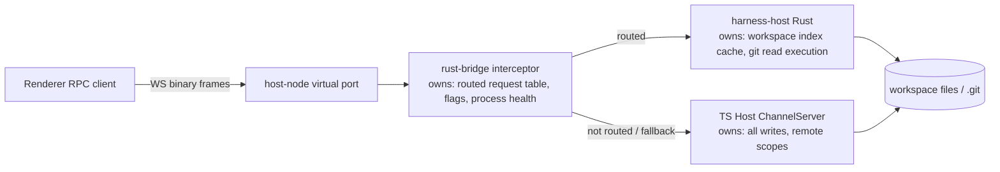

# Phase 3a: Rust hot-path services behind ports (files, search, git)

Status: active implementation contract. Wire format: `Worse/.work/phase3/contract.md` (normative
for method names, params, results and error codes). Plan section: "Phase 3: Rust hot-path
services" in `docs/plans/harness-rust-tauri-v2-plan.md`.

## 1. Purpose

Move the first three hot-path service groups out of the TypeScript Host into Rust without
changing ZCode sources and without changing what the renderer sees:

1. File read/stat/readdir/realpath and previews, plus Harness-native atomic write and path identity.
2. Workspace file index and file search (and a Harness-native streaming text search).
3. Git read operations: status/summary, changes, diff, log graph, branches, identity, refresh.

The TS implementation stays in place as the fallback and as the differential oracle.

## 2. Product rules

- R1 Drop-in: a routed call returns the same JSON (and the same error `name`/`message`/`code`) as
  the TS Host would for the same input. Ordering of arrays is part of the result.
- R2 Per-service flags: `HARNESS_RUST_SERVICES` (`fs`, `search`, `git`, `all`, `none`). Flags
  only change which implementation answers; they never change result shapes. Default when unset:
  `search` (the only service that is faster than TS; `fs` is latency-neutral and `git` is ~25%
  slower, see `Worse/.work/phase3/bridge.md`). Binary: `HARNESS_RUST_HOST`, else
  `Worse/target/release/harness-host(.exe)` if present, else `Worse/target/debug/...`.
- R3 Automatic fallback: if `harness-host` is missing, fails the handshake, crashes, times out,
  or answers with an internal/protocol error, the same request is answered by the TS Host. The
  user sees at most added latency, never an error caused by the Rust path.
- R4 Single writer: only read operations are routed in 3a. Every mutation (git stage/commit/push,
  branch switch, `.zcodeignore` write, workspace creation) stays on TS. No Rust on-disk cache.
- R5 Local scope only: remote-workspace attachments (`scope.kind` `remote`/`source-settings`)
  are never intercepted; their `file`/`git` channels belong to the remote source.
- R6 Identity: index/cache keys follow `workspaceIdentity?.trim() || workspacePath`; paths in
  results are the input strings (no case folding, no `\\?\` prefix).
- R7 Cancellation: an RPC `PromiseCancel` for a routed request cancels the Rust work; closing the
  attachment cancels all its routed requests.
- R8 No ZCode source edits; all bridge code lives in `Worse/sidecars/**`.

## 3. State ownership



| State | Owner | Notes |
| --- | --- | --- |
| Routed request id table (per attachment) | rust-bridge | cleared on response, cancel, attachment close |
| Rust process health, restart budget | rust-bridge | 3 crashes in 60 s disables routing |
| Workspace file index cache | harness-host (when `search` on) / TS Host (when off) | 60 s TTL, `.zcodeignore` fingerprint; never both serving one request |
| Files, `.zcodeignore`, `.git` | the file system | TS Host is the only writer |

## 4. Interfaces

- RPC seam: ZCode `@zcode/rpc` binary frames (`[100,id,channel,method]` + `[args]`), decoded
  header-only by `@harness/rust-bridge` (`src/rpc/*`). Responses are `[201,id]` + data or
  `[202,id]` + `{message,name,stack,code?}`.
- host-node hook: `createAttachBroker(server, shim, emit, decoratePort?)`; the decorator receives
  the virtual port and the attachment's Host message and returns the port the Host sees.
- Rust process: NDJSON JSON-RPC (contract sections 1-5).

## 5. Event order

```mermaid
sequenceDiagram
  autonumber
  participant UI as Renderer
  participant B as rust-bridge
  participant R as harness-host
  participant H as TS Host
  UI->>B: [100,id,"file","readdir"] [params]
  alt routed and healthy
    B->>R: {"id":n,"method":"file.readdir","params":...}
    R-->>B: {"id":n,"result":[...]}
    B-->>UI: [201,id] result
  else internal error / crash / timeout
    R-->>B: {"id":n,"error":{"code":-32603}}
    B->>H: original frame bytes (unchanged)
    H-->>UI: [201|202,id] ...
  end
  UI->>B: [101,id] PromiseCancel
  B->>R: {"method":"$/cancel","params":{"id":n}}
  Note over B: routed id removed; late Rust answer dropped
```

Ordering guarantee: frames that are forwarded keep their relative order. A routed request may
complete before an earlier forwarded request; this is already allowed by the RPC protocol
(responses are correlated by id).

## 6. Acceptance scenarios

| ID | Scenario | Evidence |
| --- | --- | --- |
| A1 | Fixture corpus: every routed method returns identical results through TS and Rust | `node Worse/scripts/e2e/phase3-diff.mjs` prints `PHASE3_DIFF_OK` |
| A2 | Error parity: missing path, file-as-directory, oversize preview, >15 paths | same script, error cases |
| A3 | Fallback: `HARNESS_RUST_HOST` points to a missing binary; all calls still succeed via TS | same script, fallback case |
| A4 | Phase 2 gate unaffected with flags on and off | `phase2-smoke.mjs` with `HARNESS_RUST_SERVICES=all` and `none` |
| A5 | Cancellation: `search.text` cancelled mid-stream returns `-32800` and stops | same script |
| A6 | Performance table TS vs Rust per op printed as JSON | same script output |

## 7. Out of scope (3a)

Diff computation beyond `git.getDiff`, file watcher, PTY, SQLite, remote transports, routing of
any mutation, Rust-side `.zcodeignore` editing.
