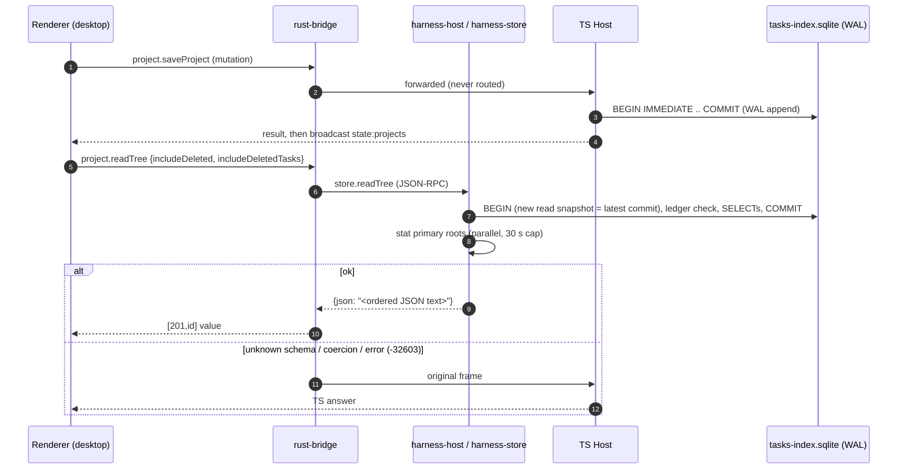

# Phase 3c (item 7): task-index SQLite read path in Rust

Status: active implementation contract. Builds on [phase-3a-rust-services.md](./phase-3a-rust-services.md)
(seam, flags, fallback, supervisor). Owner: `Worse/crates/harness-store`,
`Worse/crates/harness-host/src/methods/store.rs`, store routing in `Worse/sidecars/rust-bridge`.

## 1. Purpose and scope

The project sidebar, the mention pickers and the grouped task view read the Host's
`tasks-index.sqlite` (`{dataBaseDir}/.zcode/v2/tasks-index.sqlite`, owned by `TaskIndexRepo`)
through three read-only RPC methods. Phase 3c serves them from Rust with a read-only SQLite
connection, without changing ZCode sources and without changing what the renderer sees.

| RPC channel.method | TS implementation | Hot UI path |
| --- | --- | --- |
| `project.readTree` | `createProjectService().readTree` -> `ProjectRepository.readTree` + `projectPrimaryRootStatuses` | sidebar refresh on every `state:projects` broadcast / focus (`project-tree-reader.ts`), sessions mention provider, workspace actions |
| `project.readProjects` | `createProjectService().readProjects` (tree without tasks) | automation project picker, file mention provider, remote navigation |
| `task-groups.read` | `TaskGroupRepository.read` | grouped task view, after every `state:task-groups` broadcast |

Not routed (and why):

- Every mutation (`saveProject`, `moveTask`, `task-groups.save/move/admit`, auto-archive, ...):
  TS is the only writer (rule S1).
- `zcodeTaskService.listTasks` / `listPinnedTasks`: they also update an in-memory cache
  (`rememberIndexedTaskMeta`), so a Rust answer would skip a TS side effect.
- `project.resolveSessionDirectories`, `prepareSession`: they validate and create directories
  and are on the session-creation path, not on a list path.
- `remote-projects.*`, automations, off-peak: low frequency.

## 2. Product rules

- S1 Single writer: TS (`TaskIndexRepo`, `ProjectRepository`, `TaskGroupRepository`) is the only
  writer of the database. harness-store opens the file with `SQLITE_OPEN_READ_ONLY` (no `-shm`
  or `-wal` creation, no checkpoint on close), sets `PRAGMA query_only=1`, and never runs a
  migration, repair or `VACUUM`. It never uses `immutable=1` (that would hide TS writes).
- S2 Drop-in: a routed call returns the same value as TS after the RPC JSON round trip: same
  key order, same array order, `undefined` keys absent, `null` kept, booleans and numbers with the
  TS coercions (`row.x === 1`, `Number(...)`, `String(...)`). The only intended difference is
  `traceId` of a task whose stored meta has none: TS generates a random UUID on every read
  (`generateTraceId`), Rust also generates a random v4 UUID.
- S3 Automatic fallback: any condition Rust does not fully understand answers with JSON-RPC
  `-32603` and the bridge replays the original frame on TS. That covers: database file missing,
  open/lock failure, unknown schema (section 4), legacy rows not yet reconciled, a value TS would
  coerce in a way Rust does not reproduce (BLOB, integers outside +/-2^53-1, TEXT where a number
  is expected, REAL where a string is expected, `meta_json` that is not an object or not valid
  JSON), a non-absolute primary root, and `hostId` naming another Host.
- S4 Scope: routed only on local-scope `desktop-continuous` attachments (the window's own desktop
  renderer). Phone (`web-remote-replayable`) attachments decorate `project` with live activity in
  the TS Host, and remote scopes belong to the remote source; both always go to TS.
- S5 `hostId`: `readTree`/`readProjects` with a truthy `hostId` other than `"local"` are routed by
  TS to a remote Host; Rust falls back for them.
- S6 Flag `store` in `HARNESS_RUST_SERVICES` (also covered by `all`). Opt-in; not in the default
  set until the gate and a soak say otherwise.
- S7 Primary root status: like TS, every non-deleted project with a non-empty primary root gets
  `primaryRootStatus` from a fresh stat (`available` directory, `missing` for not-found /
  not-a-directory / a file, `unavailable` for other errors or no answer within 30 s of the first
  stat of that path). Concurrent reads share one in-flight stat per path; results are not cached.

## 3. State ownership and event order

| State | Owner | Notes |
| --- | --- | --- |
| `tasks-index.sqlite` rows, schema, migration ledgers | TS Host (`TaskIndexRepo` and repositories) | sole writer, WAL journal |
| Read-only connection cache (one per DB path) | harness-store (`StoreService`) | dropped on any error; reopened on next call |
| In-flight primary-root stats | harness-store | removed when the stat returns |
| Routed request ids, `store` flag, scope check | rust-bridge attachment router | per attachment |

Visibility of TS writes: each Rust call starts a new read transaction. In WAL mode a new read
transaction sees every transaction committed before it started (the WAL index in `-shm` is shared
across processes), so a write that TS committed before answering is visible to the next Rust read
with no delay or polling. Rust never holds a read transaction between calls, so it never pins old
WAL frames or blocks TS checkpoints.

## 4. Locking and schema policy

- Open flags: `SQLITE_OPEN_READ_ONLY | SQLITE_OPEN_NO_MUTEX`; `PRAGMA query_only=1`;
  `busy_timeout=2000` ms (a reader only waits on WAL recovery / a checkpoint restart, never on TS
  write transactions). When the file is not in WAL mode or `-shm` is missing (TS not running),
  open/read may fail; the call falls back.
- Schema check inside the same read transaction as the data, on every call:
  - `schema_migration` ids must equal exactly `0005_projects`, `0006_default_workspace_tasks`,
    `0007_initial_workspace_order`, `0008_remote_entry_deleted_cache`,
    `0009_session_creation_commands`, and `tasks_schema_migration` ids exactly
    `0001_adopt_task_schema`, `0002_provider_selection`, `0003_official_glm_selection`,
    `0004_project_execution_scopes`, `0006_task_group_admissions`; every checksum must equal the
    value the current ZCode source writes (pinned in `harness-store/src/schema.rs`). A missing
    ledger, a missing id, an extra id (a newer ZCode migrated the file) or a changed checksum
    -> fallback.
  - Readiness: no `tasks` row with `host_id IS NULL` (rows written by an old build that TS
    reconciles on startup) and no legacy `tasks.acp_session_id` column (TS renames those ids on
    startup) -> otherwise fallback.
- DB path: `ZCODE_DATA_BASE_DIR` (trimmed) else `HOME` (trimmed) else the OS home directory,
  joined with `.zcode/v2/tasks-index.sqlite`, the same rule as `packages/services/src/paths.ts`
  (harness-host inherits host-node's environment).

## 5. Interfaces

- harness-host methods: `store.readTree`, `store.readProjects`, `store.readGroups`. Params are the
  TS argument object (`{}` when the renderer passed no argument). Result: `{"json": "<text>"}`
  where the text is the TS value serialised in TS key order (serde_json maps are not
  order-preserving in every build of this workspace, so ordering is carried as text).
- Bridge: route table entries for `project.readTree`, `project.readProjects`, `task-groups.read`
  with result shape `jsonText` and `allowNoArgs`; `store` stripped from the service set of
  attachments that are not local `desktop-continuous`.

## 6. Acceptance scenarios (gate `Worse/scripts/e2e/phase3c-store-diff.mjs`)

Real ZCode Hosts run on one data directory **one at a time**, so there is never more than one
writer process: Host T (`HARNESS_RUST_SERVICES=none`, oracle), Host R (`store`), Host T again
(drift check: T1 must equal T2). The fixture database is created and migrated by the TS Host
itself, seeded with node:sqlite while no Host runs, then edited only through TS RPC mutations of
the running Host. In Host R the writer (TS, host-node process) and the reader (harness-host
process) are different processes sharing the WAL, so C2 is the cross-process visibility case.

| id | scenario | expectation |
| --- | --- | --- |
| C1 | every routed method x param variant (`{}`, no args, `includeDeleted`, `includeDeletedTasks`, both, `hostId:"local"`) on a large fixture (thousands of tasks, edge-case rows) | Host R result equals Host T result (traceIds of meta without traceId compared as UUID shape); bridge trace shows `rust` |
| C1b | a listed task whose `meta_json` is `null` (TS: `null.traceId` throws, the whole `readTree` fails) | Rust falls back (trace detail `meta_json is null`), caller gets the identical TS error |
| C2 | TS write in Host R (`saveProject`, `deleteProject`, `task-groups.save`) then immediate `readTree`/`read` in Host R | new state visible in the Rust answer; equals Host T |
| C3 | the C2 writes, read afterwards by a fresh Host T and a fresh Host R | identical (the writes are durable and Rust reads them like TS) |
| C4 | `hostId` of another Host | fallback, same error as TS |
| C5 | extra future migration id in the ledger | Rust falls back (trace `fallback`), result equals TS |
| C6 | primary roots: existing dir, missing dir, file | same `primaryRootStatus` |
| C7 | latency TS vs Rust per method | printed as a table |
| C8 | phone / non-desktop attachment | not routed (S4) - covered by `sidecars/rust-bridge/test/store.test.ts` |
