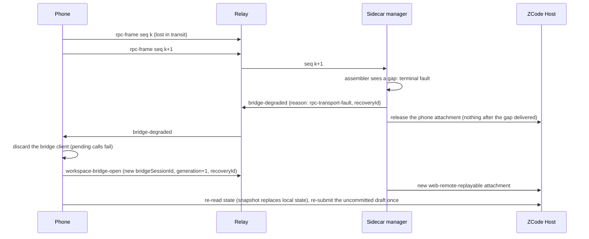
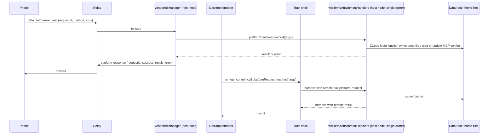

# Phase 4 (B): Web remote control, relay, and the mobile remote client

Status: active implementation contract. Plan section: "Phase 4" in
`docs/plans/harness-rust-tauri-v2-plan.md`. Companion: Phase 4 (A) remote workspaces
(`phase-4-remote-workspaces.md`). This spec covers phone control of a desktop's **local**
workspaces through the ZCode relay, and the Harness mobile shell as the phone-side client.

## 1. Purpose

Web remote control must work in Harness as it does in ZCode:

1. The desktop user turns on remote control for a workspace.
2. The desktop registers with the ZCode relay and shows a QR link (`<origin>/remote/v3|v4?sid=…`).
3. A phone opens the link, pairs through the relay, and drives the same workspace: the same Host,
   the same sessions, and the same Agent.

In ZCode, Electron **Main** owns the desktop half of this flow
(`packages/desktop/src/main/webRemoteControlManager.ts` plus `desktopMainIpc*`). Harness has no
Electron Main, so before this phase it was missing the following:

| Missing in Harness (before) | ZCode owner | Effect |
| --- | --- | --- |
| `startWebRemoteControl` / `stop` / `getStatus` / status events | preload → Main IPC | `tauriPlatform` rejected `start` ("not available yet") |
| Relay WS client, device registration, heartbeat, pairing | `webRemoteControlManager` + `web-remote-relay/*` | no relay connection at all |
| Bridge open → Host attachment for the phone | Main `attachWorkspaceHost` (MessageChannelMain to the Host utility process) | phone could not reach the Host |
| Renderer round-trips (reconnect workspace, pin/archive/create) | Main ↔ renderer IPC | not wired |
| Phone platform requests (directory list, git info, …) | Main `platformHandlers` | not wired |
| Mobile entry | the web page served by the ZCode endpoint | mobile shell rendered the pending-services fallback |

## 2. Decision: vendor the unchanged manager into the Host sidecar

The brief prefers running the unchanged TypeScript manager behind a thin Rust layer. Harness
does exactly that:

- `Worse/sidecars/host-node/vendor/webRemoteRuntime.entry.ts` re-exports the ZCode sources
  **verbatim**, with no copied logic: `createWebRemoteControlManager`, the feature gate, device
  storage, the credential and setting services, endpoint resolution, and validation schemas.
- `Worse/sidecars/host-node/scripts/build-webRemote-vendor.mjs` bundles it with esbuild into
  `dist-vendor/webRemoteRuntime.js`. `electron` is stubbed: `BrowserWindow.fromId → null`, and
  `ipcMain` / `MessageChannelMain` throw, because the manager never reaches them through Harness
  dependencies. Desktop network telemetry is a no-op.
- `Worse/sidecars/host-node/src/webRemoteHost.ts` is the **adapter**. It supplies the manager's
  dependencies the way Main does:
  - login read from the credential store;
  - endpoints from the same env resolution;
  - Host attachments created as in-sidecar virtual ports that are handed to the ZCode Host with
    `attach-service-port`;
  - renderer round-trips as events.
- Rust (`harness-host-control::HostController::send_web_remote` and
  `apps/harness-app/src-tauri/src/remote_control.rs`) is only a prefix-restricted forwarder.

Porting the manager to Rust is a **follow-up**, not part of this phase. It would mean re-implementing
the relay V2 protocol, the acknowledged rpc-frame assembler, and pairing state. The differential
gate in section 10 is the oracle such a port must keep passing.

## 3. Product rules

- R1 **One Host.** The phone attaches to the window's existing Host as one more
  `attach-service-port` attachment with `clientMode: "web-remote-replayable"`. No second Host,
  Agent, or remote session is created for the phone.
- R2 **Stateless relay and shell.** The relay (the ZCode cloud service, or the local fixture in the
  gate) and the Tauri shell only authenticate, pair, heartbeat, forward, and schedule attachments.
  - Task queues, snapshots, and session state stay in the Host.
  - The Rust shell keeps only an in-flight call-correlation map, and each entry lives no longer
    than its call.
- R3 **Two stream semantics stay distinct.**
  - The desktop renderer's attachment is `desktop-continuous`: a loopback WebSocket with no
    replay and no acknowledgements.
  - The phone's attachment is `web-remote-replayable`: acknowledged `rpc-frame` chunks over the
    relay, with a replay buffer and gap detection.
  - One attachment never changes mode. Phone recovery never touches the desktop attachment.
- R4 **Fail closed.** See section 8.
- R5 **Workspace identity.** The bridge target key is `workspaceIdentity?.trim() || workspacePath`,
  resolved by the unchanged manager against the targets the renderer synced
  (`syncWebRemoteControlWorkspaces`).
- R6 **Credentials.** The sidecar reads the user's own ZCode login from the same credential store the
  Host uses (`<ZCODE_DATA_BASE_DIR>/.zcode/v2/credentials.json`), exactly as Main does.
  - Tokens are never logged and never cross the Rust shell or the webview.
  - The Harness gate writes test-only mock credentials into an isolated data directory. It never
    reads real ones.

## 4. Owners

| State / decision | Owner | Not owned by |
| --- | --- | --- |
| Relay socket, device registration, heartbeat, pairing state, bridge sessions, rpc-frame replay buffers | vendored manager in the host-node sidecar (one per window) | Rust shell, webview |
| Phone Host attachments (open / release / message counters) | `webRemoteHost.ts` adapter | Rust shell |
| Sessions, tasks, queues, snapshots, the `CommandInbox` | ZCode Host (`packages/server`) | relay, sidecar adapter, shell |
| Login and credentials | credential store; read on demand by the manager | shell, webview |
| Remote-control status shown in the UI | manager (`getStatus` and status events) | renderer (it only renders) |
| Available workspace targets | renderer pushes them (`syncWorkspaces`); the manager keeps the latest | — |
| In-flight `remote_control_call` correlation | `remote_control.rs` (`WebRemoteCalls`) | — |
| Pairing link validation on the phone | `apps/harness-app/src/mobile/remoteLink.ts` | — |

## 5. Channels

### 5.1 Shell ↔ sidecar: the `harness-web-remote-*` control channel

This channel reuses the Phase 2 NDJSON `host` envelope. The sidecar's `main.ts` intercepts any
`host` message whose `type` starts with `harness-web-remote-`, so these messages **never** reach
the ZCode Host. No Host protocol enum changes.

| Direction | `type` | Fields |
| --- | --- | --- |
| shell → sidecar | `harness-web-remote-call` | `id`, `method`, `params`, `appVersion?` |
| sidecar → shell | `harness-web-remote-result` | `id`, `ok`, `value` or `error` |
| sidecar → shell | `harness-web-remote-event` | `event` (`status`, `reconnectRequest`, `rendererActionRequest`, `attachment`), `payload` |

Methods are listed below. `getAttachmentStats` exists only for the gate; the Rust allowlist
rejects it.

| Method | Purpose |
| --- | --- |
| `start {context}` | `authorizeStart` + `startAuthorized`; returns the start result (`status`, `qrUrl`, …) |
| `stop` | stop remote control |
| `getStatus` | read the current status |
| `notifyAuthStateChanged {change}` | forward a login change |
| `syncWorkspaces {workspaces}` | push the available workspace targets |
| `reconnectResult {result}` | answer a renderer reconnect round-trip |
| `rendererActionResult {result}` | answer a renderer action round-trip |
| `getAttachmentStats` | gate-only diagnostic |

On the Rust side:

- `harness-host-protocol` classifies the prefix as `Observe`, so it does not raise an unsupported
  warning.
- `ShellHostSink::on_host_event` hands matching messages to `remote_control::on_host_message`.
  That function resolves results by `id` and re-emits events as the Tauri events
  `harness://web-remote/{status,reconnect-request,renderer-action-request,attachment}`.
- `HostController::send_web_remote` refuses any message without the prefix.

### 5.2 Webview ↔ shell

The single command is `remote_control_call(method, params)`, which returns the result value.
`apps/harness-app/src/platform/webRemoteControl.ts` maps the `IPlatformService` members onto it:

- `startWebRemoteControl`, `stopWebRemoteControl`, `getWebRemoteControlStatus`
- `notifyWebRemoteControlAuthStateChanged`
- `onWebRemoteControlStatusChanged`
- `syncWebRemoteControlWorkspaces`
- `onWebRemoteControlReconnectWorkspace`
- `onWebRemoteControlRendererAction`

A handler that throws is answered with `success: false` and the error, so the manager's pending
round-trip never hangs past its own timeout.

### 5.3 Sidecar ↔ ZCode relay (unchanged ZCode contract)

The relay HTTP API (all calls carry a Bearer JWT):

- `POST/GET /api/v1/remote/device`
- `/api/v1/remote/device/delete`
- `/api/v1/remote/token {role}`

The relay WebSocket is `…/api/v1/remote/ws2?token=…`, with these messages:

- `auth_init` / `auth_ack`
- `pair_status_query` / `pair_status_ack`
- `data {payload, client_ts}`
- `error`

The app payloads are:

- `workspace-bridge-open` → `workspace-bridge-ready` | `workspace-bridge-error`
- `rpc-frame` / `rpc-frame-ack`
- `bridge-degraded`
- the platform and action payloads

Endpoints resolve the same way they do in ZCode:

- the origin comes from `resolveRuntimeZCodeEndpointOrigin` (production honours `ZCODE_BASE_URL` /
  `ZCODE_ENDPOINT_ORIGIN`);
- `ZCODE_WEB_REMOTE_CONTROL_RELAY_WS_URL` overrides the relay WS URL;
- `ZCODE_WEB_REMOTE_CONTROL_URL` overrides the QR page URL.

### 5.4 Sidecar ↔ ZCode Host (phone attachments)

`attachWorkspaceHost` creates an in-sidecar virtual port pair. One end goes to the manager, which
wraps it the way `wrapElectronPort` does. The other end goes to the Host through the existing
parent-port shim:

```
{type:"attach-service-port", requestId, attachmentId:"harness-web-remote-attachment-N",
 clientMode:"web-remote-replayable", terminalOwnerId?, scope:{kind:"local"}}
```

Other operations:

- `setTerminalOwner` posts `set-terminal-owner`.
- Release closes both ends, and the Host disposes the attachment.
- A non-local target (an SSH / WSL / Docker workspace from Phase 4A) goes through section 5.5.

### 5.5 Sidecar ↔ the desktop's remote session (phone on an SSH / WSL / Docker workspace)

ZCode Main wires the phone to a remote workspace with
`webRemoteControlSharedHostAttachments.attachWorkspaceHost` →
`remoteSessionManager.attachRemoteWorkspaceSessionHost`. Harness wires the same two calls, in the
process that already owns both managers (the host-node sidecar):

- The adapter (`webRemoteHost.ts`) receives `attachWorkspaceHost(windowId, {kind: "remote",
  remoteSessionId, workspacePath, workspaceIdentity, terminalOwnerId?})` from the unchanged web
  remote manager and hands it to `src/remoteWorkspaceWebRemote.ts`.
- That module applies ZCode's shared-host checks verbatim (`REMOTE_SESSION_MISSING` without a
  `remoteSessionId`, `REMOTE_WORKSPACE_IDENTITY_MISSING` without a `workspaceIdentity`,
  `workspaceKey = workspaceIdentity`) and calls the **vendored Phase 4A session manager's**
  `attachRemoteWorkspaceSessionHost`. The manager checks that the route exists, is attachable,
  belongs to window 1 and matches `workspacePath` + `workspaceIdentity`, then posts
  `attach-service-port {clientMode: "web-remote-replayable", scope: {kind: "remote",
  remoteSessionId, workspacePath, workspaceIdentity}}` to the Host with the in-process `port2`.
- The phone therefore gets one more remote-scoped attachment on the **existing** logical remote
  session in the window Host's `windowRemoteConnectionRegistry`. No `connect-remote-workspace`
  is sent; no second remote session, Host or Agent is created; the remote port never reaches the
  Rust services (same bypass as Phase 4A R5).
- The web remote manager is published into Phase 4A's `webRemoteControlManagerRef` as soon as it
  is created, so the session manager's own `failRemoteSession` (non-recoverable connection close)
  and `replaceRemoteSession` (auto-reconnect) reach the phone exactly as in ZCode.
- `disposeWorkspaceHostAttachmentsForRemoteSession(remoteSessionId)` releases every phone
  attachment of that session; `releaseWorkspaceHostAttachment` and `disposeWindow` cover them too.
- `prepareProjectWorkspace` / `cancelProjectPreparation` (phone project navigation) call the
  session manager's `prepareProjectWorkspace` / `cancelPendingRemoteWorkspaceSessionsForWindow`
  for window 1, as Main does.

```mermaid
sequenceDiagram
  participant R as Desktop renderer
  participant RW as Sidecar remote session manager (4A, vendored)
  participant WR as Sidecar web remote manager (4B, vendored) + adapter
  participant H as ZCode Host (windowRemoteConnectionRegistry)
  participant P as Phone
  R->>RW: rw.req connectRemote / bind (the desktop owns the connection)
  RW->>H: connect-remote-workspace (once)
  H-->>RW: remote-workspace-connected {remoteSessionId}
  R->>WR: syncWorkspaces [{kind: remote, remoteSessionId, workspacePath, workspaceIdentity}]
  P->>WR: workspace-bridge-open {workspaceKey = workspaceIdentity}
  WR->>RW: attachRemoteWorkspaceSessionHost(remoteSessionId, workspacePath, workspaceIdentity)
  RW->>RW: route exists + attachable + window 1 + identity match, else throw (fail closed)
  RW->>H: attach-service-port {web-remote-replayable, scope remote} + port2
  WR-->>P: workspace-bridge-ready; rpc-frames over port1 (file / git / terminal on the same session)
  R->>RW: rw.req disposeRemoteSession
  RW->>H: detach + dispose-remote-workspace-session
  RW->>WR: failRemoteSession(remoteSessionId): workspace-bridge-error to the phone, phone attachments released
  P->>WR: workspace-bridge-open (same key)
  WR->>RW: attachRemoteWorkspaceSessionHost: REMOTE_SESSION_MISSING, workspace-bridge-error; nothing reaches the Host
```

### 5.6 Phone platform requests (`platform-request`)

| Method | ZCode Main | Harness |
| --- | --- | --- |
| `isDockerAvailable`, `listWSLDistros`, `listDockerContainers` | `@zcode/server/remote` `docker-detect` / `wsl-detect`, run in Main | the same functions from the vendored `dist-vendor/remoteWorkspace.js` bundle (Phase 4A), run in the sidecar on the desktop OS (`src/remoteTargets.ts`) |
| `listSSHConfigAliases` | `listSSHConfigAliasesFromLocalConfig` (the desktop user's `~/.ssh/config`) | the same function from the same bundle |

Errors propagate exactly as in Main's handlers (no catch): the manager answers
`platform-response {success: false, error}`. While the vendored bundle is not loaded the methods
reject (fail closed) instead of answering an empty list.

## 6. Event order

### 6.1 Pairing → attach → forward → reconnect

```mermaid
sequenceDiagram
  participant R as Renderer (desktop)
  participant S as Rust shell
  participant N as host-node sidecar (manager + adapter)
  participant H as ZCode Host
  participant Y as Relay (ZCode cloud / local fixture)
  participant P as Phone (web remote page)

  R->>S: remote_control_call syncWorkspaces
  S->>N: harness-web-remote-call syncWorkspaces
  R->>S: remote_control_call start {context}
  S->>N: harness-web-remote-call start
  N->>Y: POST /remote/device (Bearer login)
  N->>Y: POST /remote/token {device}; WS ws2 auth_init
  Y-->>N: auth_ack
  N-->>S: result {status: running, qrUrl}
  N-->>S: event status
  S-->>R: harness://web-remote/status
  Note over R,P: Pairing: the user opens qrUrl on the phone
  P->>Y: GET /remote/device, POST /remote/token {terminal}, auth_init
  Y-->>P: auth_ack matched
  P->>Y: data workspace-bridge-open {bridgeSessionId, generation, workspaceKey}
  Y->>N: forward
  N->>H: attach-service-port (web-remote-replayable) + port
  N-->>S: event attachment opened
  N->>Y: data workspace-bridge-ready
  Y->>P: forward
  loop Forward
    P->>Y: rpc-frame (seq n)
    Y->>N: forward
    N->>H: RPC message (once per assembled frame)
    H-->>N: RPC reply
    N->>Y: rpc-frame / rpc-frame-ack
    Y->>P: forward
  end
  Note over P,Y: Phone socket drops (network change)
  P->>Y: reconnect (new terminal token, auth_init)
  P->>Y: replay unacknowledged rpc-frames
  Y->>N: forward; duplicates acknowledged, not re-delivered
  N->>H: only frames not yet delivered
```

### 6.2 Gap → degraded → snapshot replacement



Reusing a degraded `bridgeSessionId` and generation is rejected by the manager, so a stale bridge
cannot resume.

## 7. Replayable vs continuous

| | Desktop renderer | Phone |
| --- | --- | --- |
| Client mode | `desktop-continuous` | `web-remote-replayable` |
| Transport | loopback WS from the Phase 2 attach broker | relay `data` payloads carrying acknowledged `rpc-frame` chunks |
| Loss handling | none needed (in-process loopback); socket loss is reported as connection lost | replay unacknowledged frames after reconnect; a gap degrades the bridge and forces a snapshot rebuild |
| Lifetime | the window | one bridge session; released on degrade, stop, or window dispose |
| Who creates it | Rust `host_open_attachment` | the sidecar adapter on `workspace-bridge-open` |

The gate checks that phone disconnects, gaps, and rebuilds never close the desktop attachment, and
that the desktop observes the phone's committed inputs through the same Host.

## 8. Fail-closed behaviour

| Condition | Result |
| --- | --- |
| No login, or credentials cannot be read or decrypted | `start` fails; there is no anonymous relay session |
| `init-local` not seen yet (no device identity) | `start` / `syncWorkspaces` fail with "Host has not been initialised" |
| Host not running | `remote_control_call` returns `hostNotStarted`; the shell never spawns a Host for remote control |
| Unknown method from the webview | `invalidInput`; nothing is sent |
| Message without the `harness-web-remote-` prefix through `send_web_remote` | `hostProtocolError` |
| Bridge open for a workspace that was not synced | `workspace-bridge-error` (manager) |
| Bridge open for a remote workspace whose session is gone (desktop disconnected, unknown id, other window, offline) | the session manager throws (`REMOTE_SESSION_MISSING` / `REMOTE_SESSION_OFFLINE` / `REMOTE_SESSION_WINDOW_MISMATCH`) → `workspace-bridge-error`; nothing is posted to the Host and no connection is created |
| Bridge open for a remote workspace without `remoteSessionId` / `workspaceIdentity`, or with an identity that does not match the session | `workspace-bridge-error` (`REMOTE_SESSION_MISSING` / `REMOTE_WORKSPACE_IDENTITY_MISSING` / `REMOTE_WORKSPACE_IDENTITY_MISMATCH`) |
| The desktop disposes a remote session while the phone has a bridge on it | right after the session manager's dispose, Harness calls `failRemoteSession(remoteSessionId, "harness:desktop-disposed", {reason: "workspace-closed"})`: the phone gets `workspace-bridge-error` and its attachments are released. ZCode only does this for non-recoverable connection closes; without it the phone's calls would wait on a port the Host already detached |
| Remote session manager not loaded | remote bridge opens and discovery `platform-request`s fail |
| rpc-frame gap | `bridge-degraded`; the attachment is released; nothing after the gap reaches the Host |
| Phone pairing link from a non-allowlisted origin, without https (loopback test hosts excepted), off the `/remote/v3|v4` path, or without a `sid` | the mobile shell refuses to navigate |
| Mobile `remote_control_call` | `unsupported`; the phone never hosts remote control |
| Call outstanding for 90 s | `hostTimeout`; the correlation entry is removed and a late result is dropped |

## 9. Mobile remote client

- `Surface::Mobile` capabilities (`harness-platform`) are already correct: `local_host = false`, no
  pickers, and no reveal. The Rust mobile build compiles no `host` module.
- `main.tsx` renders `mobile/RemotePairing.tsx` when `TAURI_ENV_PLATFORM` is `android` or `ios`.
  - The user pastes the link from the desktop QR code.
  - `validateRemoteLink` checks it against the allowlist: `https://zcode.z.ai`, plus build-time
    `VITE_HARNESS_REMOTE_ORIGINS` for local test relays.
  - Once the link passes, the webview navigates top-level to the ZCode web remote page. That page
    is the same web bundle the phone browser loads, and it uses the replayable transport.
  - The remote page gets no Tauri IPC capability: `capabilities/mobile.json` is scoped to the
    app's own `main` window content, and the page needs no native calls.
- There is no local Host, Agent, PTY, or file system on the phone.
- Follow-ups:
  - in-app QR scanning (needs a barcode plugin and camera permission);
  - deep-link handling for `/remote/v4` links;
  - optional bundling of the remote page into the APK instead of loading it from the endpoint.

## 10. Acceptance scenarios

| ID | Scenario | Evidence |
| --- | --- | --- |
| W0 | The desktop `desktop-continuous` attachment with `init-local` is open before remote control | gate |
| W1 | Pairing against the local relay fixture (`createFakeRelayV2`): `syncWorkspaces`, then `start` returns `running` with a `qrUrl` whose `sid` equals the device the phone pairs with; the device is registered exactly once for the account | gate |
| W2 | The phone's `workspace-bridge-open` creates exactly one `web-remote-replayable` attachment on the existing Host; phone `setting.get` succeeds; status is `active` with `mobileConnected` | gate |
| W3 | A burst of N phone inputs (`setting.update`) with a forced relay disconnect and reconnect mid-flight: all N resolve, the Host receives exactly N messages (no duplicates, no loss), and the desktop sees the last value | gate |
| W4 | One dropped `rpc-frame` is a gap: `bridge-degraded (rpc-transport-fault)`, the old attachment is released, nothing after the gap reaches the Host, a new bridge (new id, generation 2, `recoveryId`) gets a fresh attachment, the snapshot shows the last committed value, and the re-submitted input is delivered exactly once | gate |
| W5 | The desktop continuous attachment never closed; one Host process (single `ready`, same pid); no Agent spawned by remote control | gate |
| W6 | `stop` returns to `idle` and releases every phone attachment; the sidecar exits 0 on stdin close | gate |
| W7 | The Android debug APK builds; on a device or emulator it shows the pairing screen and rejects non-allowlisted links | APK build + `adb` screenshot when a device is available |
| W8 | Phase 2/3 gates unchanged (`PHASE2_E2E_OK`, `PHASE3_DIFF_OK`, `PHASE3B_DIFF_OK`) | gates |
| W9 | Phone `platform-request`s are answered from the desktop OS: `listWSLDistros` contains the installed distro (Windows with WSL), `listSSHConfigAliases` returns the alias from a fake `~/.ssh/config` written into the gate's isolated home, `isDockerAvailable` is a boolean; `listDockerContainers` is an array when Docker is available, and without a docker CLI it answers `platform-response {success: false}` exactly as ZCode Main does (the spawn error is propagated) | gate |
| W10 | Phone on the desktop's WSL workspace: the desktop connects and binds once (rw.req) and syncs the remote target; the phone's bridge (`workspaceKey = workspaceIdentity`) lists files, reads git status and runs a terminal in the distro; exactly one `connect-remote-workspace`, one connected session, one extra remote-scoped `web-remote-replayable` attachment | gate (SKIP without WSL) |
| W11 | Fail closed: after the desktop disposes the session, the phone receives `workspace-bridge-error`, a new bridge open for the same key fails with `workspace-bridge-error`, and no `connect-remote-workspace` or remote attachment is created | gate (SKIP without WSL) |
| W12 | Phone `platform-request createTempTextAttachment`: the desktop answers ZCode's own `app-error unsupported-action` (ZCode's shared relay schema omits the method, section 12.1) and writes no file. The owner, reached by the desktop renderer path, writes `<data root>/.zcode/tmp/paste-attachments/<YYYY-MM-DD>/` with exactly the sent text. Like ZCode, the file persists: ZCode's own storage service refuses to clean `toolOutputs` ("not cleanable"); the gate then deletes its own test files and checks they are gone | gate (section 12) |
| W13 | Phone `platform-request loadMcpFromUserDirectory`: returns the servers seeded in the isolated home's `~/.zcode/cli/config.json` (`mcp.servers`) | gate (section 12) |
| W14 | Phone `platform-request saveMcpToUserDirectory upsert`: `{success:true}`; the file on disk has the new server and keeps the other fields; a second load shows it | gate (section 12) |
| W15 | The desktop renderer's own `createTempTextAttachment` / MCP load / save go through the same host-node handlers (`platformRequest` over `remote_control_call`) | gate drives the same sidecar method; UI e2e (section 12.6) |
| W16 | Scripted UI click-through in the running Harness dev app (WebView2 + CDP): add-remote-connection dialog, web remote control settings, QR against the local relay fixture; screenshots `Worse/.work/phase4/ui-*.png` | `node Worse/scripts/e2e/phase4-ui.mjs` prints `PHASE4_UI_OK` or `PHASE4_UI_PARTIAL <reason>` |

Gate: `node Worse/scripts/e2e/phase4-web-remote.mjs` prints `PHASE4_WEB_REMOTE_OK` plus a JSON
summary, or `PHASE4_WEB_REMOTE_FAIL <step>`.

- The gate uses ZCode's own relay test fixture and ZCode's real phone-side transport
  (`createAcknowledgedWebRemoteControlRelayProtocol`, `ChannelClient`). It never contacts the real
  cloud relay.
- It drives the sidecar through the same `harness-web-remote-call` lines that `remote_control.rs`
  sends.
- The Rust forwarding layer (`remote_control_call` → Tauri events) is verified by
  `cargo clippy` / `cargo test`. It has no running-webview test in this phase.

## 11. Out of scope and follow-ups

- Rust port of the manager (section 2).
- Phone control of SSH / WSL / Docker workspaces and the Docker / WSL / SSH listings are wired
  (sections 5.5 and 5.6). Docker and SSH were not exercised end to end on the reference machine
  (no daemon, no localhost sshd); they share the WSL code path.
- The other phone `platformHandlers` (temporary text attachments, MCP user-directory load / save /
  migrate) are served by host-node since fix B (section 12).
- ZCode never deletes paste attachments. The Agent keeps referencing their `localPath` from
  message history, and the Resource Manager lists `<data root>/tmp` under `toolOutputs`, which
  `storageCatalog.ts` marks as not cleanable (`toolOutputs: "none"`). Harness keeps the same
  lifecycle.
- Desktop network telemetry hooks are no-ops.
- A real cloud relay session needs the user's own login; it was not exercised by automation.

## 12. Main platform handlers: temporary text attachments and MCP user directory (fix B)

### 12.1 What Main did in ZCode

| Request | ZCode owner (Main) | Callers |
| --- | --- | --- |
| `createTempTextAttachment {text, filename?}` | `packages/desktop/src/main/tempTextAttachment.ts` | desktop renderer (preload IPC `PlatformChannels.CreateTempTextAttachment`); phone only in intent, see the note below |
| `loadMcpFromUserDirectory {workspacePath?}` | `packages/desktop/src/main/mcpUserDirectory/index.ts` `loadCliMcpFromUserDirectory` | desktop renderer `mcpStore` (local workspaces); phone |
| `saveMcpToUserDirectory {action, name, …}` | same module, `saveCliMcpToUserDirectory`, wrapped as `{success, error?}` | desktop renderer; phone |
| `migrateLegacyCommonMcp` | `mcpUserDirectory/legacy.ts` | desktop renderer; phone |

Note on the phone temp attachment (an upstream ZCode inconsistency, kept as-is):

- The web page calls `platformProxy.requestPlatformMethod("createTempTextAttachment", ...)`
  (`packages/web/src/platform/index.ts`), and Main lists it in `platformHandlers`.
- But the desktop parses relay payloads with `webRemoteControlPlatformMethodSchema`
  (`packages/shared/src/validation.ts`), whose enum does not contain `createTempTextAttachment`.
  The transport therefore treats the payload as unrecognized and replies
  `app-error {reason: "unsupported-action"}` before `platformHandlers` runs.
- Harness runs ZCode's manager and transport unchanged, so it answers the same way. Fixing this
  needs a ZCode `packages/**` change, which is out of scope. The handler stays wired, so the
  phone path works without Harness changes once ZCode adds the method to the schema.

Before fix B, Harness answered all four with "not available" for the phone, and the desktop
`IPlatformService` had none of these members. The effects:

- A long paste (≥ 5120 characters) could not become an attachment.
- The MCP settings page showed no user-directory servers for local workspaces.
- MCP edits for local workspaces were not saved to disk.

### 12.2 Decision and owner

- The four Main functions are bundled **unchanged** from the ZCode source into
  `Worse/sidecars/host-node/dist-vendor/mcpTempAttachmentRuntime.js`. The entry is
  `vendor/mcpTempAttachment.entry.ts` and the build script is
  `scripts/build-mcpTempAttachment-vendor.mjs`.
  - Main's `logger.ts` creates the Electron log directory when it is imported, so the bundle
    replaces it with a logger that writes to stderr.
- `Worse/sidecars/host-node/src/mcpTempAttachmentHandlers.ts` is the **single owner** in Harness.
  It loads the bundle lazily and wraps save results as `{success, error}`, as Main does. Both
  callers use this one object:
  - the vendored web remote-control manager, through `platformHandlers` in `webRemoteHost.ts`;
  - the desktop renderer, through `remote_control_call("platformRequest", {method, args})`.
- No native Rust or Tauri command is added. These are file reads and writes that ZCode already
  implements in Node. Rust only adds `platformRequest` to the `remote_control_call` allowlist.
- `platformRequest` works without remote control being started, without a login, and without the
  device identity.
  - Its `method` must be one of the four names above. Any other method is rejected before any IO.

### 12.3 Paths (identical to ZCode)

- **Temp files.**
  - Path: `getZCodeDataRootDir()/tmp/paste-attachments/<YYYY-MM-DD>/<name>-<8 hex>.txt`. The data
    root is `<ZCODE_DATA_BASE_DIR || HOME/USERPROFILE>/.zcode`.
  - Files are written with the `wx` flag, so an existing file is never overwritten.
  - Lifecycle matches ZCode: nothing deletes them. The Resource Manager shows them under
    `toolOutputs` but refuses to clean that category.
- **MCP config.**
  - User scope: `<HOME || USERPROFILE>/.zcode/cli/config.json` under `mcp.servers`. Reads fall back
    to `~/.agents/mcp.json` under `mcpServers`.
  - Workspace scope: `<workspace>/.zcode/config.json`.
  - Writes go through ZCode's `updateJsonObjectFile`: strict read, re-read before write, atomic
    replace, mode 0600.
  - In the gates, this home is the isolated home from `installIsolatedHome()`.

### 12.4 Sequence



### 12.5 Fail-closed

| Condition | Result |
| --- | --- |
| Phone `createTempTextAttachment` | `app-error unsupported-action` from ZCode's transport (schema omission, 12.1); no file is written |
| Empty text for a temp attachment | error "Temporary text attachment content is empty" (ZCode's message); no file is written |
| Unknown `platformRequest` method | rejected; no IO |
| Corrupt MCP config file | load and save fail with the parse error; the file is not rewritten (ZCode behaviour) |
| Mobile shell | `remote_control_call` returns `unsupported`; the phone writes desktop files only through the relay `platform-request` |

### 12.6 UI click-through (W16)

`Worse/scripts/e2e/phase4-ui.mjs` needs the built sidecar and the debug `harness-app.exe`. It does
the following:

1. Calls `installIsolatedHome("phase4-ui")`.
2. Starts the local relay fixture and the Vite dev server.
3. Launches the debug app with `WEBVIEW2_ADDITIONAL_BROWSER_ARGUMENTS=--remote-debugging-port=<port>`.
4. Connects with `playwright-core` `connectOverCDP`.
5. Clicks through:
   - the add-remote-connection dialog, connecting to WSL when `wsl.exe -l -q` lists Ubuntu;
   - the web remote control settings, generating a QR against the local relay.
6. Writes screenshots, then closes the window through the UI close control. That shuts the Host
   down gracefully; the script never calls `destroy()`.

Login: the script seeds ZCode's own e2e mock credentials (`mock-token` / `zcode-e2e-user`, the
same fixture as `packages/desktop/test/e2e/helpers/desktop-app.ts`) into the isolated data
directory, and points the endpoint origin at the local relay fixture. If the UI still shows a
sign-in wall, the script drives what it can reach and prints `PHASE4_UI_PARTIAL <reason>`.

Isolation for the GUI: `WEBVIEW2_USER_DATA_FOLDER` points the WebView2 profile into the isolated
home, `HARNESS_DEVICE_MID` keeps the shell from writing `device-mid` under the real `%APPDATA%`, and
the fixture answers non-remote ZCode API paths with 404 (it implements only `/api/v1/remote/*`).

Observed result (fix B): the app starts and restores the fixture session in the Host
(`restoreCachedSession restored: zai zcode-e2e-user`), and the renderer reads the MCP user
directory through the new `platformRequest` path (`[mcpStore] loadMcpFromUserDirectory`). Shortly
after start, ZCode shows "Your session has expired". Dismissing it opens the sign-in wall, so the
composer's remote-connection entry and the mobile remote-control dialog are not reachable without a
real login. The script therefore prints `PHASE4_UI_PARTIAL`. The trigger of that prompt is not
confirmed: the Host log shows no 401, no logout and no external origin. The remote-connection and
QR flows are covered by the protocol gates (`phase4-remote.mjs`, `phase4-web-remote.mjs`) instead.
