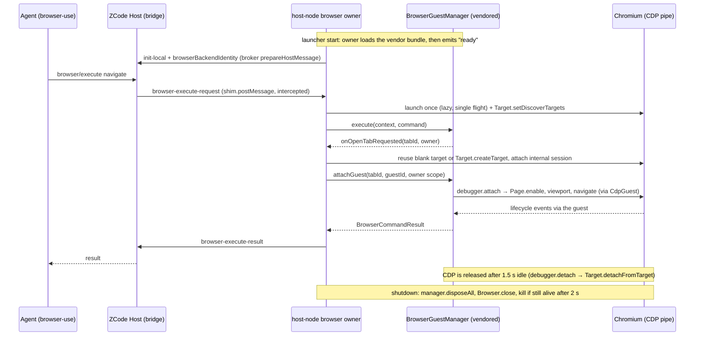

# Phase 5: Browser parity (agent browser and in-app browser)

Status: implemented (agent A, Phase 5). Gate: `node Worse/scripts/e2e/phase5-browser.mjs` prints `PHASE5_BROWSER_OK`.
Plan reference: `docs/plans/harness-rust-tauri-v2-plan.md`, Phase 5, "Embedded browser / CDP", risk #1.

## 1. Background

ZCode desktop has one browser product with two surfaces:

- **Agent browser (browser-use).** The agent's browser-use plugin (node_repl) sends `browser/list` and
  `browser/execute` to the Host. The Host's `createBrowserControlMainBridge`
  (`packages/desktop/src/host/browserControlMainBridge.ts`) posts a `browser-execute-request` to Electron
  Main over `parentPort`. Main's `runBrowserCommandOnView` calls `BrowserGuestManager.execute`
  (`packages/desktop/src/main/browserView/browserGuestManager.ts`). The manager asks the renderer to create a
  `<webview>` (`BrowserViewReady`), receives its `webContentsId` (`browserViewAttachGuest`), and then drives the
  guest through `webContents.debugger` (CDP). The answer goes back as `browser-execute-result`.
  The Host advertises the backend (`type: "iab"`, "ZCode In-app Browser") only when `init-local` carries
  `browserBackendIdentity`.
- **User-visible browser pane.** `packages/ui/src/browser-use/UnifiedBrowserView.tsx` renders an Electron
  `<webview>` in the right panel. The user watches agent tabs, browses, and handles site permissions there.

Before Phase 5, Harness did the following:

- The Rust fallback (`harness-host-control/src/fallback.rs`) answered `browser-execute-request` with
  `backend_unavailable`.
- `init-local` carried no identity, so the agent saw no browser at all (`browser/list` → `[]`).
- The pane was hidden, because `bootstrap.tsx` passes `supportsEmbeddedBrowser={false}`.

The CLI adapter (`apps/zcode-cli/packages/adapters/src/browser`) is a separate path. It uses playwright-core
plus system Chrome for `--browser-use=headless`, runs inside the agent process, and is not affected by this
phase.

## 2. Strategy (plan option 1, chosen)

The plan lists three options:

1. A Chromium/Playwright sidecar supervised by Harness (preferred).
2. Tauri child webviews with a CDP sidecar.
3. Defer, with an external browser only.

**Chosen: option 1, with ZCode's Main code reused unchanged.**

- `BrowserGuestManager` and every executor it uses (snapshot, dom_cua, playwright locator, dialogs,
  downloads, tab residency, scopes, turn and session release) are bundled unchanged into
  `sidecars/host-node/dist-vendor/browserRuntime.js` by `scripts/build-browser-vendor.mjs`. This follows the
  same pattern as `remoteWorkspace.js` and `webRemoteRuntime.js`.
  - `electron` resolves to `vendor/browserElectronStub.ts`. The manager only calls `webContents.fromId`, and
    the stub returns the CDP guest registered under that id.
  - Main's file logger resolves to `vendor/browserLoggerStub.ts`, which writes to stderr.
- The Electron `<webview>` guest is replaced by a **Chromium page target driven over CDP**
  (`src/browserGuest.ts`). It implements the exact `GuestWebContents` surface the manager uses:
  - `loadURL`, `getURL`, `getTitle`, `navigationHistory`, `executeJavaScript`, `capturePage`
  - lifecycle events and `render-process-gone`
  - `debugger.attach/detach/sendCommand/on("message")`
  - `session.on("will-download")`
  Result shapes therefore come from ZCode's own code, not from a reimplementation.
- Chromium is the user's installed Chrome, Chromium or Edge, with the same candidate list as ZCode's CLI
  adapter. `HARNESS_BROWSER_EXECUTABLE` overrides it. It is launched with `--remote-debugging-pipe`, so no TCP
  debugging port is opened.
- Windows only, and only in headless mode: Chromium is launched with `--disable-gpu`. This is the same flag
  as ZCode's own headless Chrome helper (`chromeLocalStorageManager.ts`).
  - Why: a freshly launched Chromium starts its GPU process (D3D11) cold. Its first compositor frame arrives
    about 120 to 400 ms after launch. Any input dispatched before that frame waits for the renderer's ack,
    so the first click or type after the first navigate took 50 to 300 ms. The measurements are in
    `.work/phase5/fixLatency.md`.
  - WebGL keeps working through WARP.
  - `HARNESS_BROWSER_GPU=1` keeps the hardware GPU.
  - Headful mode (`HARNESS_BROWSER_HEADFUL=1`) and macOS/Linux are unchanged; they have not been measured.
- Acceptance: in the `phase5-browser` gate, the first click and type after navigate are within about 2 to 3
  times ZCode's time, or under about 30 ms.

Why not option 2:

- WebView2 and WKWebView cannot host an Electron `<webview>`.
- Tauri multi-webview is unstable (plan risk).
- WKWebView has no CDP, so option 2 would still need a CDP sidecar for the agent.

Option 3 would leave the agent with no browser, which is a regression from ZCode.

Why the owner lives in the Node Host sidecar and not in Rust:

- The manager is about 200 KB of TypeScript with many executors, and porting it would fork behaviour.
- The Host↔Main message pair already crosses the sidecar's `parentPort` shim, so the interception point has
  no new protocol. This is the same approach as `remoteWorkspace.ts`.

## 3. Feature matrix

| Feature | ZCode (Electron) | Harness (Windows / macOS / Linux) | Status | Fallback / note |
| --- | --- | --- | --- | --- |
| Backend advertised to the agent (`browser/list`) | `init-local.browserBackendIdentity` from Main | Injected by the host-node broker hook; same `iab` descriptor | parity | No Chromium found, or `HARNESS_BROWSER=off`: no identity, so `list` returns `[]` (same as the ZCode web client) |
| navigate / back / forward / reload | `<webview>` + CDP | Chromium target + CDP, same manager | parity (gate B3) | — |
| snapshot / refs / dom_cua click / type / fill / press / hover / scroll / select / drag | manager executors over CDP | same executors, unchanged | parity (gate B3 covers snapshot, click, type, evaluate) | — |
| playwright locator actions | manager executors | same | parity (not gated separately) | — |
| evaluate | CDP `Runtime.evaluate` | same | parity (gate B3) | — |
| screenshot (viewport) | executor captures at 2x quality, then resizes to CSS px with `nativeImage.resize({quality:"best"})` | the same executor; the resize hook runs `createImageBitmap(resizeQuality:"high")` → OffscreenCanvas → PNG in a private background Chromium target | parity (gate B3: identical 1280x720 PNG) | If the resize fails, the hook returns `undefined` and the executor uses its own fallback |
| screenshot surface preparation (hidden window, transparent bootstrap) | renderer pane + owner window | not needed (headless target always renders) | parity of result | — |
| tabs: newTab / list / activate / close / claim / finalize, 32-tab residency limit | manager | same | parity (gate B3: list and close) | Suspend/restore on tab-limit eviction is not wired (no pane to suspend) |
| JS dialogs (alert / confirm / prompt / beforeunload) | manager via debugger `Page.javascriptDialogOpening` | same; the internal session never handles dialogs | parity (not gated) | — |
| downloads | Electron `will-download` | `Browser.setDownloadBehavior(allowAndName)`, renamed to the suggested name in `~/Downloads` | degraded | No per-download "Save as" prompt; a duplicate name gets a ` (n)` suffix |
| popups (`window.open`, `target=_blank`) | `setWindowOpenHandler` → renderer opens a user tab | new target attached as a user-origin tab in the opener's scope; the agent can `claimTab` it | parity of the contract (gate B4) | — |
| crash recovery (`render-process-gone`) | Electron event | `Inspector.targetCrashed` / `Target.targetCrashed` | parity (not gated) | — |
| history restore after a guest rebind | `navigationHistory.restore` | navigates to the active entry; back stack lost | degraded | Only after a guest crash rebind |
| video recording (`recordingStart`) | hidden BrowserWindow MediaRecorder (WebM) | `capability_unsupported` with an explicit message | **unavailable** | Use screenshots. Future: CDP screencast to WebM (needs sign-off) |
| visibility (`browserVisibilitySet/Get`) | shows or hides the right-hand pane | state tracked by the manager; nothing is rendered in the app | degraded | `HARNESS_BROWSER_HEADFUL=1` shows the real Chromium window |
| user-visible in-app browser pane | `<webview>` in the right panel | hidden (`supportsEmbeddedBrowser={false}`); links open in the system browser | **unavailable** | Needs a product decision (see section 9) |
| site permissions (camera, mic, geolocation, notifications prompts) | `embeddedBrowserPermission*` UI bridge | Chromium default for the profile; no in-app prompt | degraded | Headless denies prompts by default |
| clipboard virtualisation, element picker, human viewport sync | pane / renderer features | not available (no pane) | unavailable | — |
| login persistence | `persist:` partition | persistent profile `~/.zcode/harness/browser-profile`; a locked profile falls back to a temporary one | parity / degraded | A second Harness window uses a throwaway profile |
| phone remote (`web-remote-replayable`) commands | same Main path, `clientMode` passed through | same: `clientMode` and `remoteSessionId` are passed to the manager unchanged | parity of routing (not gated end to end) | — |
| CLI `--browser-use=headless` | playwright-core in the agent | unchanged (runs inside the agent CLI) | parity | — |

Observed ZCode race (finding from the reference run, not reproduced in Harness):

- When the renderer attaches a `<webview>` at `dom-ready` of its initial `about:blank`, that page's
  `did-finish-load` has not fired yet.
- The next `navigate` command's Electron `loadURL` is then settled by that stale event.
- As a result, ZCode returns `state.url = "about:blank"` for the first navigate in a fresh tab.

The Harness guest settles `loadURL` only on the navigated main frame's `frameStoppedLoading`, after
refreshing URL, title and history. The gate's reference therefore attaches after the initial load has
settled, so that it compares steady-state behaviour.

Platform notes:

- **Windows:** Chrome is found under `%ProgramFiles%`, `%ProgramFiles(x86)%` or `%LOCALAPPDATA%`, or Edge is
  used. Chromium is spawned with `windowsHide` (CREATE_NO_WINDOW). Verified by the gate on Windows 10.
- **macOS and Linux:** `/Applications/*.app` and `/usr/bin/*` candidates. Same code path, **not run in this
  phase** (no hosts available). Status is "expected parity, unverified".

## 4. Owners and interfaces

| Concern | Owner | File |
| --- | --- | --- |
| Browser semantics (tabs, scopes, refs, executors, results) | ZCode `BrowserGuestManager` (vendored, unchanged) | `dist-vendor/browserRuntime.js` |
| Backend identity, request interception, renderer stand-in (create a guest per `onOpenTabRequested`, `attachGuest` with the owner scope) | host-node browser owner | `src/browserOwner.ts` |
| Electron `webContents` stand-in per page target | `CdpGuest` | `src/browserGuest.ts` |
| Chromium process, CDP pipe, executable discovery, profile | host-node | `src/browserCdp.ts` |
| Process supervision | Rust shell kill-tree of host-node (Chromium is a grandchild). Chromium also exits on pipe EOF | `harness-sidecar` (unchanged) |

Interfaces:

- **Host → owner:** `{type:"browser-execute-request", requestId, browserId, browserGeneration, controlScopeId?,
  sessionId, turnId?, workspaceKey, workspacePath, workspaceIdentity?, remoteSessionId?, clientMode,
  sessionContext, command}`. This is unchanged ZCode protocol, intercepted on `shim.postMessage` before it
  reaches the shell.
- **Owner → Host:** `{type:"browser-execute-result", requestId, result}`, delivered via
  `shim.emitHostMessage`.
- **Workspace key:** `workspaceIdentity?.trim() || workspaceKey || workspacePath || sessionId`, the same as
  Main.
- **Window id:** `1` (one Host sidecar per window, the same as `remoteWorkspace.ts`).
- **Environment variables:**
  - `HARNESS_BROWSER=off` disables the browser.
  - `HARNESS_BROWSER_EXECUTABLE` sets the browser executable.
  - `HARNESS_BROWSER_HEADFUL=1` shows the browser window.
  - `HARNESS_BROWSER_PROFILE_DIR` and `HARNESS_BROWSER_DOWNLOAD_DIR` set the profile and download folders.

The Rust fallback for `browser-execute-request` stays in place. It now only answers if the sidecar is
running without the owner (for example an older build).

## 5. Event order

Idempotency and races:

- **Chromium launch** is single flight. If Chromium exits, every guest is marked destroyed (the manager sees
  `destroyed` and rebinds or fails the command), and the next command relaunches.
- **Late debugger sessions:** a debugger session that is created after `detach()` is detached immediately,
  so domain state never leaks across the manager's idle-release barrier.
- **Repeated `onOpenTabRequested`:** a second request for the same tab (rebind) closes the previous guest
  first.

## 6. desktop-continuous vs web-remote-replayable

The owner does not interpret `clientMode`. It passes it to the manager exactly as Main does. Stream,
snapshot and queue semantics of the phone path belong to the Host and the web-remote owner, and are
untouched by this phase. The browser shares the same manager scopes (`workspaceKey`, `sessionId`,
`remoteSessionId`) for both modes.

## 7. Error contract (no silent breakage)

| Condition | Agent sees |
| --- | --- |
| No Chromium installed / `HARNESS_BROWSER=off` / vendor bundle failed to load | no backend in `browser/list`; any stray execute → `backend_unavailable` with the reason |
| Chromium fails to launch | `backend_unavailable: Harness could not start Chromium: …` (the persistent profile is retried with a temporary one first) |
| `recordingStart` | `capability_unsupported` naming the missing capability |
| Owner throws | `execution_error` (same wrapper as Main) |

## 8. Acceptance scenarios (gate `Worse/scripts/e2e/phase5-browser.mjs`)

All scenarios run under `installIsolatedHome("phase5-browser")` against a 127.0.0.1 fixture, with no
internet access.

- **B1:** The Harness owner, behind ZCode's Host bridge and a parentPort shim, advertises exactly one `iab`
  backend. No `browser-execute-request` leaks to the shell.
- **B2:** The ZCode reference is real Electron (`node_modules/electron`) running the same `BrowserGuestManager`
  source with a real `<webview>`.
- **B3:** The same command list runs on both backends: navigate, snapshot, click the textbox, type, click the
  button, evaluate, screenshot, getState, click a link, back, list, close, list. The normalised results must
  be identical: url/title, snapshot nodes and refs, typed value, PNG size, viewport, tab counts, backend type.
  Per-command timings are reported for both.
- **B4:** Harness-only contracts:
  - recording → `capability_unsupported`;
  - popup → claimable user tab;
  - `HARNESS_BROWSER=off` → `[]` plus `backend_unavailable`;
  - the Chromium process exits on dispose.
- **B5:** In the real host-node sidecar with the real ZCode Host, the owner loads, `init-local` gets the
  identity, Chromium is **not** started at idle, and shutdown exits with code 0.

## 9. Needs sign-off

1. **User-visible browser pane stays unavailable.** Default per the plan: degrade and open external links.
   A future option is a Tauri child webview that shows a `Page.startScreencast` stream of the agent's
   target, with input forwarded over CDP. That would keep one browser engine and avoid multi-webview.
2. **Supervision.** Chromium is a grandchild (Rust → host-node → Chromium). It is not a direct Rust child,
   which the plan's "supervised by Rust" wording would suggest. Pipe EOF and the Rust kill-tree both
   guarantee no orphans.
3. **Headless by default.** The Chromium window is hidden because there is no pane to place it in.
   `HARNESS_BROWSER_HEADFUL=1` makes it visible for debugging or manual takeover.
4. **Recording.** Recording stays unavailable until a CDP screencast to WebM encoder is approved, which needs
   an encoder dependency or an offscreen MediaRecorder page.
5. **Profile location.** `~/.zcode/harness/browser-profile` is separate from ZCode's Electron partition, so
   logins are not shared with an installed ZCode.
