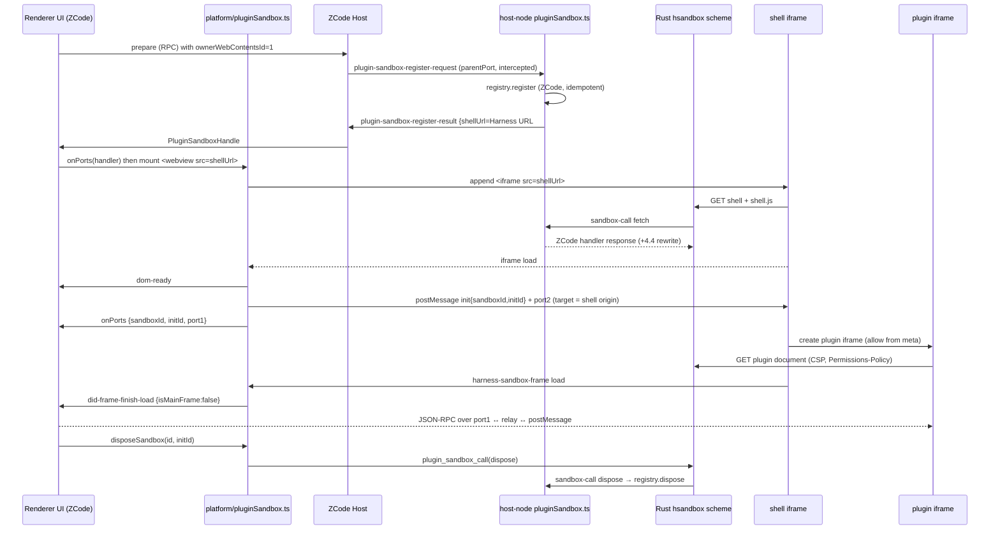

# Phase 5 (B): Plugins, plugin UI sandbox, MCP apps, CUA

Status: active implementation contract. Owner: Phase 5 agent B. Agent A owns the embedded browser
(`phase-5-browser*.md`); nothing here touches browser files.

ZCode reference (read-only, bundled unchanged where noted):

- `packages/desktop/src/main/pluginSandbox/` — registry, CSP, protocol handler, Gen UI vendor
  resources, and the security contract `CONTRACT.md`.
- `packages/desktop/src/renderer/src/plugin-sandbox/relay.ts` — the trusted relay shell logic.
- `packages/ui/src/plugin-ui/adapters/pluginUiPagePlane.ts` — the UI side that mounts a
  `<webview data-zcode-retained-sandbox>` per sandbox and listens to guest events.
- `packages/shared/src/mcp-apps/contract.ts` — `PluginSandboxPlatformPort`, register payloads.
- `packages/services/src/plugins/pluginManagement*.ts` — the plugin management service
  (`plugin-management` channel), a thin pass-through to the Agent CLI.

## 1. Product rules

1. Plugin installation, marketplaces, enable/disable, uninstall, skills, hooks and MCP servers keep
   living in the JS ecosystem (Host + Agent CLI), unchanged. Harness adds no plugin business logic.
2. Plugin UI (MCP Apps and Gen UI) renders in a sandbox that is at least as strict as ZCode's
   `CONTRACT.md`: separate origin per trusted app identity, no Host token, no Tauri IPC,
   no `window.zcode`, strict CSP and Permissions-Policy, no cache, no top navigation.
3. Anything Harness cannot match is marked `degraded` or `unavailable` in the matrix and fails
   closed (the UI already shows ZCode's own fallback text).
4. CUA stays the ZCode fail-closed placeholder (`packages/zcode-cua`): "Computer Use is not
   available in this build." Harness runs the same CLI, so the behavior is identical.

## 2. Feature matrix

Platforms: Windows = WebView2 (verified by the gate, including the real GUI step P6). macOS
(WKWebView) and Linux (WebKitGTK) are built from the same code but not exercised here. Plugin UI is
**disabled** there (the renderer sets no `pluginSandbox` port, so ZCode shows its own "unsupported"
UI): Tauri treats any origin whose scheme is a registered URI scheme as local
(`Webview::is_local_url`), so a `hsandbox://` guest that reached IPC would be trusted (6.1).

| Feature | ZCode (Electron) | Harness Windows | Harness mac / Linux | Status | Fallback / note |
| --- | --- | --- | --- | --- | --- |
| Marketplace browse / add / remove / refresh | Host → Agent CLI (`plugin-management`) | Same Host + CLI, unchanged | same code, untested | parity | — |
| Plugin install / list / enable / disable / uninstall | Agent CLI writes `~/.zcode` plugin dirs | Same | untested | parity | Gate checks install → list → disable → enable → uninstall on a local directory marketplace |
| Skills, hooks, commands, subagents from plugins | Agent CLI | Same | untested | parity | — |
| Plugin MCP servers, MCP user directory | Agent CLI / Main helper | CLI unchanged; user directory = Phase 4 fix B | untested | parity | — |
| MCP App UI (`ui://` resources) | `<webview>` guest on `zcode-sandbox://`, own partition | `<iframe>` shell on `hsandbox://` (Windows: `http://hsandbox.*.localhost`), one WebView2 profile | disabled (unsupported UI) | parity (security), degraded (storage partition) | Storage is isolated by origin (`plugin-<h32>`), not by a separate profile; see 6.4 |
| Gen UI documents | same sandbox, `gen-ui-<id>` partition | same as above | disabled | parity | Vendor CDN URLs in the HTML are served from the bundled vendor files (no network) |
| Guest JS globals | none (Electron guest has no preload) | `__TAURI_INTERNALS__` and `window.ipc` objects exist in both frames (wry injects init scripts into every WebView2 frame) but every IPC path is dead: `ipc.localhost` fetch blocked by CSP, postMessage from a subframe is never delivered, origin is non-local | — | deviation (no privilege) | Needs sign-off. Gate P6 calls `host_status` and `host_open_attachment` from both frames: no answer, no extra Host attachment |
| Sandbox registry (idempotency, quota 64, TTL 6h, `initId`) | Main | ZCode `registry.ts` bundled unchanged into host-node | same | parity | Gate compares handles with ZCode directly |
| Plugin / shell CSP, Permissions-Policy, `Cache-Control: no-store`, 404 rules | Main protocol handler | ZCode `protocol.ts`/`csp.ts` bundled unchanged; only the origin tokens are rewritten | same | parity | Gate asserts every other directive byte-identical |
| Permission prompts (camera / microphone / geolocation declared by a resource) | Main permission gate, first-use dialog | Blocked by Permissions Policy: the renderer's shell iframe delegates only `clipboard-write`, so the shell cannot forward camera / microphone / geolocation even when the record's `allow` lists them | disabled | unavailable (stricter) | Needs sign-off. No global WebView2 permission handler (ZCode's speech input needs the microphone in the main renderer). `clipboard-write` keeps parity (granted by declaration in ZCode too) |
| User gesture tokens (`consumeUserGesture`) | Guest input events, 5 s, single use | Renderer: window `blur` while the sandbox iframe is `activeElement` + `navigator.userActivation.isActive`, 5 s, single use per focus | disabled | degraded | Needs sign-off. A false result makes ZCode show its confirm dialog |
| Retained moves (`moveBefore`) | preload patches `<webview>` | Native `moveBefore`; a no-op `connectedMoveCallback` on each adopted element | disabled | parity (Win) | Gate P6: moved, no reload event, frame still attached. UI re-mounts when `moveBefore` is missing (ZCode's own path) |
| `copyImage` (copy plugin page as image) | `capturePage` | not provided | not provided | unavailable | UI shows "Image capture is not supported by this desktop version" |
| `setExecutionActive` (background execution of hidden MCP pages) | Main keeps guest unthrottled | not provided | not provided | degraded | Hidden pages may be throttled by WebView2 |
| Clear plugin browser data (Settings → clear all data) | Clears sandbox partitions | not provided | not provided | unavailable | Plugin `localStorage` persists until the WebView2 profile is cleared |
| Guest crash → card error state | `render-process-gone` | shell / plugin reload detected as navigation → crash | same | degraded | A renderer-process crash of a cross-site frame is not observable; reload is |
| CUA (Computer Use) | placeholder | same placeholder | same | unavailable (both) | "Computer Use is not available in this build." |
| Web (browser) client plugin UI | unsupported | unsupported (mobile surface sets no `pluginSandbox`) | — | parity | — |

## 3. Owners

| State | Owner | Notes |
| --- | --- | --- |
| Installed plugins, marketplaces, enablement | Agent CLI (`~/.zcode`) | unchanged |
| Sandbox records (html, CSP, permissions, TTL, gestures) | host-node `pluginSandbox.ts` → bundled ZCode registry | single owner; replaces Electron Main |
| Sandbox HTTP serving | host-node (ZCode protocol handler); Rust `hsandbox` scheme only forwards bytes | Rust keeps no sandbox state |
| Renderer port pair, frame lifecycle | renderer `platform/pluginSandbox.ts` | per mounted `<webview>` element |
| JSON-RPC protocol state with the plugin | ZCode UI AppBridge (unchanged) | relay never parses messages |

## 4. Interfaces

### 4.1 Host → host-node (intercepted, never reaches Rust)

`plugin-sandbox-register-request` (ZCode schema `hostPluginSandboxRegisterRequestResponseSchema`).
host-node validates it, checks `ownerWebContentsId === 1` (one window per Host, the value
`getOwnerWebContentsId()` returns), calls `registry.register`, and answers on the Host's parent
port with `plugin-sandbox-register-result` (strict ZCode schema). `shellUrl` is the Harness URL
(4.3) with `#init=<initId>`; every other field is the registry handle unchanged. Errors,
including `PluginSandboxQuotaError`, answer `ok:false` with the message.

The Rust fallback (`fallback.rs`, "plugin UI sandbox is not available") stays as a fail-closed
answer for a sidecar that lacks the module.

### 4.2 Shell ↔ host-node (`harness-web-remote-sandbox-*`)

Uses the existing `harness-web-remote-` prefix so the controller and classifier accept it
unchanged; host-node routes these two types to `pluginSandbox.ts`, never to the Host or the
web-remote manager.

```
→ {type:"harness-web-remote-sandbox-call", id, method, params}
← {type:"harness-web-remote-sandbox-result", id, ok, value | error}
```

| method | params | value |
| --- | --- | --- |
| `fetch` | `{url, method, embedderOrigin}` | `{status, headers: [[k,v]...], bodyBase64}`; a body above 14 MiB of base64 answers 413 (stdio line bound) |
| `dispose` | `{sandboxId, initId?}` | `null` |
| `resetOwner` | `{}` | `null`: `registry.disposeOwner(1)`; the renderer calls it at startup (a reload = Electron owner webContents destroyed) |
| `stats` | `{}` | registry size (gate only) |

Rust: `src-tauri/src/plugin_sandbox.rs` owns the `hsandbox` URI scheme
(`register_asynchronous_uri_scheme_protocol`), the call correlation map (30 s timeout), and the
Tauri command `plugin_sandbox_call(method, params)` whose allowlist is `dispose` and `resetOwner`
only (the renderer can never call `fetch` or `stats`). Scheme requests are accepted only from the
`main` webview label (else 403); `embedderOrigin` is that webview's current URL origin; a channel
error answers 502.

### 4.3 URLs and origins

`h32` = first 32 hex characters of the 64-hex `appIdentity` (a DNS label must stay ≤ 63 chars).

| Doc | ZCode | Harness (Windows) | Harness (mac / Linux) |
| --- | --- | --- | --- |
| shell | `zcode-sandbox://shell-<appIdentity>/instance/<id>/` | `http://hsandbox.shell-<h32>.localhost/instance/<id>/` | `hsandbox://shell-<h32>.localhost/instance/<id>/` |
| plugin | `zcode-sandbox://plugin-<appIdentity>/instance/<id>/index.html` | `http://hsandbox.plugin-<h32>.localhost/...` | `hsandbox://plugin-<h32>.localhost/...` |

host-node maps a Harness URL back to the ZCode URL only after checking that `h32` is the prefix
of the record's `appIdentity`; any mismatch is a 404 (ZCode's own host check then runs as well).

### 4.4 Header rewrite (the only deviation from ZCode's bytes)

- Plugin CSP: `frame-ancestors <zcode shell origin>` → `frame-ancestors <harness shell origin>
  <embedderOrigin>`. CSP `frame-ancestors` checks every ancestor; in Harness the renderer is an
  ancestor, in ZCode the shell is top-level.
- Shell CSP: `frame-src zcode-sandbox:` → `frame-src <harness plugin origin of this record>`
  (stricter than ZCode, which allows the whole scheme) and appends
  `frame-ancestors <embedderOrigin>`.
- All other directives, `Permissions-Policy`, `X-Content-Type-Options`, `Cache-Control: no-store`
  stay byte-identical. The gate asserts this.

### 4.5 Harness shell document

ZCode's shell HTML is a Vite build product that Harness does not have, and ZCode's shell accepts
`init` only from the preload (`event.source === window`). Harness serves its own shell:

- `/instance/<id>/` → the ZCode handler serves `plugin-sandbox.html` from a virtual renderer dir
  (`<vendorDir>/harness-plugin-sandbox-shell`) that holds only the Harness shell HTML and
  `assets/harness-shell.js`; any other path under it is 404. host-node injects
  `<meta name="harness-sandbox" content="{sandboxId, embedderOrigin, pluginOrigin, pluginUrl, allow}">`
  (HTML-escaped JSON); same shell CSP (4.4). The record is pinned on the first shell document.
- `assets/harness-shell.js` = `sidecars/host-node/vendor/pluginSandboxShell.entry.ts` bundled with
  ZCode's `relay.ts` unchanged (`dist-vendor/pluginSandboxShell.js`). It accepts exactly one `init` with one port, only from `window.parent` with
  `event.origin === embedderOrigin`; `allow` comes from the meta tag (registry-derived via
  `buildMcpAppsIframeAllow`), never from the message. Plugin frame messages are accepted only from
  the plugin frame's `contentWindow` with the plugin origin, as in ZCode.
- It reports to the parent (`embedderOrigin` only): `{type:"harness-sandbox-frame", event:"load"|"navigate"}`.

### 4.6 Renderer port (`apps/harness-app/src/platform/pluginSandbox.ts`)

Implements `PluginSandboxPlatformPort` for the Windows desktop shell only
(`harnessPluginSandboxSupported()`; mobile and macOS/Linux get no port):

- `getOwnerWebContentsId()` → `1`.
- `disposeSandbox` → `plugin_sandbox_call("dispose", {sandboxId, initId?})`; at startup it calls
  `plugin_sandbox_call("resetOwner")`.
- `supportsRetainedMove` → `Element.prototype.moveBefore` exists; then a no-op
  `connectedMoveCallback` is defined on each adopted element (as ZCode's preload does).
- A `MutationObserver` adopts only `webview[data-zcode-retained-sandbox]` elements whose `src` is a
  shell origin (`http://hsandbox.shell-<h32>.localhost` / `hsandbox://shell-<h32>.localhost`) with
  `#init=N`: it appends an `<iframe sandbox="allow-scripts allow-same-origin allow-forms"
  allow="clipboard-write" referrerpolicy="no-referrer">` with the shell URL, forwards `focus()`, and dispatches the Electron-shaped events the UI
  listens to (`dom-ready`, `did-frame-finish-load {isMainFrame:false}`,
  `did-start-navigation {isMainFrame, isInPlace:false, url:""}`).
- No `copyImage`, no `setExecutionActive` (matrix).

## 5. Event order



## 6. Security design

1. **No privileged surface in the guest.** Measured, not assumed (gate P6). Tauri marks its init
   scripts `for_main_frame_only`, but wry 0.57's WebView2 backend adds every script with
   `AddScriptToExecuteOnDocumentCreated`, which runs in all frames, so both iframes **do** see
   `__TAURI_INTERNALS__` and `window.ipc`. They give no privilege on Windows, for three independent reasons:
   (a) the custom-protocol path (`http://ipc.localhost`) is blocked by the shell's
   `connect-src 'none'` and by ZCode's plugin CSP; (b) the postMessage fallback calls
   `chrome.webview.postMessage`, which in a subframe raises `CoreWebView2Frame.WebMessageReceived`,
   and wry subscribes only to the top-level `CoreWebView2.WebMessageReceived`, so the message is dropped;
   (c) even if a request arrived, `is_local_url` is false for `http://hsandbox.<kind>-<h32>.localhost`
   (the domain minus `.localhost` is not a registered scheme name) and no capability lists a remote
   URL. The gate calls `host_status` and `host_open_attachment` from both frames: both stay
   unanswered and the Host log shows no extra attachment. On macOS/Linux (b) and (c) do not hold
   (the scheme name `hsandbox` is registered, so the origin is local), which is why plugin UI is
   disabled there. `window.zcode` and `__TAURI__` do not exist. The Host WebSocket token lives only
   in the renderer's module scope. Shell and plugin are cross-site to the renderer
   (`hsandbox.*.localhost` vs `localhost:1430` / `tauri.localhost`): `top.document` and
   `parent.location` throw (gate P6).
2. **Navigation.** Both iframes are sandboxed without `allow-top-navigation` / `allow-popups`.
3. **Origins.** Origin = `shell-<h32>` / `plugin-<h32>`; record lookup by `sandboxId` plus the
   `h32` prefix check stops cross-instance reads (ZCode's rule).
4. **Storage (degraded).** One WebView2 profile: origin isolation instead of partition isolation.
   Cookies cannot be set for `localhost` from a subdomain in Chromium; `connect-src 'none'`
   blocks credentialed requests by default.
5. **Permissions.** The renderer's shell iframe has `allow="clipboard-write"` only, so Permissions
   Policy disallows camera, microphone and geolocation in the shell and in every plugin frame
   (gate P6: `allowsFeature` false, `getUserMedia` → `NotAllowedError`, geolocation error 1). The
   plugin frame gets `clipboard-write` only when the record declares it (the shell's `allow` comes
   from `buildMcpAppsIframeAllow`). The plugin document's own `Permissions-Policy` header stays ZCode's.
6. **Gesture (degraded).** `consumeUserGesture(id)` is true only if the sandbox's iframe holds
   focus, the window has transient activation, the focus entry is ≤ 5 s old, and the token was not
   consumed since.

## 7. Acceptance scenarios (gate `scripts/e2e/phase5-plugins.mjs`)

Prints `PHASE5_PLUGINS_OK`. Uses `installIsolatedHome("phase5-plugins")`, a local directory
marketplace fixture, no network, no real marketplace.

1. P1, sandbox parity in process: the Harness owner and ZCode Main's registry and protocol handler
   (the same bundled code) get identical registrations. Handles are equal except `sandboxId` and
   `shellUrl`. The plugin document body and alias bytes are identical; headers are identical except 4.4.
2. P2, protocol contract: idempotent re-register; foreign owner and missing provenance rejected;
   quota error at index 64 identical to ZCode's; wrong `h32`, unknown sandbox, short host, foreign
   scheme, no instance, other shell path or traversal → 404; POST → 405; bad embedder origin
   rejected; stale `initId` keeps the record, matching `initId` removes it; Gen UI equal to ZCode
   after the vendor rewrite (3 URLs, vendor file served); rejection after `dispose()`.
3. P3, guest documents: no Tauri / IPC / Host-token / ws-port markers in any served document;
   shell `connect-src 'none'`; plugin CSP never lists `ipc:` / `localhost`.
4. P4, real host-node sidecar + ZCode Host: Gen UI `prepareSandbox` over RPC is answered by the
   sidecar owner (no register request reaches the Rust side); shell and plugin are fetched over the
   sandbox channel; foreign owner rejected; dispose → 404; unknown method rejected.
5. P5, plugin lifecycle over the real `plugin-management` RPC with a local directory marketplace:
   add marketplace → install → list (enabled) → disable → enable → uninstall → remove marketplace.
   Each step is checked against the on-disk facts under the isolated home (`installed_plugins.json`,
   `config.json` `plugins.enabledPlugins`). Harness runs ZCode's own Host and CLI unchanged, so
   this is the ZCode TS code path itself.
6. P6, real GUI (Windows, runs by default; `HARNESS_PHASE5_GUI=0` skips it explicitly). Launch the
   debug app + vite with an isolated WebView2 profile and a local 404 "cloud". Attach a node client
   to the app's Host once the renderer's attachment is active. Gen UI `prepareSandbox` → mount
   `webview[data-zcode-retained-sandbox]` → `dom-ready` + `did-frame-finish-load(sub)`. In
   both frames check: no `__TAURI__` / `window.zcode`, guest `invoke` unanswered, `top.document` and
   `parent.location` throw, `ipc.localhost` and `ipc://` fetch blocked, camera / microphone /
   geolocation disallowed and failing. Then: fixture text rendered; `moveBefore` without reload;
   `plugin_sandbox_call(dispose)` → the shell URL is no longer served; `plugin_sandbox_call(fetch)`
   rejected; screenshot `.work/phase5/plugins-gui.png`; graceful window close with exit 0.

## 8. Needs sign-off

- Declared camera / microphone / geolocation are unavailable (stricter than ZCode).
- Gesture token heuristic (6.6).
- Storage isolation by origin within one profile; no "clear plugin data" action.
- No `copyImage` / `setExecutionActive`.
- Tauri globals present but inert in guest frames on Windows (6.1); a wry fix (honouring
  `for_main_frame_only` on WebView2) would remove them.
- Plugin UI disabled on macOS/Linux until guest IPC there is proven dead (6.1).
