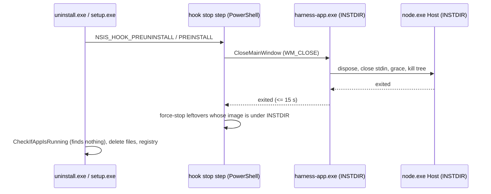

# Phase 6 (agent A): bundled Node, installers, signing, install and uninstall

Status: active implementation contract. Owner: release packaging
(`Worse/scripts/package/*`, `Worse/scripts/stage-sidecar-resources.mjs`, the `bundle` sections of
`apps/harness-app/src-tauri/tauri*.conf.json`, `src-tauri/windows/*`, `src-tauri/macos/*`, Node
resolution in `src-tauri/src/host/{node,layout,launch}.rs`, gate `scripts/e2e/phase6-package.mjs`).
The updater (`plugins.updater`, the updater module and capabilities, `bundle.createUpdaterArtifacts`,
`scripts/e2e/phase6-update.mjs`) belongs to agent B and is out of scope here.

Builds on [phase-3c-packaging-tools.md](./phase-3c-packaging-tools.md), which is still the
authoritative `host/` layout. This spec only adds `host/runtime/node/` to it, and replaces the
Phase 6 plan paragraph in [desktop-window-and-packaging.md](./desktop-window-and-packaging.md)
section 2.3.

## 1. Installer build command (contract for agent B)

```text
node Worse/scripts/package/build-installer.mjs --version <semver> [--bundles nsis] [--config <file>]...
```

- Runs the full `tauri build` (frontend, sidecar, release `harness-host`, Node runtime fetch,
  staging, signing of staged resources, bundling) with `version` overridden through a generated
  `--config` file. `tauri.conf.json` keeps `0.1.0`; the override never touches it.
- Always a release build: the signing policy (section 5) applies. Without certificates, set
  `HARNESS_ALLOW_UNSIGNED=1`, otherwise the command fails before compiling anything.
- `--bundles` defaults to the OS default (`nsis` on Windows, `app,dmg` on macOS,
  `appimage,deb,rpm` on Linux).
- `--config <file>` (repeatable) passes extra Tauri config files after the generated override, in
  order (Tauri CLI merge semantics), for example an updater override. The generated override lives
  in `Worse/.work/tmp/package/` and is deleted after the build.
- Builds share `Worse/target`; the script takes the lock file `Worse/.work/tmp/package/build-lock.json`
  and waits (up to 30 min) for another build to finish, so agents A and B can call it concurrently.
  Callers never retry on lock errors. Build lock contract (`scripts/package/buildLock.mjs`, regression
  test `node --test Worse/scripts/package/test/buildLock.test.mjs`):
  - Acquire is atomic: the owner record `{pid, startedAt, token, acquiredAt}` is written to a unique
    temp file and hard-linked to the lock path (`EEXIST` = held), so the lock never exists without
    its content. `startedAt` is the OS creation time of the owner (Windows `Win32_Process.CreationDate`,
    Linux `/proc/<pid>/stat` starttime, otherwise `ps -o lstart`).
  - Release removes the file only while it still carries the caller's token (also on `exit`).
  - Stale = pid gone, or pid alive with a different creation time (pid reuse). A stale lock is removed
    only under the exclusive `build-lock.json.break` file, and only if the lock file still holds the
    exact bytes that were judged stale, so a lock created after that judgement is never removed. If a
    breaker dies inside that millisecond window, its break file is cleared by the same pid + creation
    time rule.
  - Waiting is event-driven (directory watch), with a liveness re-check every 30 s for crashed owners.
  - The pre-fix lock (`build.lock/` directory + `owner.json`) could be removed by a stale-lock breaker
    while another build was writing `owner.json` (`ENOENT`), and released by deleting whatever lock
    was there.
- Extra environment (for example `TAURI_SIGNING_PRIVATE_KEY` for updater artifacts) is passed
  through untouched.
- Last stdout line on success: `HARNESS_BUNDLE_OK {"version":...,"artifacts":[{"bundle":"nsis","path":...,"bytes":...}]}`.
  On Windows the NSIS artifact is
  `Worse/target/release/bundle/nsis/Harness_<version>_x64-setup.exe`.

Silent install for tests: `Harness_<v>_x64-setup.exe /S /NS /D=<absolute dir>` (per-user, no
shortcuts, `/D` last and unquoted). Silent uninstall: `<dir>\uninstall.exe /S` (the uninstaller
re-launches itself from `%TEMP%` and returns at once; wait for `<dir>` to disappear).

## 2. Bundled Node runtime

### 2.1 Version, source, verification, cache

| Item | Rule |
| --- | --- |
| Version | `mise.toml` `[tools] node` (currently `24.14.0`). `scripts/package/node-runtime.lock.json` repeats it; the fetch script fails if they differ. The Host requires Node >= 24 (`node:sqlite`). |
| Source | Official distribution only: `https://nodejs.org/dist/v<version>/node-v<version>-<os>-<arch>.<ext>` (`win-x64.zip`, `win-arm64.zip`, `darwin-x64.tar.gz`, `darwin-arm64.tar.gz`, `linux-x64.tar.xz`, `linux-arm64.tar.xz`). |
| Verification | Two independent checks, both fail closed: the archive SHA-256 must equal the value pinned in `node-runtime.lock.json` (committed, copied from the release's `SHASUMS256.txt`), and must equal the line for that file in the freshly downloaded `SHASUMS256.txt`. After extraction `node --version` must print `v<version>`. GPG verification of `SHASUMS256.txt.sig` is an open item (needs the Node release keyring in CI). |
| Cache | `HARNESS_NODE_CACHE_DIR`, else `Worse/.work/cache/node-runtime/` (gitignored). Layout: `<cache>/v<version>/<archive>` and `<cache>/v<version>/<platform>-<arch>/{node(.exe),LICENSE,verified.json}`. A cached, verified runtime is reused without network access; `verified.json` holds the archive and binary SHA-256. |
| Producer | `node Worse/scripts/package/fetch-node-runtime.mjs [--platform <p> --arch <a>]`. Fetches only; it never writes into `host/`. |
| Extraction | Only `node(.exe)` and `LICENSE` are extracted (Windows: `%SystemRoot%\System32\tar.exe`, which reads zip; Unix: `tar`). npm, npx and corepack are not shipped, matching ZCode, which ships none of them. |

### 2.2 Layout

`stage-sidecar-resources.mjs` stays the only producer of `host/`. It copies the verified cached
runtime for the build platform into:

```text
host/runtime/node/node(.exe)      bundled Node binary
host/runtime/node/LICENSE         Node.js license (includes bundled third-party notices)
```

Staging fails, naming the fetch command, when the cached runtime is missing, when its binary
SHA-256 does not match `verified.json`, or when `--version` is wrong. `--skip-node` stages without
it, for dev-only layouts. `harness-host-manifest.json` gains `nodeRuntime`
(`{version, path, sha256, archive, archiveSha256, source, license}`). A cached runtime is valid
only when its `verified.json` records the archive SHA-256 currently pinned in the lock and the
binary still matches its recorded SHA-256.

Staging also fails when a staged entry imports a workspace package (`@zcode/*` resolving outside
`node_modules`). That happens when `tsc -b` (for example `pnpm typecheck`) has overwritten the tsup
bundle in `packages/desktop/out/host`: the staged copy would hold `.ts` sources under
`host/node_modules`, which Node refuses to type-strip (`ERR_UNSUPPORTED_NODE_MODULES_TYPE_STRIPPING`),
so the packaged Host could not start. The error names the tsup rebuild command.

### 2.3 Who uses which Node

| Process | Node used |
| --- | --- |
| Shell -> Host sidecar | `src-tauri/src/host/node.rs`, order: `HARNESS_NODE_BIN` -> `<layout root>/runtime/node/node(.exe)` -> `node` on `PATH`. Each candidate must report major >= 24. The source (`explicit`, `bundled`, `path`) is logged at info. A packaged layout without the bundled binary logs a warning and falls back to `PATH`. |
| Host -> agent CLI (`zcode.cjs app-server`) | ZCode's own resolver runs it with `process.execPath`, which is the Node that runs the Host. So the agent uses the bundled runtime in packaged builds and the `PATH` Node in dev, with no change to ZCode code. |
| Host -> rust-bridge -> `harness-host` | Native binary; no Node. |
| Agent shell tools, MCP stdio servers, terminals | The user's `PATH`, unchanged. The bundled directory is never prepended to `PATH`, so Harness does not shadow the user's own `node`/`npm` (ZCode's Electron runtime is not on `PATH` either). |

In a dev checkout `<checkout>/runtime/node` does not exist, so the order falls through to `PATH`.
`HARNESS_REPO_ROOT=<staged dir>` uses the staged runtime.

### 2.4 Licenses

Node.js is MIT-licensed; its `LICENSE` file (with the notices of its bundled dependencies) ships
next to the binary and is recorded in the manifest. The other staged packages keep their own
license files (staging copies whole package directories).

## 3. Installer targets

| OS | Targets | Config | Status |
| --- | --- | --- | --- |
| Windows x64 | NSIS, per-user (`installMode: currentUser`, default `%LOCALAPPDATA%\Harness`), WebView2 download bootstrapper, hooks `src-tauri/windows/installer-hooks.nsh` | `tauri.windows.conf.json` | built and verified by the gate. MSI is not built (per-machine, needs WiX). |
| macOS 13+ | `app`, `dmg`; hardened runtime; `minimumSystemVersion 13.0`; entitlements `src-tauri/macos/Entitlements.plist` | `tauri.macos.conf.json` | config only, **untested** (needs a Mac). No ZIP target in tauri-bundler; the updater's `.app.tar.gz` (agent B) replaces ZCode's ZIP. |
| Linux x64/arm64 | `appimage`, `deb`, `rpm` (WebKitGTK 4.1 is a system dependency) | `tauri.linux.conf.json` | config only, **untested**. |
| Arch Linux | none | - | out of scope (tauri-bundler has no pacman target; an AUR script is future work). |

`tauri.conf.json` keeps `targets: "all"` only as the generic default; each desktop platform file
overrides `bundle.targets`.

## 4. Native resources inside `host/`

Tauri signs the main executable, external binaries and the installer, but not files under
`resources`. Executables inside `host/` (`runtime/node/node.exe`, `harness-host.exe`,
`OpenConsole.exe`, `conpty.dll`, `rg.exe`, `ugrep.exe`, `*.node`) are therefore signed by
`scripts/package/sign-staged-resources.mjs`, which runs after staging inside `beforeBuildCommand`
(section 5.2). Staging itself never signs.

## 5. Signing pipeline

### 5.1 Policy (single module `scripts/package/signing-policy.mjs`)

| Mode | When | No credentials | Credentials present |
| --- | --- | --- | --- |
| release | `HARNESS_RELEASE=1` or `CI=true` (`build-installer.mjs` always sets `HARNESS_RELEASE=1`) | **fail** before building, unless `HARNESS_ALLOW_UNSIGNED=1`, then build unsigned and print `UNSIGNED BUILD` | sign; a signing or verification failure fails the build |
| local | anything else (plain `pnpm tauri build`) | skip with a notice | sign |

Rules: no certificate, key or password is ever stored in the repository or printed; scripts read
them from the environment only. A self-signed test certificate may be created only under
`Worse/.work/tmp` for a local dry run and must be deleted afterwards; it is never configured as a
release identity.

### 5.2 Windows Authenticode

| Variable | Meaning |
| --- | --- |
| `HARNESS_WINDOWS_SIGN_COMMAND` | custom signer (cloud HSM, Azure Trusted Signing); `{file}` is replaced with the quoted path |
| `HARNESS_WINDOWS_CERT_THUMBPRINT` | certificate in the user/machine store (`signtool /sha1`) |
| `HARNESS_WINDOWS_CERT_FILE` + `HARNESS_WINDOWS_CERT_PASSWORD` | PFX file (`signtool /f /p`) |
| `HARNESS_WINDOWS_TIMESTAMP_URL` | RFC 3161 timestamp server (default `http://timestamp.digicert.com`) |
| `HARNESS_SIGNTOOL` | path to `signtool.exe` (default: newest Windows 10/11 SDK) |

Flow: `sign-staged-resources.mjs` signs every unsigned PE file in `host/` (files that already carry
a valid vendor signature, such as the official `node.exe` and Microsoft's `OpenConsole.exe`, keep
it). When signing, `build-installer.mjs` adds `bundle.windows.signCommand` =
`{ "cmd": "node", "args": ["<abs>/scripts/package/sign-file.mjs", "%1"] }` to its generated
override (absolute path, so it does not depend on the makensis working directory), and Tauri calls it
for `harness-app.exe`, the uninstaller and the installer. Without credentials no sign command is
configured. A plain `tauri build` signs `host/` (local mode, when credentials exist) but not the
shell or the installer; release signing always goes through `build-installer.mjs`. Every signature is SHA-256 with an RFC
3161 timestamp and is verified with `Get-AuthenticodeSignature` (`Valid`; a test-only
`HARNESS_SIGN_ALLOW_UNTRUSTED=1` accepts an untrusted root).

### 5.3 macOS Developer ID and notarization (untested)

Tauri reads `APPLE_SIGNING_IDENTITY` (+ `APPLE_CERTIFICATE`/`APPLE_CERTIFICATE_PASSWORD` to import
into a temporary keychain) and notarizes with `APPLE_API_KEY`/`APPLE_API_ISSUER`/`APPLE_API_KEY_PATH`
or `APPLE_ID`/`APPLE_PASSWORD`/`APPLE_TEAM_ID`. Release mode requires the identity and one complete
notarization set. `sign-staged-resources.mjs` signs every Mach-O file in `host/` first with
`codesign --force --timestamp --options runtime`; `node` and `harness-host` get
`src-tauri/macos/node-entitlements.plist` (`allow-jit`, `allow-unsigned-executable-memory`,
`disable-library-validation` for `.node` addons). Plan default kept: no ZIP, DMG + updater tarball.

### 5.4 Linux (untested)

`HARNESS_LINUX_GPG_KEY` (key id) + optional `HARNESS_LINUX_GPG_PASSPHRASE`: after bundling,
`build-installer.mjs` writes detached ASCII signatures (`<artifact>.asc`) for AppImage, deb and
rpm, and runs `rpmsign --addsign` when `rpmsign` exists. Repository-level signing (apt/yum metadata)
is a distribution concern outside this repo. **Needs sign-off**: detached signatures vs embedded
AppImage signatures.

## 6. Install, uninstall and data rules

### 6.1 What the Windows installer writes (per-user)

| Item | Install | Uninstall |
| --- | --- | --- |
| `<INSTDIR>` (default `%LOCALAPPDATA%\Harness`) | app + `host/` | removed |
| `HKCU\Software\Microsoft\Windows\CurrentVersion\Uninstall\Harness` | Add/Remove Programs entry | removed (Tauri) |
| `HKCU\Software\Harness\Harness` (default value = install dir) | written (Tauri) | removed by the post-uninstall hook unless `/UPDATE` (Tauri leaves it otherwise) |
| Start Menu `Harness.lnk` | interactive and silent installs; **not** with `/NS` | removed |
| Desktop `Harness.lnk` | silent/passive installs; **not** with `/NS` | removed |
| `HKCU\...\Run\Harness` | never written by Harness | deleted if present (Tauri) |
| Program Files, HKLM | never (per-user mode) | - |

### 6.2 Data

- User data lives in `~/.zcode` (shared with ZCode) or in the custom data directory. **Uninstall
  never deletes it**, not even with the uninstaller's "Delete the application data" box: that box
  only removes Harness's own shell data (`%APPDATA%\dev.harness.app`, `%LOCALAPPDATA%\dev.harness.app`:
  logs, WebView2 profile, `device-mid`). Deleting `~/.zcode` would also delete the user's ZCode data;
  doing it on opt-in is **needs sign-off** and is not implemented.
- Install and update never write into `~/.zcode`.

### 6.3 Processes

- Exit: the window close barrier (desktop-window-and-packaging.md 1.4) disposes the Host, which
  disposes the agent CLI and `harness-host`; nothing outlives the shell.
- Install, update and uninstall: `installer-hooks.nsh` (pre-install and pre-uninstall) runs
  an inline PowerShell stop step (directory passed as `HARNESS_STOP_DIR`; inline because Tauri copies
  the hooks file into its build directory, so a sibling script file cannot be referenced) before
  Tauri's own running-app check. It asks every `harness-app.exe` whose
  image lives in `<INSTDIR>` to close (`CloseMainWindow`, so the barrier runs), waits up to 15 s,
  then force-stops what is still running from `<INSTDIR>` (the shell, `node.exe`, `harness-host.exe`,
  `OpenConsole.exe`, `rg.exe`). It never touches processes outside `<INSTDIR>`.



### 6.4 Coexistence with ZCode

Different identifier (`dev.harness.app`), product name, install directory, uninstall key and Start
Menu entry; Harness registers no `zcode://` protocol. Both apps can be installed together and
uninstalling one leaves the other. They share the user data in `~/.zcode` (by design, "works like
ZCode"); running both at the same time on the same data is not supported, which is the same rule
as running two ZCode instances (open item).

### 6.5 Custom data directory parity (fixed)

ZCode Main reads `dataBaseDir` from `<home>/.zcode/v2/setting.json` at startup
(`desktopDataBaseDirBootstrap.ts`) and passes it to its Host as `ZCODE_DATA_BASE_DIR`
(`buildHostProcessEnv`). The Harness shell did not, so a user who moved their data in ZCode saw an
empty Harness. Now `launch.rs`, before each Host spawn:

1. reads `<home>/.zcode/v2/setting.json` (home = `ZCODE_DESKTOP_HOME_DIR` -> `HOME` -> `USERPROFILE`,
   the same order as ZCode's `settingService`, so it reads the file the Host writes);
2. if `dataBaseDir` is a non-empty string, sets `ZCODE_DATA_BASE_DIR` for the Host (overriding an
   inherited value, as ZCode's `setDataBaseDir` does); otherwise the inherited value, if any, stays;
3. a missing or invalid file means "no custom directory" (ZCode behaves the same).

In a packaged Windows layout the shell also sets `ZCODE_WINDOWS_APP_INSTALL_DIR` to the install
directory, so ZCode's `validateDataBaseDirTarget` refuses moving data into the Harness install dir
(it already refuses ZCode's own). Changing the directory still requires a restart, as in ZCode.

## 7. Acceptance scenarios

| ID | Scenario | Evidence |
| --- | --- | --- |
| A1 | Fetch verifies the pinned SHA-256 and `SHASUMS256.txt`; a tampered archive or lock entry fails | `fetch-node-runtime.mjs` (manual tamper check recorded in `.work/phase6/packagingA.md`) |
| A2 | Staging places `host/runtime/node/node(.exe)` + `LICENSE`, manifest records it; missing cache fails naming the fetch command | `stage-sidecar-resources.mjs`, gate |
| A3 | Resolver order explicit -> bundled -> PATH, version floor | `cargo test -p harness-app` (`host::node`, `host::layout`) |
| A4 | Release build without signing credentials fails closed; with `HARNESS_ALLOW_UNSIGNED=1` it builds | `build-installer.mjs` run without the variable (expected failure) and the gate |
| A5 | Signing hook signs and verifies a file with a throwaway self-signed certificate under `.work/tmp` (removed afterwards) | manual dry run recorded in `packagingA.md` |
| A6 | Windows: silent per-user install into `Worse/.work/tmp`, launch with no `node` on `PATH`, Host starts on the bundled Node (log + process image path), graceful exit, silent uninstall, no leftover processes, install dir and registry entries removed, no shortcuts created, isolated user data kept, real `~/.zcode` unchanged | `node Worse/scripts/e2e/phase6-package.mjs` -> `PHASE6_PACKAGE_OK` |
| A7 | Custom data dir: `setting.json` `dataBaseDir` reaches the Host as `ZCODE_DATA_BASE_DIR` | gate (writes `dataBaseDir` into the isolated home and checks the Host created `<dir>/.zcode`) |
| A8 | macOS DMG / Linux AppImage, deb, rpm | **untested**: config only |

## 8. Needs sign-off

1. Uninstall never deletes `~/.zcode`, even on opt-in (section 6.2).
2. Linux signing = detached GPG signatures (section 5.4).
3. Node is not put on `PATH` for agent tools (section 2.3).
4. No MSI on Windows; no ZIP on macOS.
5. Packaged layout falls back to `PATH` Node when the bundled binary is missing (warn) instead of failing.
