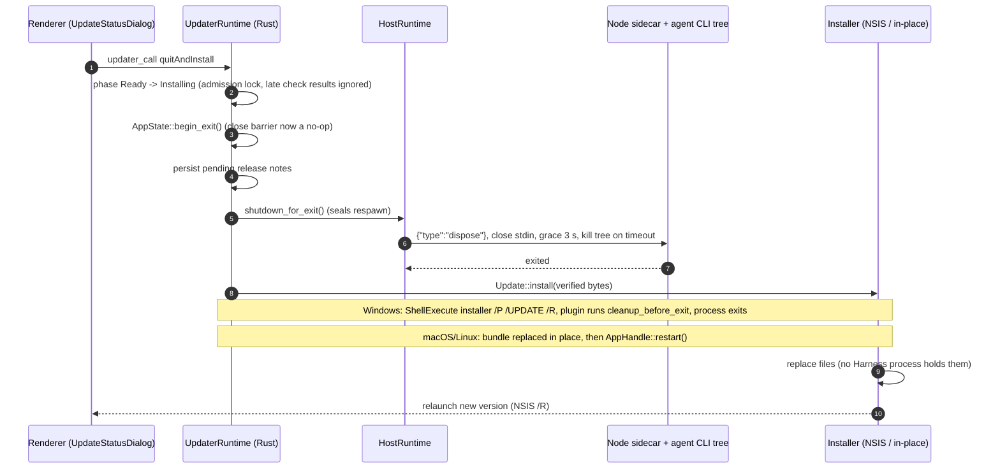

# Phase 6 (B): Auto-updater

Status: active implementation contract. Owner: Tauri shell updater module
(`Worse/apps/harness-app/src-tauri/src/updater/`) and the renderer adapter
(`Worse/apps/harness-app/src/platform/updatePlatform.ts`). Gate: `Worse/scripts/e2e/phase6-update.mjs`.

This spec replaces ZCode's `electron-updater` flow (`packages/desktop/src/main/autoUpdater.ts`) with
`tauri-plugin-updater` 2.12 while keeping ZCode's renderer contract (`IPlatformService` update members,
`UpdateStatePayload`, `UpdateCheckResultPayload`, `PostUpdateReleaseNotesPayload` in
`packages/shared/src/update.ts`) unchanged, so the unmodified ZCode UI shows the same states.
Packaging, installers, Authenticode and bundled Node belong to agent A (`phase-6-packaging.md`).

## 1. Product rules

1. The updater lives in the Rust shell. The renderer only renders state it receives; it never decides
   whether an update is installable. One owner: `UpdaterRuntime` (managed Tauri state).
2. Updates are **full signed packages** (NSIS `-setup.exe` on Windows, `.app.tar.gz` on macOS,
   AppImage/deb/rpm on Linux). There is no delta layer (`tauri-plugin-updater` has none). Budget a
   full download per update.
3. The Harness feed is **separate** from the ZCode feed: a static `latest.json` (section 3). The shell
   never points at a ZCode update server. In dev builds and in any build without a feed URL the updater
   is **off**.
4. Every artifact is verified with the minisign public key compiled into the shell before it can become
   "ready". Verification failures, downgrades and missing platform entries never install (section 5).
5. Install always drains the Host through the existing graceful shutdown barrier first (section 4). It
   never kills the Host hard and never calls window `destroy()`.
6. Mobile shells are remote clients: they have no updater (app-store distribution) and keep the
   no-op update members.

## 2. ZCode behavior matrix and Harness mapping

| # | ZCode (`autoUpdater.ts`, electron-updater 6.8) | Harness |
| --- | --- | --- |
| 1 | Startup check, then poll every 15 min (2 min while an update target is visible); poll skipped while downloading or after admission of install | Same: startup check, 15 min poll, 2 min while `update-available`/`update-downloaded` is visible; no poll while downloading/installing |
| 2 | Manual "Check for updates" (menu, caption menu, `executeDesktopCommand(CheckForUpdates)`) reports through `UpdateCheckResult` toasts: `up-to-date`, `available`, `downloading`, `already-downloading`, `ready`, `dev-skipped`, `error` | Same payloads on `harness://updater/check-result`; `dev-skipped` when the updater is off (dev build, no feed, placeholder key) |
| 3 | `autoDownload = false`; download only on user click or the "auto download and install" preference | Same; preference stored by the shell (section 6) |
| 4 | Download progress → `download-progress` with percent string, transferred/total bytes; stale progress after cancel ignored | Same; progress throttled to whole-percent changes; a generation counter drops stale chunks after cancel |
| 5 | Cancel download → back to `update-available` | Same (download task aborted) |
| 6 | Download failure → back to `update-available` for the same version, error toast, recheck | Same (no automatic recheck loop; next poll or manual check retries) |
| 7 | `update-downloaded` → `UpdateReady(version)` + state; Windows waits for explicit install; macOS/Linux install on quit | Same: `harness://updater/ready`; Windows explicit; macOS/Linux install the verified bytes after the close barrier |
| 8 | Ready version kept when the feed still announces it; a newer feed version replaces the ready one | Newer remote version replaces the ready bytes (download again); same version keeps ready |
| 9 | `quitAndInstall` admission lock (`preparing` → `installing`), late check results ignored, IPC rejects when not ready | Same lock (`Installing` phase); `quitAndInstall` rejects with `Update is not ready to install: state=<kind>` |
| 10 | Install enters Host shutdown (`onBeforeQuitAndInstall`) before the installer so resources are unlocked; failure after shutdown relaunches the app | Same: `HostRuntime::shutdown_for_exit()` then `Update::install`; failure after the barrier restarts the app (`AppHandle::restart`) |
| 11 | Windows Authenticode check of the installer before install | Replaced by the minisign signature (always). Authenticode of the installer is agent A's signing pipeline (no production cert today) |
| 12 | Skip version (per channel) persisted in settings; manual check clears it | Same; one channel (row 13) so one skipped version |
| 13 | Channels: `stable`/`preview` from the "receive preview" setting, manifest per channel | **One channel per feed URL** (`stable`); `channel` omitted from payloads. A preview channel is a second feed URL — *needs sign-off* |
| 14 | Post-update release notes persisted at download, shown once after restart, acknowledged by the renderer | Same: notes persisted before install, offered once when the running version equals them, cleared on ack |
| 15 | Force-update gate (minimum version) | Not ported (no Harness minimum-version service) — *needs sign-off* |
| 16 | Separate update window (`openUpdateStatusWindow`) | Not provided; the UI falls back to its in-window dialog |
| 17 | Running-session confirmation before restart (`getDesktopSessionActivity`) | Not provided yet (the count lives in the Host); the dialog installs without the extra confirm. Open item |
| 18 | Dev runtime: `dev-skipped` unless `ZCODE_AUTO_UPDATE_DEV` | Off unless a feed URL and a real key are configured |

UI states (`UpdateStatePayload.kind`): `idle` → `checking` → `update-available` → `download-progress`
→ `update-downloaded`. The shell's internal `Installing` phase is reported as `update-downloaded` with
`enabled: false`, like ZCode.

## 3. Feed format

`latest.json`, the `tauri-plugin-updater` static format:

```json
{
  "version": "0.1.1",
  "notes": "# Harness 0.1.1\n\n- ...",
  "pub_date": "2026-11-01T00:00:00Z",
  "platforms": {
    "windows-x86_64": { "url": "https://<feed-host>/0.1.1/Harness_0.1.1_x64-setup.exe", "signature": "<contents of the .sig>" },
    "darwin-aarch64": { "url": "https://<feed-host>/0.1.1/Harness.app.tar.gz", "signature": "..." },
    "linux-x86_64": { "url": "https://<feed-host>/0.1.1/Harness_0.1.1_amd64.AppImage", "signature": "..." }
  }
}
```

- Platform keys are `<os>-<arch>` (`windows|darwin|linux` × `x86_64|aarch64|i686|armv7`); the plugin also
  accepts `<os>-<arch>-<installer>` first (e.g. `windows-x86_64-nsis`).
- `signature` is the `.sig` file text produced by the Tauri CLI with `TAURI_SIGNING_PRIVATE_KEY` and
  `bundle.createUpdaterArtifacts: true`. Its trusted comment records `version:<x.y.z>`.
- A `204 No Content` response means "no update".
- Feed URL resolution (first match wins): runtime env `HARNESS_UPDATE_FEED_URL` (`off` disables), then
  `plugins.updater.endpoints[0]` in the built config. Default: none → updater off.
- Transport: `https` only. `http` is accepted only for a loopback host (`127.0.0.1`, `::1`, `localhost`)
  **and** only when the build sets `plugins.updater.dangerousInsecureTransportProtocol` (test builds) or
  is a debug build. Any other URL disables the updater with a logged reason.

## 4. Install orchestration



- `shutdown_for_exit()` seals the Host slot before disposing, so a renderer reconnect during install
  cannot respawn a Host from the install directory (the same seal now protects the window-close path).
- If `begin_exit()` reports that a close barrier is already running, `quitAndInstall` is refused.
- Failure after the barrier (installer launch error): log, emit `error`, restart the app so the Host
  and remote control come back (ZCode `recoverFromFailedUpdateInstall`).
- macOS/Linux install-on-quit: the window close barrier (`lib.rs`) calls the updater after
  `shutdown_for_exit()`; with a verified ready update it installs before `app.exit(0)` and does not
  relaunch.
- Known Windows risk: the Tauri NSIS template kills running processes with the main binary name of the
  current user before copying files. Harness has exited by then; other running instances of the same
  binary are also stopped (same as ZCode's installer). The gate uses a unique binary name.

### 4.1 Leftover installer directories (Windows)

`tauri-plugin-updater` 2.14.1 extracts the verified package into
`%TEMP%\<productName>-<version>-updater-<6 random alphanumerics>` with `tempfile ... .keep()` and then
`std::process::exit(0)` after `ShellExecuteW`, so the directory (about 51 MB) is never removed. The
plugin has no cleanup option or hook (its `on_before_exit` runs before the installer starts).

The shell (`updater/temp_sweep.rs`) sweeps `std::env::temp_dir()` twice per run, off the main thread:
at startup (the installer may still be exiting; a locked file is left for the next sweep) and in the
window close barrier after the Host drained. It removes a directory only when all of these hold:

- the name is exactly `<this productName>-<semver>-updater-<6 ASCII alphanumerics>`;
- that version is `<=` the running version (a newer version's installer is never touched);
- it is a plain directory (not a symlink or junction) that holds only regular files.

Every removal and every kept candidate is logged (`removed a leftover updater temp directory` /
`kept an updater temp directory`, with the reason). The sweep is updater-independent: it also runs
when updates are off.

## 5. Fail-closed rules

| Case | Mechanism | Result |
| --- | --- | --- |
| Missing/placeholder pubkey | key starts with `HARNESS_UPDATER_PUBKEY_PLACEHOLDER` or is empty | updater off |
| Bad signature / tampered bytes | minisign verify in `Update::download` | download fails; never `ready`; state back to `update-available`; `error` |
| Signature for a different version (relabelled feed) | `requireSignedVersion: true` (trusted comment `version:` must equal announced version) | same as above |
| Downgrade / same version | default comparator `remote > current`; `allowDowngrades` stays false | treated as "no update" |
| Wrong platform | no `<os>-<arch>` entry → `TargetsNotFound` | check `error`; nothing downloaded |
| Insecure URL | section 3 transport rule | updater off |
| Not ready at install | `quitAndInstall` rejects | renderer button released |
| Shutdown barrier already running | `begin_exit()` already true | `quitAndInstall` rejects |

No code path installs bytes that did not pass `Update::download` verification in this process; the
verified bytes are held in memory only (never re-read from disk before install).

## 6. Persistence

`<data>/updater.json`, `<data>` = `HARNESS_APP_DATA_DIR` or the Tauri `app_data_dir()`:
`{ "autoDownloadAndInstallUpdates": bool, "skippedVersion": string|null, "pendingReleaseNotes": {...}|null }`.
Written atomically (temp file + rename) with async IO. Not shared with ZCode's `setting.json`.

## 7. Renderer contract

One command, `updater_call(method, params)`, methods: `getState`, `check {manual}`, `download`,
`cancelDownload`, `skipVersion {version}`, `quitAndInstall`, `getPreferences`, `setAutoDownload {enabled}`,
`takeReleaseNotes`, `ackReleaseNotes {version}`, `getDiagnostics` (phase, last error, current version,
enabled/disabled reason; used by the gate and support). Mobile returns `unsupported`.

Events: `harness://updater/state` (`UpdateStatePayload`), `harness://updater/check-result`
(`UpdateCheckResultPayload`), `harness://updater/ready` (version). Post-update release notes are pulled once with
`takeReleaseNotes` when the renderer subscribes (no event).

`updatePlatform.ts` maps them onto `onUpdateStateChanged`, `getUpdateState`, `onUpdateReady` (also
replays a ready state on subscribe), `onUpdateCheckResult`, `downloadUpdate`, `cancelUpdateDownload`,
`skipUpdateVersion`, `quitAndInstallUpdate`, `getAutoUpdatePreferences`,
`setAutoDownloadAndInstallUpdates`, `onPostUpdateReleaseNotes` (pulls once on subscribe),
`acknowledgePostUpdateReleaseNotes`, and `executeDesktopCommand(CheckForUpdates)` → `check {manual:true}`.

Capabilities: the webview gets **no** `updater:*` plugin permission. Only the shell calls the plugin
from Rust.

## 8. Rollback

Rollback = republish `latest.json` pointing at the previous signed build **with a higher version
number** (re-tag and re-sign it, e.g. `0.1.3` built from the `0.1.1` sources), because downgrades are
refused by design. Users who already installed the bad build move forward to the rebuilt one; ZCode stays
installable in parallel. Removing `latest.json` (404) or returning 204 stops the rollout.

## 9. Key management

- **There is no production updater key.** `tauri.conf.json` carries
  `plugins.updater.pubkey = "HARNESS_UPDATER_PUBKEY_PLACEHOLDER (supply HARNESS_UPDATER_PUBKEY at build time)"`;
  with it the updater is off.
- Production: the release pipeline sets `HARNESS_UPDATER_PUBKEY` (base64 public key) when compiling
  the shell (read with `option_env!`, `build.rs` reruns on change) and `TAURI_SIGNING_PRIVATE_KEY` /
  `TAURI_SIGNING_PRIVATE_KEY_PASSWORD` plus `bundle.createUpdaterArtifacts: true` when bundling. Owner:
  release/security (plan question 6) — *needs sign-off*.
- Tests: the gate generates a throwaway keypair (and a second "attacker" keypair) with
  `tauri signer generate` under `Worse/.work/tmp/phase6-update/keys/` (gitignored) and deletes it at the
  end. Private keys never enter the source tree.

## 10. Acceptance scenarios (`scripts/e2e/phase6-update.mjs`, Windows)

| ID | Scenario | Evidence |
| --- | --- | --- |
| U1 | Build N and N+1 NSIS installers signed with the test key; N+1 re-uses N's frontend/sidecar build and only recompiles the shell + re-bundles with a bumped version | `.sig` trusted comment contains `version:N+1` |
| U2 | Per-user silent install of N into `Worse/.work/tmp/phase6-update/install` (`/S /NS /D=`), unique product/binary/identifier. The directory is reached through a temporary `subst` drive letter, removed at cleanup: with the gate's isolated `USERPROFILE`, `ShellExecuteW` returns `SE_ERR_PATHNOTFOUND` for any exe under the real profile folder, and NSIS `RunAsUser` (non-elevated) relaunches through `ShellExecuteW`. In a normal user environment this relaunch path works | installed exe version N; HKCU keys listed |
| U3 | Downgrade feed (version < N) and same-version feed | check → `up-to-date`; still N |
| U4 | Tampered artifact, bad-key signature, relabelled version | download → `error`, never `update-downloaded`; `quitAndInstall` rejected; still N |
| U5 | Wrong-platform feed | check → `error`; still N |
| U6 | Good feed: check → available → progress → ready → `quitAndInstall` | Host sidecar exits before installer starts (shell log order); relaunched app reports N+1 |
| U7 | No orphans | no process from the install dir after the N+1 window closes through the close barrier |
| U8 | Uninstall + cleanup | `uninstall.exe /S`, HKCU keys, Start Menu/desktop shortcuts and app data removed; isolated home guard OK |
| U9 | No updater temp leftover (section 4.1) | Before N starts, the gate plants decoys in `%TEMP%`: an older-version directory with files only (must be removed), a newer version, another product, a 7-character suffix and a directory with a subdirectory (all must survive). After N+1 closes: no `HarnessE2EUpdater-*-updater-*` directory created by this run is left and every decoy is in its expected state; the sweep log lines go into the report |

## 11. Out of scope / open

- Delta updates, staged rollout percentages, preview channel, force-update minimum version.
- Authenticode / notarization (agent A); macOS/Linux install paths are implemented but untested here.
