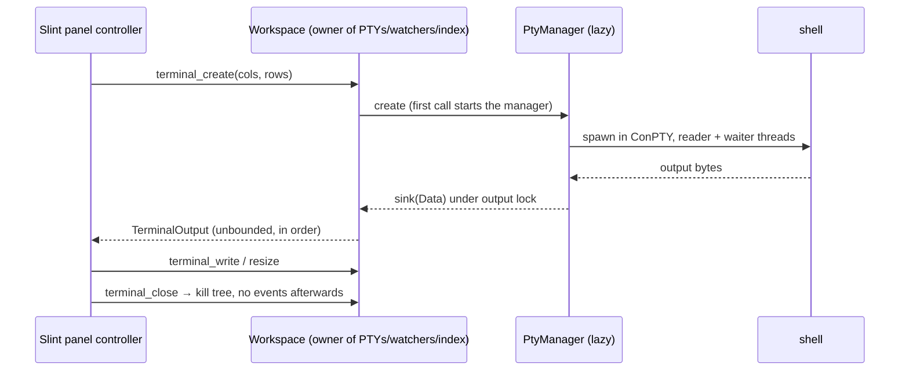

# Phase 8 Core: Agent Hub

Status: active implementation contract (round 8.1, agent A). UI side: `phase-8-ui.md` (agent B, Slint).

## 1. Product rules

1. Harness has no LLM of its own. It is a hub that drives external agent CLIs (Claude Code, Codex CLI,
   agy) as child processes. A CLI process runs only while some session needs it and is stopped after an
   idle period.
2. **One Harness session = one conversation.** The user sees one transcript. Each turn is served by exactly
   one agent; different turns of the same session may be served by different agents.
3. **The Harness transcript is the source of truth** (`~/.harness/harness.sqlite`). Native CLI sessions
   (Claude session id, Codex thread id, ACP `sessionId`) are a per-agent cache of that conversation.
4. **Sticky active agent.** Every session has one active agent. It changes only when
   (a) the user swaps (explicit agent on `send_message`, or `set_active_agent`), or
   (b) the active agent's quota/credit is exhausted: Harness fails over to the next available agent in the
   user-configurable fallback order (default `claude-code → codex → agy`), and that agent becomes sticky.
   There is no automatic switch back. Automatic routing beyond failover is out of scope; the extension
   point is `AgentSelector` (§6.4).
5. Only one turn runs per session at a time. Further sends are queued (FIFO) and admitted serially by the
   session actor (the Harness equivalent of `CommandInbox`).
6. Workspace files, MEMORY.md files and the Harness MCP memory server are shared by all agents.
   Permission decisions are recorded per turn.
7. Data lives in `~/.harness` (`HARNESS_HOME` overrides; gates always set it). No ZCode data is read or
   written. A one-time ZCode import is a later round.
8. Harness never writes into the repository's `CLAUDE.md` / `AGENTS.md` / `GEMINI.md`. Memory reaches
   agents through official per-session channels (§8).

## 2. Process model

```
┌──────────────────────────── harness (one OS process) ───────────────────────────┐
│ Slint UI (agent B)  ──calls──▶  harness-core-api::HarnessCore (trait object)     │
│                                     ▲ implemented by                            │
│                     harness-agent-hub: Hub ── session actors ── AgentPool       │
│                                     │              │                 │          │
│                              sqlite store     memory files     ACP connections   │
└──────────────────────────────────────────────────────────────────────┼──────────┘
                                   stdio JSON-RPC (ACP)                 │ spawn on demand
          ┌────────────────────────────┬────────────────────────────────┤
   claude-code adapter          codex adapter                     agy adapter
   (child, exits when idle)     (child, exits when idle)          (child, exits when idle)
          │ spawns (per ACP session/new mcpServers)
   harness-memory-mcp (stdio MCP server, tiny Rust binary, lives as long as the agent session)
```

Justification:

- **One process for UI + core** (libraries, not a sidecar): no IPC hop, no second runtime, one tokio
  runtime. That is the only way to stay inside 20–50 MB idle with a window open; every extra resident
  process costs ≥3–5 MB of private memory on Windows before doing anything.
- **Agent CLIs are child processes** because they are third-party programs with their own auth and storage;
  they are spawned only when a turn needs them and stopped after `agent_idle_timeout`, so idle RAM is just
  the hub.
- **The MCP memory server is a separate executable** because MCP stdio servers are spawned by the agent,
  not by Harness. It is a ~1 MB Rust binary that shares the memory-file code with the hub (§8.3).
- Remote/phone access (later round) attaches to the same `HarnessCore` command/event API over an
  authenticated WebSocket; no second hub, no second agent process (§11).

## 3. Crate layout

| Crate | Kind | Purpose |
|---|---|---|
| `crates/harness-core-api` | lib | UI-agnostic types + `HarnessCore` trait + `EventStream`. Deps: serde, tokio (sync). No Slint/Tauri. |
| `crates/harness-agent-hub` | lib + bin `harness-memory-mcp` | Hub implementation: store, session actors, agent pool, ACP client, adapters, quota registry, memory files, MCP memory server. |
| `crates/harness-fake-agent` | bin `harness-fake-agent` | Scripted ACP agent for gates (stream, permission, cancel, load, quota exhaustion, MCP calls). |
| `crates/harness-core-gate` | bin `harness-core-gate` | Integration-test driver used by `scripts/e2e/phase8-core.mjs`. |
| `crates/harness-workspace` | lib | Round 8.2: `WorkspaceServices` for one workspace root (files, search, git incl. stage/commit, PTY terminals, watcher), lazy, on top of harness-fs/-search/-git/-pty/-watch (§15.3). |

Existing crates reused: `harness-core::WorkspaceKey` (identity rule). `harness-store` is the read-only ZCode
index and is **not** reused (different schema, ZCode data is out of scope). `harness-sidecar`'s kill-tree
approach (taskkill /T /F, process groups on Unix) is replicated in the hub's process module because the
sidecar supervisor is single-sidecar and Tauri-oriented.

ACP implementation: a minimal in-crate JSON-RPC/ACP codec (serde_json) instead of the
`agent-client-protocol` crate (3.6.0 on crates.io). Reasons: exact control of message ordering (§9), the
fake agent and client share one codec, and the wire subset we need is small. Revisit when we need
`terminal/*` or elicitation.

## 4. Core API (`harness-core-api`)

All calls are async and go through `HarnessCore` (dyn-compatible, boxed futures). Events go through a
broadcast `EventStream`. Every type is serde-serializable so the same API can be carried over a wire later.

| Call | Semantics |
|---|---|
| `list_agents()` | `AgentInfo { id, display_name, availability, quota, runtime }` for every configured agent. |
| `get_fallback_order()` / `set_fallback_order(Vec<AgentId>)` | Global failover order; persisted. Unknown ids rejected. |
| `create_session(CreateSession { workspace_path, workspace_identity, title, agent })` | Creates an empty session. `agent=None` → first available agent in fallback order. |
| `list_sessions(ListSessions { workspace_key, query, limit })` | Newest first; `query` matches title and transcript text. |
| `open_session(id)` | `SessionDetail { summary, turns, queue, pending_permissions }` snapshot. Resume after restart = open + send; the native session is resumed lazily on the next turn. |
| `send_message(SendMessage { session_id, text, agent, client_message_id })` | Accepts a user turn. `agent=Some(x)` is a manual swap (x becomes sticky). Returns `SendAccepted { turn_id, seq, position }`. Idempotent on `client_message_id`. |
| `set_active_agent(session_id, agent)` | Manual swap without sending; clears x's exhaustion mark (user retries it) and resumes a paused turn. |
| `stop(session_id)` | Cancels the running turn (ACP `session/cancel`; pending permissions resolve `cancelled`). Queued turns stay queued. |
| `cancel_queued(session_id, turn_id)` | Removes one queued turn (status `cancelled`). |
| `respond_permission(session_id, request_id, option_id)` | Answers an agent permission request. Second answer → `AlreadyResolved`. |
| `memory_read(scope)` / `memory_write(scope, content, mode)` | `MemoryScope::Global` or `Project { workspace_path }`; `mode` replace/append. |
| `subscribe()` | `EventStream` of `HubEvent { seq, session_id, kind }`. On `Lagged` the UI re-opens the session snapshot. |
| `shutdown()` | Cancels running turns, stops all agent processes, closes the store. |

`EventKind` variants: `SessionCreated`, `SessionUpdated`, `TurnQueued`, `TurnStarted { agent, attempt }`,
`MessageDelta`, `ThoughtDelta`, `ToolCall`, `ToolCallUpdated`, `PermissionRequested`, `PermissionResolved`,
`TurnFinished { outcome }`, `TurnPaused { reason }`, `AgentSwitched { from, to, reason, message }`,
`AgentRuntime { agent, state, pid }`, `AgentQuota { agent, quota }`, `MemoryChanged { scope }`.

`AgentSwitched.message` is a ready-to-show string, e.g.
`"switched from Claude Code to Codex: Claude Code limit reached (resets at 2026-11-02T15:00:00Z)"`.

### 4.1 API change log (additive only after publication)

| Date | Change |
|---|---|
| 2026-11-02 | 0.1.0 published (this document §4). |
| 2026-11-02 | 0.1.1: added `SwitchReason::Unavailable` (sticky agent not installed → next agent in the fallback order). Additive. |
| 2026-11-02 | Behaviour, no type change: `set_active_agent` on a session with a paused turn resumes that turn on the chosen agent, even if that agent attempted it in an earlier failover round (§6.4). |
| 2026-11-02 | **0.2.0** (round 8.2, all additive, §15): `SessionSummary.agents_used`; `TurnView.segments` (`TurnSegment` text/tool order); `open_session` fills the running turn's `assistant_text`; `HarnessCore::turn_diff` (default method) + `TurnDiff`; diff types `FileDiff`/`DiffHunk`/`DiffLine` and `diff::parse_unified`; `time::local_time_label`; new module `workspace` (`WorkspaceServices` trait, `WorkspaceEvent` stream) implemented by the new crate `harness-workspace`. Hub: `<HARNESS_HOME>/agents.json`. New fields carry `#[serde(default)]`, so 0.1.x payloads still deserialize. |
| 2026-11-02 | **0.3.0** (phase 9.1, additive, `phase-9-parity.md` §9.1.5): `HarnessCore::{agent_options, list_modes, list_models, list_config_options, set_mode, set_model, set_config_option}` (default methods), types `ModeInfo`/`ModelInfo`/`ConfigOption`/`ConfigValue`/`SessionModes`/`SessionModels`/`SessionConfigOptions`/`AgentDefaults`/`AgentOptions`, `EventKind::SessionOptionsChanged`. Hub: `HubConfig.agent_defaults`, table `session_prefs`, `mcpServers` overlay from `<HARNESS_HOME>/mcp.json`. |
| 2026-11-02 | **0.4.0** (phase 9.1, additive, `phase-9-parity.md` §9.1.5a): `HarnessCore::{agents_overview, test_agent, memory_files, memory_doc, memory_plan, memory_apply, list_projects, remove_projects, restore_projects, archive_sessions, list_archived, unarchive, delete_archived}` (default methods), types `AgentOverview`/`AuthPresence`/`AgentTestResult`/`MemoryFileInfo`/`MemoryDoc`/`MemoryPlan`/`ListProjects`/`ProjectInfo`/`ListArchived`/`ArchiveSort`/`ArchivedSession`/`ArchivePage`/`SessionSelection`, `ApiError::{Conflict, Busy}`, `EventKind::SessionsChanged`. Behaviour change: `list_sessions` excludes archived sessions and (without a workspace key) sessions of removed projects; `send_message` unarchives; `create_session` restores a removed project. Hub: `HubConfig.{agent_kinds, auth_probe}`, table `projects`, column `sessions.archived_at`, session-actor `Retire`. |
| 2026-11-03 | **0.5.0** (phase 9.2, additive, `phase-9-parity.md` §9.2.1): session organisation (`rename_session`, `set_pinned`, `set_unread`, groups), turn actions (`fork_session`, `rewind_session`, `edit_and_resend`, `retry_turn`, `plan_file_changes`, `apply_file_changes`), `find_in_session`, `SendMessage.context` + `resolve_context` + `mention_candidates`, `list_commands`, plan/usage/tool content fields and events, `command_search` with an injected `FileSearchSource`, read-only `import_scan`/`import_sessions`, scheduled prompts. New events `GroupsChanged`, `TurnsRemoved`, `FilesRestored`, `PlanUpdated`, `UsageUpdated`, `CommandsChanged`, `SchedulesChanged`.

## 5. Session store (`~/.harness/harness.sqlite`)

Single writer: the hub's store thread (`Store`, rusqlite, WAL). `PRAGMA user_version` = schema version (1).

```sql
sessions(id TEXT PK, title TEXT, workspace_path TEXT, workspace_key TEXT, active_agent TEXT,
         created_at INT, updated_at INT)
turns(id TEXT PK, session_id TEXT, seq INT, client_message_id TEXT, user_text TEXT,
      agent_id TEXT /* agent that finally served it */, assistant_text TEXT,
      status TEXT /* queued|running|paused|completed|cancelled|failed|interrupted */,
      stop_reason TEXT, error TEXT, created_at INT, finished_at INT, UNIQUE(session_id, seq))
turn_attempts(turn_id TEXT, attempt INT, agent_id TEXT, status TEXT, partial_text TEXT,
              error_class TEXT, error TEXT, resets_at INT,
              PRIMARY KEY(turn_id, attempt))      -- once per agent per failover round: enforced by the actor (§6.4)
turn_events(turn_id TEXT, idx INT, kind TEXT, payload TEXT, PRIMARY KEY(turn_id, idx))
              -- display copy: tool calls, permission requests/decisions, failover notes
agent_handles(session_id TEXT, agent_id TEXT, native_session_id TEXT, last_seq INT,
              PRIMARY KEY(session_id, agent_id))  -- cache, never authoritative
agent_quota(agent_id TEXT PK, state TEXT /* ok|exhausted */, resets_at INT, reason TEXT, updated_at INT)
settings(key TEXT PK, value TEXT)                 -- fallback_order (JSON array)
```

On startup turns left `queued`/`running` by a crash become `interrupted` (they are not re-run silently).

## 6. Agents

### 6.1 Adapter trait

```rust
trait AgentAdapter: Send + Sync {
    fn id(&self) -> &AgentId;
    fn display_name(&self) -> &str;
    fn probe(&self) -> Availability;                       // PATH lookup only; never runs the CLI
    fn launch(&self, ctx: &LaunchContext) -> Result<LaunchSpec, HubError>; // program, args, env
    fn transport(&self) -> Transport;                      // Acp (round 8.1); native adapters later
    fn classify_error(&self, err: &AgentError) -> ErrorClass; // quota | transient | fatal
}
```

`ErrorClass::QuotaExhausted { resets_at: Option<unix_secs> } | Transient { retry_after } | Fatal`.

### 6.2 Built-in agents (round 8.1 implements the ACP transport; all three go through it)

| Agent | Launch | Memory/system channel | MCP channel | Resume |
|---|---|---|---|---|
| `claude-code` | ACP adapter `claude-agent-acp` (npm `@agentclientprotocol/claude-agent-acp`, which replaces the deprecated `@zed-industries/claude-code-acp`; Node, runs only while active) | prompt context block (§8.2) | ACP `session/new.mcpServers` | ACP `session/load` if `loadSession` |
| `codex` | ACP adapter `codex-acp` (npm `@agentclientprotocol/codex-acp`, which replaces the deprecated `@zed-industries/codex-acp`) | same | same | same |
| `agy` | `agy --acp` (**unverified**, §6.5) | same | same | same |

Native (no-adapter) transports planned for 8.2, interfaces verified from `--help`/schema on this machine:

- **Claude Code 2.1.316**: `claude -p --input-format stream-json --output-format stream-json
  --include-partial-messages --append-system-prompt <memory> --mcp-config <json> --strict-mcp-config
  --session-id <uuid> | --resume <id> --permission-prompt-tool <mcp tool>`. Removes the Node adapter.
- **Codex CLI 0.166.0**: `codex app-server --stdio` (JSON-RPC). `thread/start|thread/resume` take
  `developerInstructions` (memory) and `config` (→ `mcp_servers`), `turn/start { threadId, input }`,
  `turn/interrupt`; approvals arrive as server requests `item/commandExecution/requestApproval` /
  `item/fileChange/requestApproval` with decisions `accept|acceptForSession|decline|cancel`.
  Source: `codex app-server generate-json-schema` (run with a throwaway `CODEX_HOME`).

### 6.3 Error classification (quota vs transient vs fatal)

| Source | Quota exhausted | Transient | Notes / status |
|---|---|---|---|
| Codex app-server | `TurnError.codexErrorInfo = "usageLimitExceeded"` (also `sessionBudgetExceeded`); reset from `account/rateLimits` `RateLimitWindow.resetsAt` (unix secs) | `rateLimitExceeded`, `serverOverloaded`, `httpConnectionFailed`, `responseStreamConnectionFailed`, any `ErrorNotification.willRetry = true` | Verified from generated schema (0.166.0). |
| codex-acp | JSON-RPC error on `session/prompt`; we look for `data.codexErrorInfo` and message text `usage limit` | `rate limit`, network texts | How codex-acp maps `TurnError` to ACP is **unknown** (not installed); classifier checks both data and text. |
| Claude Code stream-json | assistant message `error: "rate_limit"` / `"billing_error"`, `result.is_error`, message `Claude AI usage limit reached|<unix>` or `… limit reached … resets <time>` | `overloaded_error`, 5xx, network | From the Claude Agent SDK message types and observed CLI text — **not verified locally** (no real session allowed). |
| claude-code-acp | JSON-RPC error text carrying the Claude messages above | same | **unknown** mapping. |
| agy | JSON envelope `status` field (`-p --output-format json`) | — | **unknown**; quota text not documented. |
| Any ACP agent | Harness convention: error `data.harnessErrorKind = "quota_exhausted"`, `data.resetsAt` (unix secs) | `data.harnessErrorKind = "transient"` | Used by the fake agent; generic fallback = text match `usage limit|quota|credit|limit reached` → quota, `rate limit|overloaded|timeout|ECONN` → transient. |

Reset time parsing: `resetsAt`/`resets_at` numeric fields; `…|<unix>` suffix; ISO-8601 after `resets at`.
Unparseable → `resets_at = None`.

### 6.4 Selection and failover

`AgentSelector` (extension point for automatic routing, only `StickySelector` exists):

```
select(session.active_agent, explicit_agent, fallback_order, availability, quota) -> AgentId | AllExhausted
```

- Explicit agent on send / `set_active_agent` → that agent, becomes sticky, its exhaustion mark is cleared
  (the user is retrying it deliberately).
- Otherwise the sticky agent if available and not exhausted; else the first agent after it in the fallback
  order (wrapping), skipping not-installed and exhausted agents. The chosen agent becomes sticky and an
  `AgentSwitched { reason: QuotaExhausted }` event + transcript note are emitted.
- None left → the turn becomes `paused` (`TurnPaused { reason: AllAgentsExhausted { agents } }`). It
  resumes on `set_active_agent` / explicit send, or when the earliest known `resets_at` passes (the hub arms
  one wake-up for that instant; this is a product rule, not a synchronisation timeout).

Quota state is global per agent (accounts are per machine, not per session) and owned by the hub's
`QuotaRegistry` (persisted in `agent_quota`). Exhaustion expires at `resets_at`.

**Failover mid-turn** (quota error while a turn runs on agent X):

1. Session actor records attempt `(turn, n, X, status=quota_exhausted, partial_text, tool calls)`; marks X
   exhausted in `QuotaRegistry` (with `resets_at`); stops using X for this session (the X process is
   released; it exits by the normal idle rule).
2. Selects Y, never an agent that already attempted this turn in the current **failover round**: a turn never
   runs twice on the same agent within one automatic failover chain. The session actor (single owner)
   enforces this. A pause (all agents exhausted) ends the round; a resume by manual swap or by a reset may
   run the turn again on an agent that tried it before, with every earlier partial output forwarded.
3. Re-runs the **same** turn on Y. The user message is not duplicated in the transcript; Y receives the
   catch-up context plus a labelled block `Partial output from <X> before its limit was reached: …` with
   X's partial text and tool calls, then the user message.
4. Emits `AgentSwitched` and appends a `failover` turn event. Y stays sticky afterwards.

Transient errors do not fail over: the turn ends `failed` with `ErrorClass::Transient` (the user resends).
Fatal errors end the turn `failed`.

### 6.5 agy findings

`agy` is **not installed** on this machine (only the Antigravity desktop app with `language_server.exe`).
Public third-party documentation (Antigravity CLI cheat sheets, v1.2.x) lists: `-p/--print`,
`--output-format text|json|stream-json`, `--input-format text|stream-json`, `--conversation <id>`,
`-c/--continue`, `--model`, `--mode accept-edits|plan`, `--dangerously-skip-permissions`, `agy mcp add`,
MCP config files `.agents/mcp_config.json` (workspace) and `~/.gemini/config/mcp_config.json` (global), rules
files `GEMINI.md`/`AGENTS.md`/`.agents/rules/*.md`. Unknown: whether `agy --acp` exists (claimed by one closed
OpenAB PR; several community adapters `agy-acp` wrap `agy -p` instead), whether a per-invocation MCP config
or system-prompt flag exists (the documented MCP paths are a repo file or a global user file — both
forbidden for us), the stream-json event schema, and the quota error format. Round 8.1 ships `agy` as an
ACP agent launched with `agy --acp`, probed as `not installed` here; if `--acp` does not exist, 8.2
writes a stream-json adapter once `agy --help` can be read.

## 7. Turn execution and catch-up

Each session keeps per-agent handles `{ native_session_id, last_seq }` (`last_seq` = last turn that agent
saw, its own or via catch-up).

When turn `N` goes to agent `A`:

- Handle exists and the native session is live in the current A process → `session/prompt` with
  catch-up blocks for turns `(last_seq, N)` not served by A (user text + assistant text + agent label),
  then the user message.
- Handle exists but the A process was restarted → `session/load` if A advertises `loadSession`
  (replayed history updates are dropped: the route is registered only after the load response), then as
  above. If load is unsupported or fails → new native session seeded like the next case.
- No handle → `session/new` (with `mcpServers`), first prompt = memory block + seed transcript of turns
  `< N` + user message.

Seed/catch-up budget: 48 000 characters of history text (~12k tokens). Newest turns are kept verbatim
until the budget is reached; older turns are reduced to one line each
(`[turn k, <agent>] user: <first 160 chars> / assistant: <first 160 chars>`); if even that exceeds the budget,
the oldest lines are dropped with a note `(<n> earlier turns omitted)`. No LLM summarisation (Harness has
no model). The budget is a constant in `harness-agent-hub::catchup`.

After the turn, `last_seq = N` for A.

## 8. Memory

### 8.1 Files

- Global: `<HARNESS_HOME>/MEMORY.md`.
- Project: `<workspace_path>/.harness/MEMORY.md` (the hub creates `.harness/` lazily on first write).
- One write path: `harness_agent_hub::memory::MemoryFiles` (used by the hub API and by the MCP server
  binary). Writes take an exclusive lock file `MEMORY.md.lock` (create-new, removed after write), write a
  temp file and rename atomically. Reads are lock-free (rename is atomic).

### 8.2 Injection

At the start of every native session (new or seeded), the first prompt carries a text block:

```
<harness-memory scope="global">…</harness-memory>
<harness-memory scope="project" path="…">…</harness-memory>
Use the harness-memory MCP tools memory_read / memory_write to read or update shared memory.
```

ACP has no system-prompt field; a leading prompt content block is the per-session context channel. Native
8.2 adapters use `--append-system-prompt` (Claude) / `developerInstructions` (Codex). Agents read fresh
content any time via MCP.

### 8.3 MCP memory server

`harness-memory-mcp --project <workspace_path>` (env `HARNESS_HOME`), MCP over stdio (protocol
`2025-06-18`): `initialize`, `tools/list`, `tools/call`, `ping`. Tools:

- `memory_read { scope: "global" | "project" }` → text content.
- `memory_write { scope, content, mode: "replace" | "append" }` → `ok`.

Passed in every ACP `session/new`/`session/load` as
`{ name: "harness-memory", command: <abs path>, args: ["--project", <ws>], env: [{name:"HARNESS_HOME", value}] }`.
The hub emits `MemoryChanged` for its own writes; agent writes are seen on next read (8.2: file watch).

## 9. Ownership and event order

| State | Single owner |
|---|---|
| Transcript, turn status, queue, sticky agent, agent handles | Session actor (one tokio task per open session), persisted via `Store` |
| Agent quota/exhaustion | `QuotaRegistry` (hub), persisted |
| Agent process lifecycle | `AgentPool` (one slot per agent id; one process serves many ACP sessions) |
| Memory file contents | the files; one write path `MemoryFiles` |
| UI drafts / scroll / selection | UI (not the hub) |

```mermaid
sequenceDiagram
    participant UI
    participant Hub
    participant S as Session actor (owner)
    participant Q as QuotaRegistry
    participant P as AgentPool
    participant A as Agent X (ACP child)
    participant B as Agent Y
    UI->>Hub: send_message(text, agent?)
    Hub->>S: Cmd::Send (unbounded inbox, FIFO)
    S->>S: persist turn(queued) → TurnQueued; if idle admit
    S->>Q: select(sticky, explicit, order)
    S->>P: acquire(X) (spawn+initialize if absent)
    S->>A: session/new|load, session/prompt(catch-up + text)
    A-->>S: session/update* (routed into the same inbox, in wire order)
    A-->>S: session/request_permission → PermissionRequested
    UI->>Hub: respond_permission → S → reply to A, PermissionResolved
    A-->>S: prompt response | error   (driver posts TurnDone into the inbox after all updates)
    alt quota exhausted
        S->>Q: mark X exhausted(resets_at)
        S->>P: release(X)
        S->>B: same turn with catch-up + labelled partial output
        S->>UI: AgentSwitched(X→Y), sticky = Y
    end
    S->>S: persist turn(completed), last_seq; TurnFinished; admit next queued
    P->>P: busy=0 → idle timer → stop child → AgentRuntime(Stopped)
```

Ordering guarantee: the ACP reader task pushes every `session/update` and agent request for a session into
that session's inbox **before** it completes the oneshot of the `session/prompt` response; the turn driver
posts `TurnDone` into the same inbox only after that oneshot resolves, so the actor always sees all
deltas before the turn end. Commands from the UI interleave in the same FIFO.

Stop: actor sends `session/cancel`, answers pending permissions `cancelled`, and waits for the agent's
prompt response (`stopReason: cancelled`, required by ACP). If the agent process dies instead, the reader's
EOF fails all pending requests and the turn ends `cancelled`.

## 10. Idle shutdown

`AgentPool` slot = `{ connection, busy, generation }`. `acquire` increments `busy`; `release` decrements
it and, at 0, arms an idle wake-up after `agent_idle_timeout` (default 300 s; `HARNESS_AGENT_IDLE_SECS`).
When it fires and the slot is still idle with the same generation, the pool closes stdin, waits the shutdown
grace (3 s) and kills the process tree (`taskkill /T /F` on Windows, process group on Unix). Children are
spawned with `CREATE_NO_WINDOW` and `kill_on_drop`. Hub `shutdown()` stops every slot.

## 11. Remote / phone access (later round)

The phone attaches to the running desktop hub (never its own hub or agents): a `harness-remote` crate
exposes `HarnessCore` calls + `HubEvent` stream over an authenticated WebSocket (pairing token, origin
check), with snapshot (`open_session`) + event `seq` for `web-remote-replayable` recovery. The relay stays
stateless. Not built in round 8.1.

## 12. RAM budget (idle, window open; target total 20–50 MB)

| Component | Budget | Round 8.1 measurement |
|---|---|---|
| Slint UI (agent B) | 15–30 MB | agent B |
| Hub (tokio runtime, sqlite, actors) | ≤ 8 MB | gate, release build, idle, 3 sessions loaded, agents stopped: working set 9 MB, private 4 MB (gate binary includes test code) |
| Agent CLI processes | 0 at idle (stopped) | gate asserts none alive after idle |
| MCP memory server | 0 at idle (child of the agent) | — |

## 13. Acceptance (gate `scripts/e2e/phase8-core.mjs` → `harness-core-gate`)

Isolated home (`installIsolatedHome`), `HARNESS_HOME` inside it, fake agents `fake-a`, `fake-b`, `fake-c`:
send/stream; stop mid-stream; queued second message ordering; permission approve and deny; resume after
hub restart (new hub instance, native `session/load`); idle shutdown of the agent process; memory_write
via MCP by fake-a visible to fake-b via memory_read; MEMORY.md injection present in the agent's first
prompt; agent switch within one session with catch-up both ways; failover mid-turn on quota exhaustion
(partial output forwarded, user turn not duplicated); sticky after failover; manual swap; all exhausted →
paused, resumed by manual swap; all exhausted → paused, resumed automatically once a reset passes; failover
at start (no partial output); attempts of a resumed turn persisted across a restart; hub RSS at idle; no
leftover processes; `PHASE8_CORE_OK`.

Fake agent: `harness-fake-agent --name <id>`, env `FAKE_AGENT_STATE` (state dir) and `FAKE_AGENT_LOG` (JSONL
of every new/load/prompt including all prompt blocks). Directives are read from the last prompt block (the
user message) only:
- `[[slow N]]` streams N chunks 50 ms apart and honours `session/cancel`.
- `[[permission]]` sends `tool_call` + `session/request_permission` (allow_once / reject_once).
- `[[mem-write global|project TEXT]]` / `[[mem-read global|project]]` spawn the MCP server passed in
  `mcpServers` and call the tool.
- `[[quota-start ID]]` / `[[quota-mid ID]]` fail with a usage-limit error (`data.harnessErrorKind =
  "quota_exhausted"`, `resetsAt`), at start or after three streamed chunks, when the agent is `ID`.
- A file `<state>/<id>.exhausted` holding a unix time makes every prompt fail with that reset time.
- `session/load` replays the persisted history before answering.

Manual real-CLI smoke (not automated; uses the user's subscription; requires the confirmation flag):
`node scripts/manual/phase8-real-cli-smoke.mjs --i-understand-this-uses-my-subscription [claude-code] [codex] [agy]`.

## 14. Roadmap

| Round | Scope |
|---|---|
| 8.1 | This spec: API, hub, ACP, fake agent, gate. |
| 8.2 | Done in this round: API requests 1–5, turn diff, workspace services + Slint panels (§15). Still open: native adapters (Claude stream-json, Codex app-server, agy once readable); real-CLI smoke with user approval; memory file watch; Slint integration fixes. |
| 8.3 | Git, terminal (`harness-pty`), files (`harness-fs`), search (`harness-search`) wired into the Slint UI on demand. |
| 8.4 | Remote/phone access (§11). |
| 8.5 | Plugins/browser on demand (WebView only while open). |
| 8.6 | Installer (no Node), ZCode one-time import, cutover. |

## 15. Round 8.2: API requests and workspace services

### 15.1 API requests from the UI (`.work/phase8/api-requests.md`)

| # | Request | Contract (API 0.2.0) |
|---|---|---|
| 1 | Configurable agents | `Hub::start` applies `<home>/agents.json` when present and `HubConfig.load_agents_file` is set (default `true`; gates that need only the built-ins set it to `false`): either an array or `{ "replaceBuiltins": bool, "agents": [...] }`; entry `{ id, displayName, program, args?, env?: {k: v}, installHint?, dialect?: "generic"\|"claudeCode"\|"codex"\|"agy" }`. An entry with a built-in id replaces that built-in in place; new ids are appended (also to the default fallback order). Invalid file → `HubError::Config` (the hub does not start with a half-read config). `HubConfig::apply_agents_file(&mut self)` (async) applies the same file explicitly, e.g. to validate a config before starting. |
| 2 | Reset time for display | `resets_at` stays unix seconds (UTC). UIs format locally with `harness_core_api::time::local_time_label(unix_secs) -> String` (`HH:MM` today, `MM-DD HH:MM` otherwise, system time zone via chrono). `AgentSwitched.message` keeps its ISO-8601 UTC text (log-friendly). |
| 3 | Running text in `open_session` | For the running turn, `TurnView.assistant_text` = text streamed so far by the current attempt, and the last `attempts[]` entry's `partial_text` = the same text. Event order guarantee: the snapshot is taken by the session actor, so every `MessageDelta` with `seq` lower than the actor's next event is already included (no gap, no double count when the UI applies events whose `seq` is greater than the last event it saw before calling `open_session`). |
| 4 | Tool call order | `TurnView.segments: Vec<TurnSegment>`, `TurnSegment::Text { text } \| Tool { tool_call_id }`, in live order. Text segments partition `assistant_text` exactly (concatenated they equal it). Tool calls of earlier (failed-over) attempts come first. The actor records a tool call's `textOffset` (byte length of the attempt's text when the call first appeared) and `attempt` in the `tool_call` turn event; snapshots rebuild segments from it. Old rows without an offset are placed after the text. |
| 5 | `agents_used` | `SessionSummary.agents_used: Vec<AgentId>`: distinct agents that served at least one turn (`turns.agent_id`, plus agents of attempts), ordered by first use. Empty for a new session. |
| 6 | Cancel a queued message | Already in 0.1.x: `cancel_queued(session_id, turn_id)` (`TurnFinished { outcome: Cancelled }`, status `cancelled`). No change. |

### 15.2 Turn diff (changes an agent made during a turn)

Owner: the **session actor** (it owns turn boundaries). Storage: table `turn_snapshots(turn_id PK, before_tree, after_tree, workspace_scope)` in the hub store (additive `CREATE TABLE IF NOT EXISTS`; `user_version` stays 1 because older builds ignore the table).

1. Before the **first** attempt's prompt is sent, the driver task snapshots the workspace's git worktree: copy the repo index to `<HARNESS_HOME>/tmp/index-<id>`, `GIT_INDEX_FILE=<copy> git add -A`, `git write-tree` → `before_tree`, delete the copy. The user's index, worktree, refs and HEAD are never touched; only blob/tree objects are written (as `git stash create` does). Untracked files are included, ignored files are not. Not a git repo / git missing → no snapshot (diff `available: false`).
2. When the turn ends (completed, cancelled, failed, interrupted by shutdown), the actor takes `after_tree` the same way **before** it emits `TurnFinished`. So a UI that sees `TurnFinished` can call `turn_diff` at once.
3. `HarnessCore::turn_diff(session_id, turn_id) -> TurnDiff { turn_id, available, reason, files: Vec<FileDiff>, truncated }` runs `git diff --no-color --no-ext-diff -M --relative <before> <after> -- <workspace scope>` (paths relative to the workspace, like the workspace services) (output cap 2 MiB → `truncated`) and parses it with `diff::parse_unified`. A running turn diffs `before` against the current worktree.
4. A failover re-run keeps the first `before_tree`, so the diff covers the whole turn whichever agents served it.
5. Limits (documented, not hidden): concurrent sessions editing the same workspace see each other's edits in their turn diffs; manual edits during a turn are included; trees are unreferenced objects, so `git gc --prune` may delete them after git's prune grace (2 weeks default) → `available: false, reason: "snapshot no longer in the repository"`. `HARNESS_TURN_SNAPSHOTS=0` disables snapshots.

### 15.3 Workspace services (`harness_core_api::workspace`, crate `harness-workspace`)

`WorkspaceServices` is a second trait next to `HarnessCore` (dyn-compatible, boxed futures). One instance serves **one workspace root**; `harness_workspace::Workspace::open(root, config)` does no IO except canonicalizing the root. It reuses the existing crates: `harness-fs` (read), `harness-search` (index + fuzzy + text search), `harness-git` (status, per-file diff, branches), `harness-pty` (terminals), `harness-watch` (watcher). Writes to git (stage, unstage, commit) are new and run the git CLI asynchronously with `CREATE_NO_WINDOW`.

| Call | Semantics | Single owner |
|---|---|---|
| `read_file(path, max_bytes)` | `FileContent { path, text, size, truncated, binary }`. Paths: workspace-relative with `/`, or absolute inside the root; anything resolving outside the root (`..`, symlink escape) → `InvalidArgument`. | files (no state) |
| `open_external(path)` | Opens with the OS default application (`explorer` / `open` / `xdg-open`, no shell string). Same path rule. | — |
| `search_files(query, limit)` | Fuzzy file-name search (`harness-search` ranking, ZCode-compatible). First call builds the index (lazy); cached 60 s, rebuilt when ignore files change. | `IndexCache` in the workspace |
| `search_text(SearchText { search_id, query, is_regex, case_sensitive, max_results })` | Content search; streams `SearchProgress { search_id, matches }` batches, then returns `TextSearchResult { matches, match_count, file_count, truncated }`. `cancel_search(search_id)` → the running call fails with `ApiError::Internal("cancelled")` (the API has no dedicated cancelled variant; matching on the text is the contract). Starting a search with a running id cancels the old one. | search registry (id → token) |
| `git_status()` | `GitStatus { is_repository, branch, upstream, ahead, behind, detached, staged, unstaged }` (`GitFileChange { path, old_path, kind, section, added, removed }`, workspace-relative paths). | git CLI (no cache) |
| `git_file_diff(path, staged)` | `FileDiff` of one file: staged = index vs HEAD, else worktree vs index (untracked: whole file added). | — |
| `git_stage(paths)` / `git_unstage(paths)` | `git add -A -- <paths>` / `git restore --staged -- <paths>` (`git rm --cached -r --` on an unborn HEAD). | — |
| `git_commit(message)` | `git commit -m <message>` (no editor, no hooks bypass); `CommitResult { hash, summary }`. Empty message or nothing staged → `InvalidArgument`. | — |
| `git_branches()` | `Vec<BranchInfo { name, current, upstream }>`. | — |
| `terminal_create(cols, rows, cwd?, shell?)` | Spawns a PTY shell (`harness-pty`, ConPTY / Unix PTY), cwd defaults to the root. Returns `TerminalInfo { id, shell, cwd, pid }`. The PTY manager is created on the first call. | `PtyManager` (per workspace) |
| `terminal_write(id, data)` / `terminal_resize(id, cols, rows)` / `terminal_close(id)` | Input bytes, size, kill (tree). Unknown id → `NotFound`. | `PtyManager` |
| `watch_start()` / `watch_stop(id)` | Recursive watch of the root with `.gitignore` rules (`harness-watch`, debounce 150 ms / max-wait 1 s). Watch hub created on first call. | `WatchHub` (per workspace) |
| `stats()` | `WorkspaceStats { terminals, watches, index_built, pty_started, watcher_started }` — used by gates to prove lazy start. | — |
| `subscribe()` | `WorkspaceEventStream` (one unbounded channel per subscriber: no events are dropped; terminal output must not be lost). | event fan-out |
| `shutdown()` | Kills every terminal tree, stops watchers, cancels searches. Idempotent. | — |

`WorkspaceEvent { seq, kind }`, `WorkspaceEventKind`: `TerminalOutput { id, data }`, `TerminalExited { id, code }`, `FilesChanged { watch_id, paths, rescan }`, `WatchClosed { watch_id, reason }`, `SearchProgress { search_id, matches }`.

Event order: per terminal, every `TerminalOutput` precedes its `TerminalExited` (harness-pty emits both under the session's output lock, the fan-out preserves order); after `terminal_close` no further event of that id is sent. Per search, all `SearchProgress` precede the call's return. `seq` is global and gap-free per subscriber.



Diff types (shared by git and turn diffs): `FileDiff { path, old_path, status: Added|Modified|Deleted|Renamed, binary, added, removed, hunks: Vec<DiffHunk { header, old_start, old_count, new_start, new_count, lines: Vec<DiffLine { kind: Context|Added|Removed|NoNewline, old_line, new_line, text }> }> }`. `diff::parse_unified` is a pure function in `harness-core-api` (line numbers are computed from hunk headers).

### 15.4 Lazy start and RAM

Nothing in §15.3 runs at idle: no PTY manager, no watcher thread, no index until the first call. With the panels closed the UI does not even create the `Workspace` (the panel controller thread starts on first panel open). Budget: total app idle (panels closed) ≤ 50 MB private working set, unchanged from §12; the terminal's emulator grid (scrollback 2 000 lines) is the main added cost while a terminal is open.

### 15.5 Acceptance additions (gate `phase8-core`, isolated fixture repo)

`workspace_lazy` (stats all zero after open), `workspace_read` (+ path escape rejected), `search_files`, `search_text` (progress before result, regex, cancel), `git_status`, `git_file_diff` (worktree + staged), `git_stage_unstage`, `git_commit` (+ branch info), `terminal` (create → echo marker in output → resize → exit code → close; no events after close; PTY child gone), `watch` (file write → `FilesChanged` with the path; stop), `turn_diff` (fake agent `[[write path text]]` edits the fixture during a turn → diff lists exactly that file with the added line; a turn without edits → empty diff; non-repo workspace → `available: false`), `api_8_2` (agents.json, running text snapshot, segment order text/tool/text, agents_used, local time label).

The gate's isolated home lives under `Worse/.work/tmp`, inside the ZCode git repository. The gate therefore sets `GIT_CEILING_DIRECTORIES=<isolated home>` for the core process and checks it before starting: without it, the non-repo scenarios would find the enclosing repository and snapshots would write objects into the user's `.git`. The Slint panels gate (`phase8-panels`, phase-8-ui.md §10) does the same.
