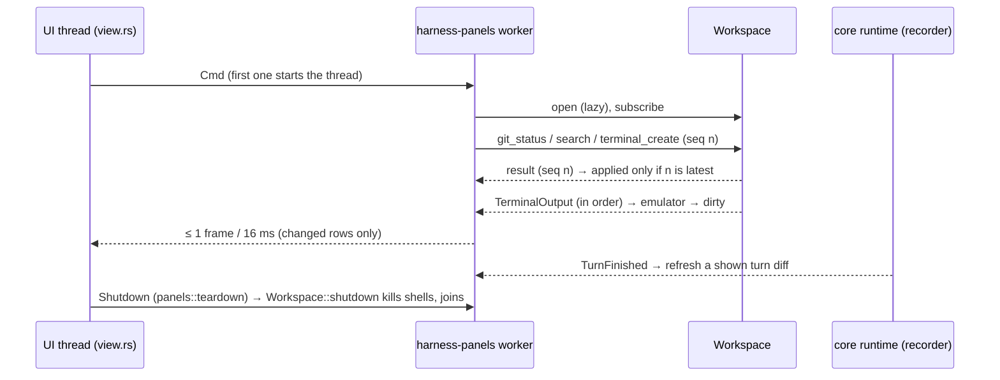

# Phase 8 — Native UI (Slint)

Status: round 1 (agent B), 2026-11-02. Owner of this spec: Phase 8 UI.
Related: `phase-8-*.md` core specs (agent A, `crates/harness-core-api`), `DESIGN.md` (repo root), `AGENTS.md`.

## 1. Decisions this spec implements (user, 2026-11-02, binding)

- The WebView UI is replaced by a native **Slint** UI. Idle RAM target **20–50 MB total** (UI + Rust core,
  whole process tree, window open, private working set). No WebView at idle; plugin/browser panels may open a
  WebView on demand later.
- Harness has **no own LLM agent**. It is a hub that drives external agent CLIs (Claude Code, Codex CLI,
  agy/Antigravity CLI), spawned on demand by the core. Data lives in `~/.harness` (`HARNESS_HOME` overrides).
- **One session = one conversation.** The agent is chosen **per message in the composer**, not at session
  creation. The choice is **sticky**: the session stays on that agent until the user switches it, or the agent's
  credit/quota runs out — then the core fails over to the next available agent in the **fallback order**
  (default Claude Code → Codex → agy) and that agent becomes the sticky one.
- Each assistant turn shows a small **agent badge** (which CLI answered). The session list is agent-agnostic
  (it shows the agents used as small chips only).

## 2. Screen inventory (mapped from ZCode `packages/ui/src`)

| ZCode area (source dir) | Harness screen / element | Round |
|---|---|---|
| `WorkspaceSidebar`, `project-sidebar`, `workspace-grouped-tasks` | Session sidebar: list, new, resume (click), active highlight, agents-used chips | 1 |
| Conversation (`components/ai-elements`, `presentation`) | Chat view: user bubbles, assistant turns with agent badge, streaming text | 1 |
| Markdown renderer | Headings, paragraphs, lists, code blocks, inline code, bold/italic, links | 1 |
| `prompt-editor`, `chat-input-toolbar`, `composer-toolbar-layout` | Composer: multi-line input, Send, Stop, queue chip, **agent picker (sticky)** | 1 |
| `ToolCallBlocks` | Tool-call cards (title, status: running/done/denied/failed/awaiting permission) | 1 (summary row only) |
| `cua-permission`, permission prompts | Permission dialog (approve / deny), modal over the chat | 1 |
| `workspace-file-tree` | Workspace file tree (lazy expand, dirs first) | 1 (read-only) |
| `settings` (appearance, language) | Settings overlay: theme (System/Light/Dark), language (en-US / zh-CN), **fallback order**, About (AboutSlint) | 1 |
| (new) | Failover notice in transcript, exhausted agents disabled in picker with reset time, paused banner | 1 |
| `GitPane`, diff renderers, `git-graph`, `git-action-menu` | Diff view, git panel | 2 |
| `terminal` | Terminal pane (PTY from `harness-pty`) | 2 |
| `mentions`, `quickpick`, `workspace-file-search` | `@` file mentions, command palette, file search | 2 |
| `image-preview-editor`, attachments | Attachments / image preview | 3 |
| `remote`, `remote-connection*`, `web-remote-control` | Remote workspaces, phone remote control | 3 (phone client is a separate surface) |
| `plugin-ui`, `browser-use`, `side-pane-full-view` | Plugin / browser panels (on-demand WebView) | 3 |
| `settings/*` (MCP, hooks, commands, automations, usage) | Remaining settings sections | 2–3 |
| `login`, `rewards`, `onboarding`, `marketing-touch-contract`, `highspeed` | Not applicable (no own provider / account) | dropped |

## 3. Architecture

```
            UI thread (main)                               core thread (tokio current_thread)
 ┌──────────────────────────────────────┐   Command (mpsc)   ┌───────────────────────────────────┐
 │ Slint AppWindow + models (VecModel)  │ ─────────────────▶ │ core::hub adapter → HarnessCore   │
 │ UiState (thread_local, owns models)  │                    │ (harness_agent_hub::Hub)          │
 │ callbacks → Command                  │                    │ sessions, sticky agent, queue,    │
 │                                      │ ◀── batched ────── │ failover, permissions, persistence│
 │ apply(Vec<Event>)                    │ invoke_from_event_ │ Event (mpsc) → Pump (coalesce)    │
 └──────────────────────────────────────┘     loop           └───────────────────────────────────┘
```

- **State owners.** The core is the single owner of sessions, transcript items, sticky agent, fallback order,
  agent availability/exhaustion, the run queue (admission), permissions and settings persistence. The UI keeps
  only view state (open overlays, draft text, scroll position, expanded tree rows) and a mirror of core state
  built exclusively from events. The UI never writes `~/.harness` directly; every change is a `Command`.
- **Threading.** Slint runs on the main thread. The core runs on one dedicated thread with a tokio
  `current_thread` runtime (lower RAM than a multi-thread pool; agent CLIs are I/O bound). UI callbacks only
  enqueue commands (`UnboundedSender::send`, non-blocking). Core → UI goes through
  `slint::invoke_from_event_loop` with `Send` payloads; the UI state lives in a `thread_local` on the UI thread.
  Nothing blocks the UI thread; all file/network IO is async on the core thread.
- **Event order.** Events from the core are applied in emission order. The pump never reorders: it merges
  only *adjacent* `TextDelta`s of the same item.
- **Streaming batching.** The pump collects events; when the first event arrives into an empty buffer it waits
  up to 33 ms (≈30 fps) collecting more, merges adjacent deltas, and flushes the batch with one
  `invoke_from_event_loop`. No timer runs while idle (no idle wakeups). On flush the UI appends the text to the
  item's raw buffer, re-splits markdown into blocks and updates only rows whose block changed
  (`set_row_data` / push / truncate), so Slint repaints only the last message.
- **Markdown.** `pulldown-cmark` splits the message at top-level headings and fenced/indented code blocks.
  The text between them is rendered with Slint's `StyledText` (`StyledText::from_markdown`: paragraphs,
  lists, bold/italic/strike, inline code, links with `link-clicked`). Headings are `StyledText` with the
  DESIGN.md heading scale; code blocks are a monospace `Text` in a card with the language label. Unsupported
  constructs (tables, block quotes, code inside lists) fall back to plain text for that chunk. Links open via
  the platform opener (round 1: logged; opener wiring in round 2).
- **Agent picker (composer).** Shows the session's sticky agent (from core). Options list all agents with
  availability: available, not installed (disabled), exhausted (disabled, "resets HH:MM" when known).
  Selecting an option sends `SetStickyAgent`. `Send` carries the agent explicitly.
- **Failover.** On quota exhaustion mid-stream the core marks the agent exhausted, ends the partial turn as
  *interrupted*, appends a transcript notice `Switched from A to B: limit reached (resets 10:00)`, sets B
  sticky and continues the same prompt with B. When no agent is left, the session is **paused**: a banner
  above the composer, sending is queued (not dropped) until an agent becomes available. While paused the
  picker enables exhausted agents too: picking one is a manual retry (`set_active_agent` clears its exhaustion
  and resumes the paused turn; the hub rejects an agent that already attempted that turn).
- **Queue.** Sending while a turn runs (or while paused) queues the prompt in the core; the composer shows
  `N queued`. Stop (button or Esc) cancels the running turn only; queued prompts continue.
- **Permissions.** A permission request shows a modal dialog (title + detail, Approve / Deny). The tool card
  shows "awaiting permission" until the decision. Stop cancels a pending request.

## 4. Theme, i18n, accessibility, layout

- **Theme.** A Slint `global Theme` with semantic tokens from DESIGN.md (Zai Light / Zai Dark values from
  `packages/ui/src/styles.css`): background, sidebar, panel, card, border, foreground (+subtle/subtlest),
  primary, hover/selected, confirmation surface, success/warning/destructive, inline-code. Type scale
  `ui-xl/lg/base/caption/sm/xs` = 18/16/14/13/12/10 px. Preference System / Light / Dark; System follows
  `Palette.color-scheme`. Radius ladder xl 12 / lg 8 / md 6 / sm 4; main composer shell 16 (2xl exception).
- **i18n.** All UI strings use `@tr(...)` with English source text. Translations are **bundled** at build time
  (`slint-build` `with_bundled_translations("lang")`, `lang/zh_CN/LC_MESSAGES/harness-slint.po`) and switched at
  runtime with `slint::select_bundled_translation` — no gettext runtime dependency. Core-originated text
  that needs translation (failover / paused notices) is sent as structured data and formatted in Slint.
- **Accessibility.** The `accessibility` feature (AccessKit → Windows UI Automation) is on. Every interactive
  element has `accessible-role` + `accessible-label`; assistant turns expose their raw text as the label and
  the agent badge as a labelled text. Keyboard: Enter send, Shift+Enter newline, Esc stop, Tab order through
  sidebar → chat → composer.
- **Layouts.** Desktop (width ≥ 720 px): sidebar | chat | optional file pane. Narrow (< 720 px, phone-size):
  single column; sidebar and file tree become drawers opened from the header. Same components in both.

## 5. Licensing (Slint)

Slint 1.18.1 is licensed `GPL-3.0-only OR LicenseRef-Slint-Royalty-free-2.0 OR LicenseRef-Slint-Software-3.0`.
Harness uses the **Royalty-free Desktop, Mobile, and Web Applications License 2.0**. Conditions:

- Attribution: either (a) show the `AboutSlint` widget in an About screen reachable from the top-level menu
  (Harness: Settings → About), or (b) the "Made with Slint" badge on the public download page. We do (a).
- Not allowed: embedded systems; distributing Slint alone; an application that exposes Slint's APIs.
- Keep license notices in Slint's source; ship the license text with third-party notices in the installer.

## 6. Renderer and RAM budget

Backend **winit**. Renderers compiled: `software` and `femtovg` (OpenGL); `skia` is an optional cargo feature
for comparison only (large binary, downloads prebuilt Skia). Measured private working set at idle with the window
open (Windows 10, round 1): software ~7 MB, femtovg ~90 MB, Slint's automatic choice ~38 MB. The app therefore
selects `winit` + `software` explicitly at startup (`main.rs` `select_renderer`); numbers per run are in
`.work/phase8/uiB.md`. Runtime override: `SLINT_BACKEND=winit-software|winit-femtovg|winit-skia`.
Superseded: phase-10 made femtovg the default, and the 2026-11-04 text-quality fix made `skia` a default
renderer feature and the default renderer (phase-10-midnight-glass-ui.md §2).

Fonts: the window's `default-font-family` is a platform UI font with Simplified Chinese glyphs (Windows
`Microsoft YaHei UI`, macOS `PingFang SC`, Linux `Noto Sans CJK SC`); the default fallback on Windows picks a
Japanese font and shows simplified-only characters as boxes. Since 2026-11-04 Windows uses Segoe UI unless the UI
language is Chinese (phase-10-midnight-glass-ui.md, "UI font").

Budget (whole process tree, private working set, window open, idle): UI ≤ 30 MB, core ≤ 10 MB at idle
(agent CLIs are not running at idle and are excluded only while a turn runs), total ≤ 50 MB, stretch 20 MB.

## 7. Test automation (gate `scripts/e2e/phase8-ui.mjs`)

Slint has no DOM. The gate uses Slint's **embedded MCP introspection server** (`i-slint-backend-testing`,
cargo feature `automation` → `slint/mcp`, enabled only in the gate build; the server starts only when
`SLINT_MCP_PORT` is set and binds `127.0.0.1`). It drives the real UI: element tree with accessible labels,
clicks, `set_element_value` on the composer, key events (Enter/Esc go through the same key handlers as a user)
and PNG screenshots. Chosen over Windows UI Automation because it is cross-platform, deterministic (no focus
stealing, no screen coordinates) and gives screenshots; the accessible labels it reads are the same ones UIA
exposes. Release builds do not include the feature. The gate also measures a **release build without the
automation feature** for the RAM numbers.

Scenarios (in order, one app instance, then a restart):

1. start: shell, file tree (fixture workspace), picker shows the first agent of the fallback order;
2. new session → sidebar item;
3. keyboard: Shift+Enter keeps a newline in the draft (Enter sends, checked by every send below);
4. send with agent 1 (`[[slow 20]]`) → a partial streamed label is observed, then the final reply with badge;
5. picker → agent 2, send → both replies in one chat with their own badges;
6. stop: long stream; a message sent meanwhile shows as a queued row above the composer (not a bubble),
   its x button cancels it (`cancel_queued`) and it never runs (8.2); Esc → *Stopped*, Stop button gone;
7. permission approve → tool card *Done*, agent sees `allowed`; deny → *Denied*, agent sees `denied`;
8. failover: agent 1 hits quota mid-stream → notice "Switched from Claude Code to Codex: limit reached (resets
   HH:MM)" — local time, `MM-DD HH:MM` when not today, never `UTC` (8.2) —, agent 2 continues, agent 1's partial
   marked *Interrupted*, picker shows agent 2; agent 1 shown
   disabled with "Limit reached · resets …", uninstalled agy disabled;
9. all exhausted: agent 2 hits quota at start → paused notice + banner; manual pick of an exhausted agent (allowed
   only while paused) resumes the turn and clears the banner;
10. theme Dark/Light (screenshot luminance differs by > 60); language 简体中文 → zh-CN strings, back to English;
11. close (graceful WM_CLOSE, whole tree must exit) → restart → session list restored, transcript (scrolling the
    list to the top for the earliest turns), failover notice and dark theme restored;
12. markdown and ZCode comparison (8.2): a second instance on the fake core (separate `HARNESS_HOME`) runs
    `phase8-ui/scenes.mjs`; the 3x3 table and the highlighted `rust` code block must be in the accessibility tree;
    shots are composed next to the ZCode reference shots into `.work/phase8/compare-*.png`.

Then RAM: release build without automation, idle with the window open — `winit-software` and
`winit-femtovg` for the comparison, then the default at 60 s and 5 min. Fake agents only; isolated home
(`installIsolatedHome`, `HARNESS_HOME`); output `PHASE8_UI_OK` / `PHASE8_UI_FAIL <step> <reason>`; on a
failure the visible labels and a screenshot are saved. Knobs for development: `PHASE8_UI_SKIP_BUILD`,
`PHASE8_UI_SKIP_RAM`, `PHASE8_UI_IDLE_S`, `PHASE8_UI_COMPARE_S`.

## 8. Core API dependency

The UI codes against a small port in `src/core/mod.rs` (`Command` / `Event`: agent passed per `Send`, sticky
agent, failover notice, exhaustion state, fallback order). Two implementations:

- `core::hub` (default): adapter onto `harness_core_api::HarnessCore`, implemented by `harness_agent_hub::Hub`
  (spec `phase-8-core.md` §4). Commands become API calls (`send_message` with `agent = Some(id)` only when it
  differs from the session's sticky agent, i.e. a manual swap; `set_active_agent`; `stop`;
  `respond_permission` with the first allow/reject option; `set_fallback_order`). Hub events for the opened
  session become UI items: `TurnQueued` → user bubble, `MessageDelta` → assistant item tagged with the
  serving agent, `ToolCall*` → tool card, `PermissionRequested/Resolved` → dialog, `AgentSwitched` with
  `QuotaExhausted` → failover notice + sticky change, `TurnStarted` attempt > 1 → previous partial marked
  *interrupted*, `TurnPaused` → paused notice + banner. `RecvError::Lagged` re-reads lists and the session
  snapshot. `resets_at` is shown in local time via `api::time::local_time_label` (round 8.2).
  Theme and language are UI-only and stored in `<HARNESS_HOME>/ui-settings.json`; everything else is owned by
  the hub.
- `core::fake` (`HARNESS_UI_CORE=fake`): in-process scripted core for UI work without agent binaries.

Agent configuration: the hub's built-ins by default. `HARNESS_UI_AGENTS=<json file>` replaces them with
`[{id, name, program, args, env}]` ACP agents (development and gates; the gate registers
`harness-fake-agent` as `claude-code` / `codex` and an uninstalled `agy`). A hub-side equivalent
(`<HARNESS_HOME>/agents.json`) is requested in `.work/phase8/api-requests.md`.
## 9. Roadmap

- Round 1: this spec's round-1 rows on the real hub (fake ACP agents in the gate), gate, RAM measurements.
- Round 2: real ACP adapters (agent A); local-time reset labels; thought stream display; queued-turn cancel; diff view; terminal; tool-card detail expansion
  (input/output, file diff); text selection/copy in chat; `@` mentions; link opener; window chrome polish.
- Round 3: remaining settings, plugins/browser on-demand WebView, phone remote-control client parity,
  macOS/Linux verification.

## 10. Panels (round 8.2, agent A)

Owner of this section: agent A. Files: `ui/panels/*.slint` and `src/panels/*.rs` (agent A only). Agent B owns
tokens (`ui/theme/tokens.slint`, which also holds the diff/git/terminal colours from ZCode
`packages/ui/src/styles.css`), the shared components (`ui/components/controls.slint`) and every other screen. The
panels import B's `Theme` and components and add no tokens of their own. Contract: `.work/phase8/TOKENS_READY.md`
("Panel contract"). Requests to B: `.work/phase8/ui-requests.md`.

### 10.1 Layout (ZCode mapping)

All four panels are tabs of the **Side Pane** (right frame, B's tab bar: `Files` + `PanelTabs.tabs`).

| ZCode | Harness tab | Content |
|---|---|---|
| `GitPane` (changes list, stage/unstage, commit box, branch) | **Git** | Branch + ahead/behind, commit box, "Staged changes" / "Changes" sections with stage/unstage (per file and all). A row opens its diff. |
| diff renderers (unified + side by side, line numbers) | **Diff** | One working-tree/staged file (from Git) or **Turn changes** (agent's last finished turn, core §15.2, file list when > 1 file). Segmented Unified / Side by side. Binary, empty and cut (> 20 000 rows) diffs show a notice. |
| `workspace-file-search`, search in files | **Search** | Files (fuzzy, as you type) / Content (Enter; regex `.*`, match case `Aa`), up to 500 hits, read-only preview around a hit (−10 / +60 lines; whole first 200 lines for a file hit). |
| `terminal` (xterm) | **Terminal** | One shell (`harness-pty` default shell: pwsh → powershell → ComSpec on Windows), restart / kill, exit code tag, scrollback 2 000 lines (wheel). |

Only the visible tab is instantiated (`if` in `PanelHost`), so a closed Side Pane or the Files tab costs nothing.

### 10.2 Hooks into B's files

| Where (B's file) | Hook | Status |
|---|---|---|
| `ui/app.slint` | `import { PanelHost, PanelTabs } from "panels/panels.slint"`, `export * from "panels/globals.slint"`, `tabs: PanelTabs.tabs`, `if tab != "files": PanelHost { tab }` | done (B) |
| `ui/app.slint` | `PanelNav.open-tab(id)` → Side Pane tab (git row → Diff) | requested |
| `src/main.rs` | `panels::install(&window)` after `bridge::install`; `panels::teardown()` after `bridge::teardown()` | done |
| `src/core/hub.rs` | `crate::panels::attach_core(core)` after `Hub::start` (on the core runtime) | requested |
| session switch | `crate::panels::session_opened(id)` | requested |

Without `attach_core` the Diff panel's "Turn changes" shows "Turn diffs need the agent hub (not attached)."

### 10.3 State owners and event order

| State | Single owner | Writers |
|---|---|---|
| Panel globals (`PanelGit`, `PanelDiff`, `PanelSearch`, `PanelTerminal`) | `src/panels/view.rs` on the UI thread | only `view::*`, fed by the worker |
| Workspace services, git/search/terminal state, emulator grid | `harness-panels` worker thread (`src/panels/worker.rs`, current-thread tokio) | worker only; UI callbacks send `Cmd`s |
| Git status, index, commits | the repository (via `WorkspaceServices`) | worker re-reads `git_status` after its own action and 300 ms after `FilesChanged` |
| Last finished turn / chat session | `panels::HubLink` (recorder task on the core runtime, `session_opened`) | recorder, B's hook |
| Shells | `harness-pty` inside the workspace | worker (`terminal_create/write/resize/close`) |

Lazy start: the worker thread, the `Workspace`, the watcher, the index and the PTY manager start on the first
panel command. The watcher starts when the Git tab first refreshes and then stays on (it keeps the git status and a
shown working-tree diff fresh). The shell starts when the Terminal tab first reports its size.

Sequencing: every spawned operation carries a sequence number; a result is applied only when it is still the
latest of its kind (git status, diff, search, preview), so a superseded refresh or search never overwrites a newer
one. A new content search cancels the previous one (`cancel_search`).

Terminal: the shell is created inline in the worker loop, so its id is known before the first `TerminalOutput` is
handled (no output is dropped as "unknown terminal"). Output is fed to `alacritty_terminal` in order; DSR/DA replies
go back to the PTY. Writes and resizes go through one ordered writer task. Dirty rows are pushed at most once per
16 ms; the UI patches only changed rows of the existing model. Keys: printable text as-is, Enter `\r`, Backspace
`DEL`, arrows (`ESC [` or `ESC O` in application cursor mode), Home/End/PgUp/PgDn/Insert/Delete, Ctrl+letter → C0,
Alt → `ESC` prefix. Wheel scrolls the scrollback; typing returns to the live screen.



Text built in Rust (diff notices, search summary, git result lines) is English-only in this round; the Slint
strings use `@tr` (zh-CN entries requested from B).

### 10.4 Accessibility and automation

Every interactive panel element has `accessible-role` + `accessible-label`. Row labels: git `<code> <path>`;
stage buttons `Stage <path>` / `Unstage <path>`; search `<path>` (file) or `<path>:<line> <text>`; preview
`<no> <text>`; unified diff `<+|-| > <old> <new> <text>`; side by side `<old-no> <old> | <new-no> <new>`;
terminal rows: their text; exit tag `Exited (<code>)`.

Gate `scripts/e2e/phase8-panels.mjs` (feature `automation`, the same Slint MCP channel as `phase8-ui`, isolated
home, `GIT_CEILING_DIRECTORIES`, fixture git repo, fake agents only):

1. lazy: with the Files tab shown there is no shell process and no git panel state; tabs Diff/Terminal/Git/Search exist;
2. git: branch label, modified and untracked rows, no shell started; screenshot `panel-git.png`;
3. watcher: a file written by the gate appears without a refresh;
4. diff: unified rows with line numbers (`panel-diff-unified.png`), side by side (`panel-diff-split.png`);
5. git: stage → unstage → stage → commit (HEAD subject checked with git, untracked file stays untracked);
6. search: files by name; content (case-insensitive, then match case), preview around the hit (`panel-search.png`);
7. terminal: lazy shell start, `echo PANEL_$(40+2)_OK` → `PANEL_42_OK`, `exit 7` → `Exited (7)` and shell gone
   (`panel-terminal.png`); restart, kill (shell gone), restart;
8. turn changes: with the hub hook wired, a fake agent `[[write …]]` turn shows its file; without it the step is
   recorded as SKIPPED in `phase8-panels.json` (not counted as passed);
9. close: WM_CLOSE with a live shell → the whole process tree exits;
10. RAM: release product build idle with panels closed (≤ 50 MB private working set, whole tree); automation build
    panels closed vs terminal open (delta reported).

Output `PHASE8_PANELS_OK` / `PHASE8_PANELS_FAIL <step> <reason>`; report `.work/phase8/phase8-panels.json`.
## 11. ZCode look and round-8.2 features (agent B)

Owner: agent B. Goal: the Slint UI matches ZCode (`DESIGN.md`, `packages/ui/src/styles.css`) in light and dark.

- **Tokens**: `ui/theme/tokens.slint` (`Theme` global) is the only place for colours, radii, spacing, type sizes and
  the diff/git/terminal colours, mirrored from ZCode's CSS variables for both themes; contract in
  `.work/phase8/TOKENS_READY.md`. Screens and panels use tokens, never literals.
- **Icons/fonts**: Lucide (the library ZCode uses) and ZCode's Material Icon Theme file icons, generated by
  `scripts/ui/gen-slint-icons.mjs` (licenses in `ui/icons/LICENSES.md`); `src/files.rs` maps file names and
  extensions to the icon index like ZCode's `fileDisplayHelpers.ts`.
- **Screens**: sidebar (brand, New session, Sessions, workspace + settings footer), framed main panel with a
  44 px header and hairline, empty state, right-aligned user bubble (≤ 80 % of the column), assistant block with
  agent badge, tool rows with status tags, failover/paused notices, permission card that replaces the composer
  while pending (as ZCode), composer with agent picker, send/stop round button and queue rows, side pane tabs,
  settings page (left nav, cards, segmented theme/language, fallback order, about).
- **Markdown** (`src/markdown.rs`): paragraphs/lists via `StyledText`, headings, fenced code cards (language +
  file icon, highlighted), GFM tables (header row subtle, equal fixed-width columns, cells inline-only: leading
  block markers are escaped). Accessibility: code card label `code <lang>`, description `highlighted|plain`; table
  label `table <rows>x<cols>`.
- **Highlighting** (`src/highlight.rs`): small built-in tokenizer (keywords, strings, comments, numbers, types,
  function calls) for rust, js/ts, go, C-like, json, python, shell, toml/yaml; GitHub light/dark colours; runs
  lazily per code block when the block is built; unknown languages stay plain.
- **Reset times**: `api::time::local_time_label` (local `HH:MM`, `MM-DD HH:MM` when not today).
- **Queued messages**: owner is the core (`CommandInbox` admission). `TurnQueued` with `position > 0` becomes a
  queue row (not a bubble); the row's x button sends `Command::CancelQueued` → `cancel_queued(session, turn)`;
  `TurnStarted` of a queued turn moves it from the queue into the transcript; the UI never re-orders the queue.
  Order: `TurnQueued(pos>0)` → `Event::Queue` → (`TurnStarted` → user bubble + `Event::Queue`) | (`cancel` →
  `Event::Queue`, `TurnFinished` ignored for the UI).
- **Focus**: the window forwards initial focus to the root `FocusScope`, and focus returns there when the
  permission card replaces the composer, so Esc always reaches the shortcut handler.
- **Comparison tool**: `scripts/e2e/phase8-ui/zcode-reference.mjs` (ZCode, isolated home, mock provider) and
  `compare.mjs` (Harness, fake core) take the same scenes at 1100x720; output `.work/phase8/compare-<scene>.png`.
